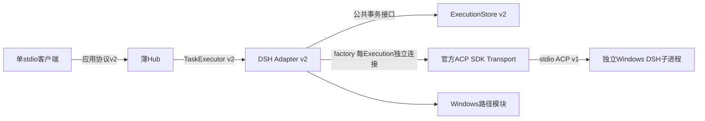
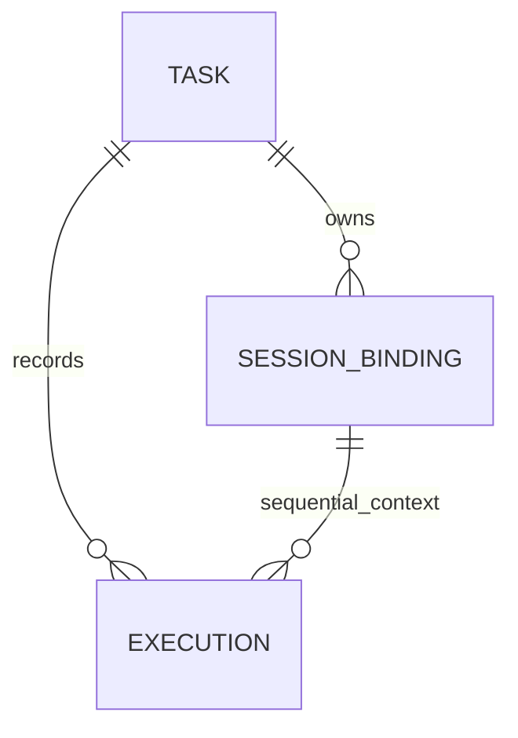
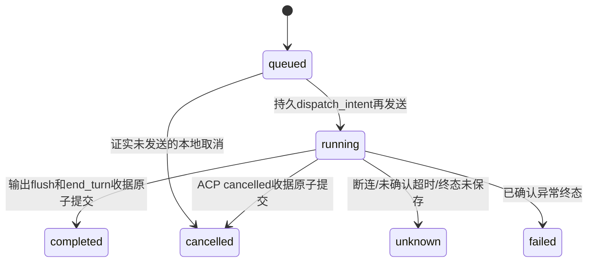
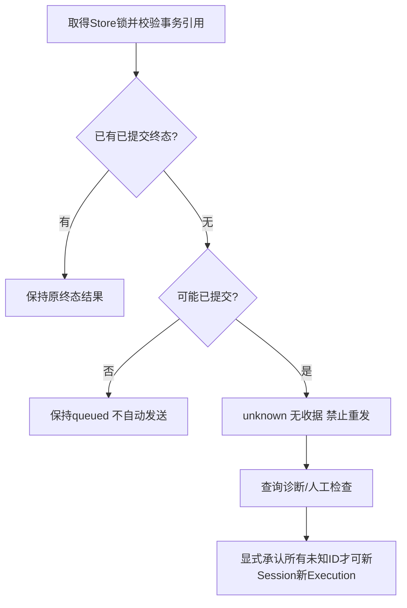

# Phase 1.1 模块化架构

运行模块可分别初始化/停用/测试；Store、Transport通过构造注入，执行器不读取DSH内部数据库。新模块位于packages/task-store-v2和packages/dsh-acp-v2；旧模块保留用于兼容验证，不被新Hub引用。纯类型/函数无需创建空守护进程。

Task是工作意图和总体投影；Execution是一次不可覆盖尝试；Binding是官方Session的上下文归属。每Task最多一个活动Execution，每Session不能跨Task共享。新轮只在旧Session关闭且旧连接停止、取消发送结束后提交。未知旧尝试可在逐一显式承认风险后用新Session重试，历史unknown仍反映在Task整体状态。

没有interrupted凭同事务收据变completed的分支：同一原子事务成功即终态，否则没有额外可信收据。官方ACP恢复不回放历史结果，不能通过问模型猜测原执行状态。

终态Execution的Binding仍为active时（终态提交后、清理确认前崩溃），恢复将Binding标为unknown并写入`TERMINAL_SESSION_UNSETTLED`诊断，不伪造closed；`resumeTask`/`closeSession`确认清理后才允许新执行。已closed但残留`recoveryRequired=true`时只做本地归一化，不重复访问远端；远端关闭成功但本地提交失败不会报告成功。含Execution的Task必须显式携带全部投影字段，Store拒绝缺失`unresolvedExecutionIds`等字段的快照，Executor也不会把缺失字段当成空数组。完整性警报可在保留原始警报、确认人和时间的前提下人工确认；确认不证明结果完整，`duplicateExecutionRisk`继续保留，且不会复用受影响的Session。Hub stop失败会清空本次失败以便重试，成功则记忆化；`closeTask`可重试失败的transport清理，只有清理成功后才标记Binding closed。

输出批量落盘、精简事件、硬上限和终态预留控制写放大。仍为有容量上限的本地PoC，无自动压缩和无限历史承诺。Windows rename/fsync不能被扩大为跨进程事务或断电零损失承诺。

DSH凭据仍归官方profile，本项目不提取秘密。默认权限拒绝；不存在HTTP监听口、多bot身份或多调用方路由。未接入的bot不依赖本Hub是否在线。当前默认最多8个独立执行子进程，资源代价高于共享Runtime，换取明确通知/取消隔离；不构造多Agent协作系统。
