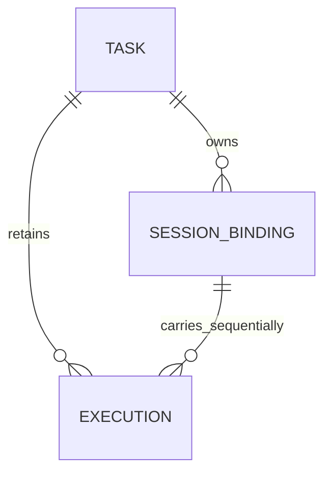
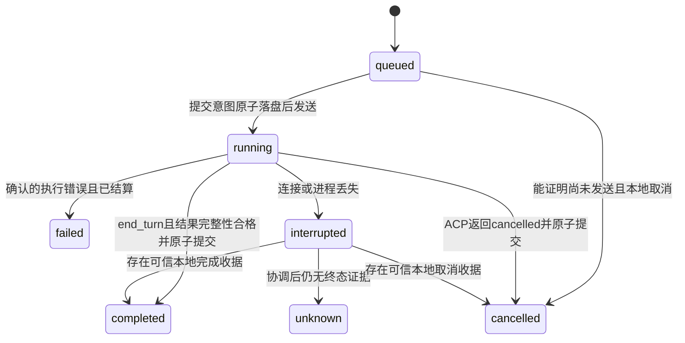
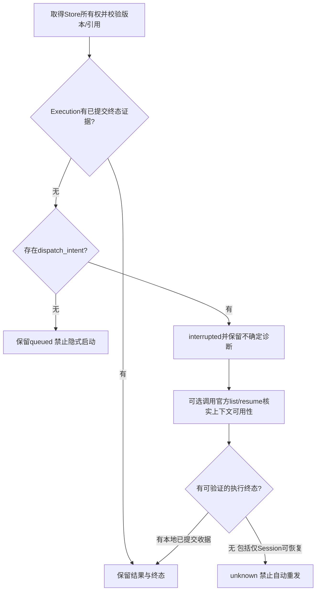

# Phase 1.1 / Phase B — 原始状态模型与恢复设计

> 用户已批准按补充澄清实施。本文保留审查时方案历史；如有冲突，以 phase-1.1-clarifications.md 和当前 contracts.md 为准。特别撤回 interrupted→completed 的同事务收据恢复路径，以及把 close/resume 当作可靠回合边界的表述。

日期：2026-11-09，Windows 原生。本文为设计，不代表已实现。Phase C/D 必须等待用户确认；本阶段不接入任何 bot。

## 1. 决策原则

1. Store 是本地已观察且已提交事实的唯一权威登记，不是 DSH 实际执行状态的全知来源。
2. 本地快照原子性不等于跨进程事务；ACP 没有本项目 executionId 对应的远程幂等提交和最终结果查询协议。
3. 先持久化提交意图，再发送 prompt；崩溃后只要不能证明未发送，就不自动重发。
4. Session 存在、可恢复或模型声称完成，都不是原 Execution 完成证据。
5. 已持久化终态不可因恢复/关闭 Session 失败而覆盖。错误记录在相应恢复操作上。
6. 不承诺端到端 exactly-once；承诺本模块对同一 executionId 不主动重发，重试请求通过幂等键复用原记录。

## 2. Task / Execution / Session

Task 是要完成的工作，保留初始 objective、cwd、taskId、revision、activeExecutionId、latestExecutionId，以及供上层方便读取的状态投影。completed 仍表示最新执行正常结束，不证明自然语言目标已被现实验证。

Execution 是一次实际尝试：executionId、taskId、ordinal、immutable prompt、requestKey、inputHash、sessionBindingId、status、submission、result、resultIntegrity、completionEvidence、cancel、diagnostics、时间与 revision。每次续接新 prompt 新建 Execution，不覆盖旧执行。Task 的 result 如保留，必须明确是 latestExecution 的投影。

SessionBinding 保存 taskId、sessionId、cwd、runtime identity（配置指纹/逻辑 runtimeId，不含秘密）、连接世代和最后观察的可用性。一个 Task 可依次拥有多个绑定，一个绑定仅属于一个 Task；同一 Session 同时至多一个活动 Execution。不同 Task 不共享 Session。

runtime identity 改变时禁止悄悄沿用旧映射。需要显式选择原 runtime 或创建新上下文；旧结果保留。

## 3. 状态与证据

保留现有七种 Task 状态。Execution 复用这些状态，不增设大量业务状态。取消与发送阶段使用独立字段。

| 字段 | 值与意义 |
| --- | --- |
| submission | not_started / dispatch_intent / response_observed；dispatch_intent 不代表远端已接收 |
| cancel | requestedAt、sentAt、confirmedAt、outcome；sentAt 只证明通知写出，不证明停止 |
| resultIntegrity | partial / observed_complete / uncertain；无消息也可能是合法空结果，但通知处理出错必须 uncertain |
| completionEvidence | ACP prompt response 的 stopReason、executionId、sessionId、connectionGeneration、observedAt，和本地提交事务 ID |
| diagnostic | code、message、retryable、requiresReview、duplicateExecutionRisk、observedAt |

已保存终态是不可变执行事实。重新尝试创建新 executionId，使 Task 投影变为 queued，不修改旧 Execution。超时本身不是远端 failed/cancelled 证据。取消与完成竞态按收到的真实终态裁决：end_turn 可为 completed，同时记录取消未生效；不能用 requested 标志覆盖。

## 4. 持久化事务与崩溃窗口

保留小规模单所有者 JSON Store，不引入队列框架。格式 v2 在同一快照中保存 tasks、executions、sessionBindings、requestKeys 和 events。提供带 expectedRevision 的原子 commit API，并校验关联、唯一性和合法迁移。

关键事务：

1. 创建 Task、首个 prepared Execution 和幂等请求映射一并提交。
2. Session 创建/恢复后保存绑定。创建响应丢失会留下可能的孤立空 Session；不能靠 cwd 猜测关联。
3. 发送前将 submission=dispatch_intent、execution.status=running 和 Task 投影/事件原子提交，成功后才调用 session/prompt。
4. 每条已接受的输出及其序号、完整性标志通过 Store 提交；持久化失败立即进入存储故障模式，拒绝新提交，尝试停止自有执行，向 stderr/health 暴露故障，不循环调用同一失败写入。
5. prompt 终态响应、result、Execution 终态、Task 投影、事件在同一事务中提交。仅提交成功才向调用者报告 completed/cancelled。

| 崩溃窗口 | 恢复策略 |
| --- | --- |
| 已创建，尚无 dispatch_intent | 保留 queued；恢复只登记，不自动启动。显式 startExecution 才发送 |
| dispatch_intent 落盘后、实际发送前 | 不能区分是否已发送，unknown；牺牲可用性防止重复 |
| 已发送、尚无终态 | interrupted → unknown，禁止自动重发 |
| 输出已保存、终态响应尚未保存 | 输出是 partial/uncertain；不能据此 completed |
| 远端已完成、本地没有完成收据 | 当前 ACP 无结果回放，unknown + RESULT_UNAVAILABLE，需要人工检查 |
| 本地完成事务已提交、应答调用者前崩溃 | requestKey 查询返回同一 Execution 的 completed，不重发 |
| 取消意图落盘、通知或确认丢失 | 保留 cancel 请求记录，unknown，不伪造 confirmedAt |
| close/resume 失败 | 更新绑定可用性和诊断；保留既有 Execution 终态 |

不引入一个仅为掩盖无法消除窗口而存在的第二份结果文件。可以从本模块已提交快照/事件恢复事实；没有收据时明确 unknown。未来若有官方可验证终态查询，再作为能力扩展加入。

## 5. 恢复与幂等

恢复请求必须带 recoveryKey 或通过同一 Task 操作合并；相同 key 重复请求返回同一已提交结果。无状态变化不追加重复迁移事件。连接失败只增加诊断，不擦除历史状态。list 必须分页，且未列出不能直接推断不存在（可能正在占用或上下文不匹配）。

resumeTask 只恢复上下文并协调状态，不携带 prompt。未知任务若要重试，使用 startExecution(new requestKey, retryOf, acknowledgeUnknownExecutionId)，显式承认可能重复副作用；旧 unknown 保持原样。不是模型自行授权，也不能仅换 requestKey 绕过未知执行门禁。

## 6. 并发、通知和取消

- 每个 Task 使用短时互斥保护 admission/恢复/关闭/取消元数据操作；不要持锁等待完整 prompt，否则取消无法进入。
- 全局以 SessionBinding 唯一索引拒绝跨 Task 共享；内存映射固定到 connectionGeneration + sessionId + executionId。
- cancel 对同一 Execution 合并为同一 in-flight promise，先持久化 request，再发送；重复请求不重复改写时间与事件。
- resume/close/start 对同一 Task 受相同门禁约束；close 等待取消后重新读取绑定，不用 await 前的旧快照。
- ACP 通知是即时消息，不是可持久重放日志。保存本地接收序号用于诊断，不能冒充远端顺序号。
- 不按 messageId 单独去重：同一消息可能有多个合法 chunk。只有协议明确提供唯一事件身份时才可据此去重；无身份的重复文本不能可靠识别。
- 在同一 Session 的两轮之间使用官方 close/resume 作为回合边界，按真实官方顺序保证处理在响应前的通知；异步通知先经本地队列落盘，终态提交等待队列 drain。没有 turn ID 的恶意/非合规迟到更新无法百分百归属，检测到则隔离、resultIntegrity=uncertain，不宣称通用 exactly-once 流。
- 不接受非活动/恢复阶段的文本作为新 Execution 输出；记录 orphan/late 诊断。
- Runtime 共享连接的强制终止会中断其他 Session，必须在受影响 Execution 上逐个记录；本阶段不引入每任务 Runtime 池。

## 7. 长任务与生命周期

分离 startupTimeout、sessionOperationTimeout、executionDeadline、cancelGrace、shutdownTimeout，避免拿取消宽限时间限制 Session 创建/恢复。无进度通知不等于执行挂死；不以 idle 时间自动判成功或重发。

Execution 保存 startedAt/deadlineAt/lastNotificationAt，限制 JS timer 范围并对超长 deadline 分段计时；默认超时可配置。长任务测试用可控时钟和静默模拟服务器为主，真实 DSH 做有上限的集成用例，不宣称已运行数小时。

Transport stop期间拒绝新start，用生命周期epoch阻止已等待cleanup的旧启动越过停机边界；停完后才允许显式重启。Executor stop先中止Transport启动，再等待握手结算，不先等待整个startupTimeout。Hub使用有界UTF-8字节解析和有界并发命令队列，控制命令有独立准入，不依赖readline收到换行后才限长。

Transport health、Store health 和 Executor health 合并报告。关闭失败保留可重试的 stop 状态，不能只缓存永久 rejected promise；存储故障不能阻断其他任务的本地 abort 和进程清理。Hub 硬退出后的 Runtime 生命周期需通过真实进程故障注入验证，不预设所有工具孙进程均被回收。

## 8. Contracts 与迁移

提议 Contracts/Hub 升级 v2：

- 增加 Execution、SessionBinding、诊断与 Store 原子事务类型。
- createTask 增加 requestKey（创建并默认调度首轮以兼容使用习惯）；排队重启不自动调度。
- 新增 getExecution/listExecutions/startExecution/reconcileTask/getEvents(afterSequence,limit)。
- resumeTask 不再接受 prompt；旧调用明确返回 MIGRATION_REQUIRED，不能悄悄解释为恢复加执行。
- cancelTask 返回持久化的 cancellation 状态与当前 Execution，取消请求应答和终态事件分离。
- Task 可暂保留 sessionId/result/prompt 兼容投影，但标记 deprecated；历史以 executions 为准。
- store interface 定义 commit(expectedRevision, transition) 与读接口；不得由适配器直接读 JSON。
- healthCheck 返回分层状态，异常不能只有 generic ERROR。

v1→v2：离线备份、取得独占锁、在副本迁移并验证后原子切换。保留完整 v1 events 原件作为 legacyEvents，不伪造 Execution 边界。可从明确事件链识别的历史轮次生成 legacy 记录；无法区分的快照标记 legacy_unverified，不声称可恢复完整执行历史。尤其 v1 cancelled 受本次发现影响，不能生成假的取消确认；completed 可以保留 legacy_reported_completed 标签，但不得捏造 ACP 原始收据。v1 queued 因缺乏提交阶段证据保守 unknown，只有新格式未提交 queued 可安全保留。

v2 文件不由旧程序读写；回滚先停止服务，再恢复备份，不能丢弃 v2 新执行后直接覆盖。迁移失败保持原文件不动。

## 9. 实施与测试计划（尚未执行）

### 单元测试

Store 原子多实体事务、expectedRevision、唯一 Session、幂等 key 冲突、迁移、事件快照一致性；状态投影、取消与 end_turn 竞态、无证据 unknown、重复 reconcile、延迟/重复通知诊断；长 deadline 与持久化异常。

### 模拟 ACP 与故障注入

每个场景断言 prompt 接收次数、executionId 历史、结果完整性和最终记录，而不只断言状态字符串：

| 场景 | 关键断言 |
| --- | --- |
| Hub 创建后退出 | v2未提交保持queued；恢复不发prompt |
| 提交意图后/发送后退出 | unknown；重启没有第二次提交 |
| DSH完成、结果事务提交前退出 | 无收据不completed，不重发 |
| 结果事务提交后、Hub应答前退出 | 相同requestKey返回原completed |
| Runtime执行中退出 | 所有受影响Execution保留不确定状态 |
| stdout断开但进程存活 | 有界清理后才允许新代连接 |
| 恢复期间再次退出 | 不新增Execution，不丢历史，不重复迁移 |
| 取消期间退出 | requested保留，confirmed不伪造 |
| 多Task多Session交错通知 | 绑定无串线、原子唯一性成立 |
| 重复cancel/resume/stop | 合并请求、无重复提交、可重试关闭失败 |
| 长时间静默后成功 | 静默不失败，结果事务完整提交 |
| 长任务断连/存储失败 | 无虚假成功，无永久running，无失控重发 |
| Hub并发启动 | 同一Store单所有者，第二实例明确失败 |

### 真实 Windows DSH

保留原创建/输出/关闭/list/重启/恢复/取消链，新增有限并发 Session 和真实 Runtime 中断。结果日志必须标记 real-dsh、版本、配置摘要、各 executionId 和断言。等待 running 事件要有 deadline，并核对对应 executionId；不能只有本地 running 就宣称模型已长时间执行。

基线29项保留或逐条解释变化：queued重启、无证据超时、取消竞态、resume携带prompt等语义需要更新；不得为凑通过数量保留错误断言。分类分别报告，不预先承诺测试数量。

## 10. 八项架构问题答复

1. 当前 Store 可作本地登记权威，但不足以作为远端任务结果的唯一事实来源；v2仍需显式 unknown。
2. 已提交的 Session 映射可恢复；session/new响应后、映射写入前的窗口不可保证完整恢复，不能猜测绑定。
3. 必须引入 Execution ID；否则续接、重试、取消与历史证据无法稳定关联。
4. ACP 通知可做实时观察，不能提供丢失后重放、可靠百分比或原执行结果恢复。
5. 有本地完成/取消收据可恢复终态，确定未提交可queued；已经可能提交且无终态证据必须unknown。
6. 官方ACP没有执行幂等键，外部执行与本地记录无法原子提交；本模块禁止不确定重发，人工重试以duplicateExecutionRisk明确暴露。
7. 当前Hub不适合两个bot各自启动一个实例同时使用；它只有单条stdio和单Store锁。内部多任务也尚缺本阶段的验证。
8. 集成前必须完成本设计实现/验收，再确定单Hub多调用方接入、身份授权、稳定请求幂等键、事件续读与可观测诊断；这些入口设计不能混入本阶段bot接入。

## 11. 进入下一阶段的门槛

建议完成 Phase 1.1 后再讨论 Phase 2，目前不建议进入。即使全部本阶段测试通过，也不能承诺取回“仅存在于DSH且未被本地保存”的最终结果；替代策略是 unknown、保留诊断、显式人工处理。该ACP限制应作为已接受限制列入验收，而不是把模拟结果冒充真实恢复。
