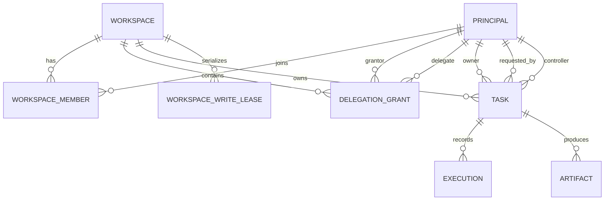
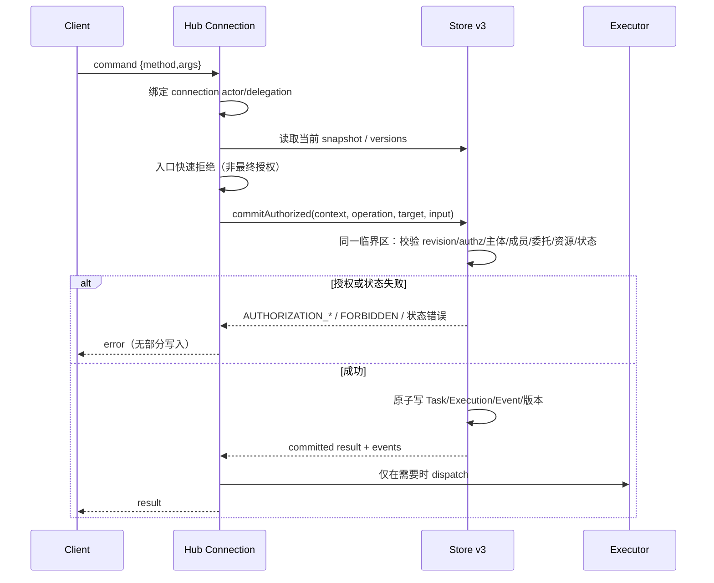
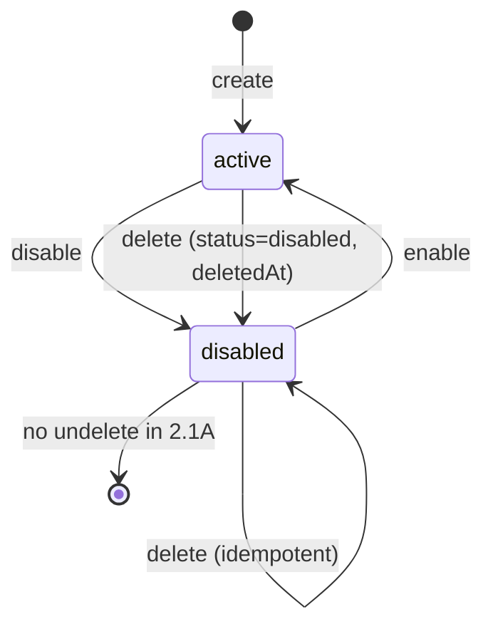
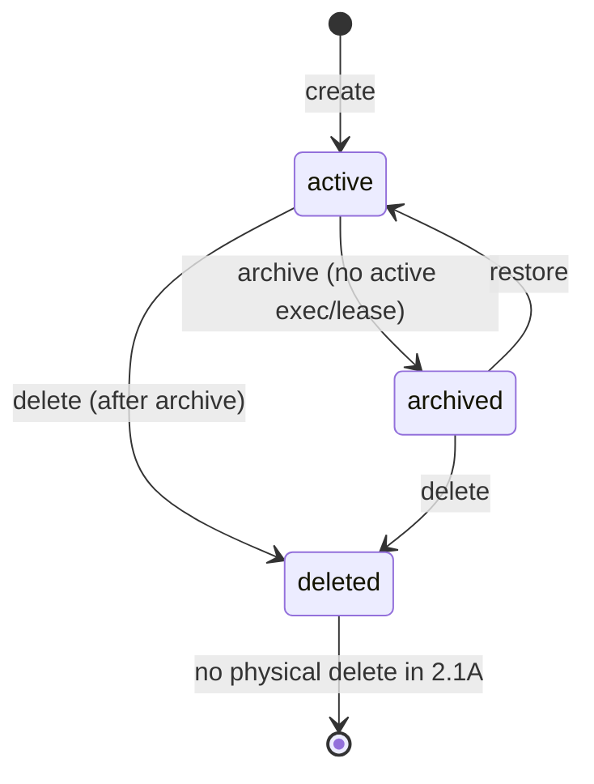
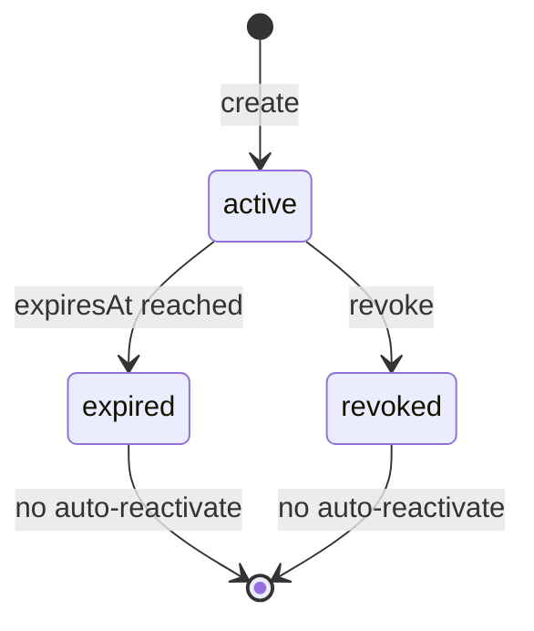

# Phase 2.1A：Identity & Workspace 设计方案

状态：**Proposed Design Baseline / Design Review Candidate / Implementation Not Started**

日期：2026-11-10（Asia/Hong_Kong）

依据：

- `docs/phase-2.0.1-architecture-decisions.md`（AD-01 至 AD-05）
- `docs/phase-2.0.2-architecture-decisions.md`（AD-06 至 AD-11）
- `docs/phase-2.0.3-implementation-constraints.md`（AD-12 至 AD-14，Phase 2.0 冻结基线）
- `docs/phase-2.0-baseline-review.md`
- Phase 1.1 设计、最终审查与当前 `packages/`、`apps/`、`config/` 实现

范围：只做 Identity & Workspace 的架构设计与一致性审查；不实现代码，不修改 Contracts、Store、Executor、ACP Transport、配置、数据库或测试。

本文件不是 Phase 2.1A 的实现验收，也不把下列设计描述成仓库已有能力。当前仓库仍然是 Phase 1.1 的单 stdio、无 Principal、无 Workspace 模型；本文件定义的是 v3 的目标边界。

> **Phase 2.1A.1 补充：** 第 19 节新增 IW-09（Windows Workspace root 路径边界）、IW-10（Local Bootstrap 权限范围）、IW-11（Membership stored/effective 状态）。第 19 节与前面段落冲突时以第 19 节为准；本轮仍只改文档，不实现。
>
> **Phase 2.1A.4/2.1A.5 更新：** 本文第 4.6/6.7 等节中“撤权事务在同一 commit 枚举所有受影响 Task 并置 frozen”的措辞，由 `docs/phase-2.1A.4-revocation-model-closure.md` 与 `docs/phase-2.1A.5-authority-fence-decision-closure.md` 的 authority version + `AuthorityRevocationFence` + 异步物化语义取代；授权交集、可见性与生命周期结论仍有效。OD-11 已由用户选择方案 A 冻结，AD-06-R1/AD-12-R1 已记录。

---

## 0. 结论摘要

Phase 2.1A 需要先回答四个不可合并的问题：

1. **谁在调用**：`actor` 必须来自可信连接，不得来自 payload。
2. **他代表谁**：`requestedBy` 必须由有效 DelegationGrant 推导，不得由调用方声明。
3. **他能对哪个资源做什么**：必须同时满足 Workspace 角色、Task/Artifact 资源权限、Delegation scope 和资源范围。
4. **授权与写入是否同一原子事实**：最终授权检查必须和状态写入在同一个 Store 单所有者 commit 中完成（AD-12）。

本文件冻结以下设计方向：

| ID | 决策 |
|---|---|
| IW-01 | Principal 是 User、Agent、System 的统一不可变主体；`createdBy`、`requestedBy`、`owner`、`controller`、`actor` 继续分开 |
| IW-02 | Workspace Owner 必须是 active User；Agent 可做 Operator/Viewer，但 Phase 2.1A 不允许 Agent 成为 Owner 或 Admin |
| IW-03 | Membership 只授予 Workspace 级能力，不自动授予任何 Task 的控制权 |
| IW-04 | DelegationGrant 的 grantor 只能是 User，delegate 只能是 Agent；Phase 2.1A 禁止二次委托 |
| IW-05 | `AuthorizationContext` 由连接身份和服务端状态生成；写操作由 Store 在同一个 commit 内完成最终授权与状态变更 |
| IW-06 | Store commit 成功是命令被接受的线性化点；撤权不追溯取消已经提交的 `dispatch_intent`，但禁止撤权后的新控制命令 |
| IW-07 | 本地 stdio 只允许显式 bootstrap User + 单一受限 Workspace；无匿名 fallback，不把本地 stdio 当成多用户安全认证 |
| IW-08 | Task/Artifact 的详细字段与生命周期仍归 Phase 2.1B；本阶段只冻结身份、成员、委托、授权上下文及其对 Task/Execution 的约束 |
| IW-09 | Windows Workspace root 的字符串路径不是文件系统身份；Phase 2.1A 只提供 cooperative path guard，不宣称 OS 级隔离；无法验证时失败关闭/quarantine |
| IW-10 | Local bootstrap 永远没有 `workspace:create`；Workspace 只由离线 provisioning 或未来独立管理上下文创建；不改变现有 bootstrap 配置格式 |
| IW-11 | Membership 的 stored state 与 effective state 分离；授权只看 effective；Principal 恢复 active 不复活显式 revoked Membership；用 append-only history 保留审计 |

本文件的推荐结论是 **Design Pass with Conditions**：可以作为 Contracts v3、Store v3、API v3 的设计输入，但实现前必须关闭第 16 节列出的 P1 条件，且不得据此声称 Phase 2.1A 已实现。

---

## 1. 设计目标与非目标

### 1.1 目标

1. 定义可审计、不可伪造的 Principal 身份模型。
2. 定义 Workspace、Membership、Owner 转移和 Workspace 生命周期。
3. 定义 DelegationGrant 的范围、有效期、撤销和有效权限交集。
4. 定义从连接认证到 Store commit 的完整授权流程，满足 AD-12。
5. 定义所有读 API 的统一过滤方式和所有写 API 的原子授权方式。
6. 定义本地 Windows stdio 的 Bootstrap Principal，禁止匿名和默认全权限。
7. 给出角色/资源权限矩阵和越权反例。
8. 给 Contracts v3、Store v3、API v3 提供可执行的约束，而不是只给概念。

### 1.2 非目标

- 不实现登录、OIDC、mTLS、OAuth、密码、MFA 或远程身份提供方。
- 不实现 Agent Connector、Cyrene、AstrBot、QQ/NapCat、Bilibili 接入。
- 不实现 Task/Execution/Artifact 的完整 v3 数据模型、迁移脚本或状态机代码。
- 不实现 Message/Event/Command、InputRequest、Automation 或 DSH Adapter 能力扩展。
- 不改变 Phase 1.1 的可靠性不变量：终态不可覆盖、unknown/interrupted 不自动重发、单 Store 所有者、不承诺 exactly-once。
- 不把应用层权限检查宣称为 OS 级文件隔离；物理隔离仍受 AD-11/AD-13 的能力约束。

### 1.3 设计原则

1. **默认关闭**：无身份不自动变成 bootstrap；无 Membership 不自动获得 Workspace 读取；Agent 不因服务某个 User 自动获得该 User 的权限。
2. **主体分离**：`actor`、`createdBy`、`requestedBy`、`owner`、`controller` 各自只有一个含义，不合并成 `userId`。
3. **最小权限**：Workspace 角色只是上限之一；Task 控制权和 Artifact ACL 必须单独满足。
4. **不可伪造**：身份和委托来自连接与服务端状态，不来自业务参数。
5. **同一线性化点**：授权与写入不能被拆成“先 authorize 再 commit”。
6. **失败关闭**：配置缺失、主体不存在、Workspace 不可用、委托状态不明时拒绝，不回退到匿名或默认 Owner。
7. **不推断 legacy**：不从本机账户、`cwd`、显示名或 `taskId` 推断身份（AD-05）。

---

## 2. 当前实现与目标能力的差距

本节以当前仓库实际文件为准。设计不得把这些目标字段当成已有字段。

| 能力 | 当前实现 | Phase 2.1A 目标 | 结论 |
|---|---|---|---|
| 调用方身份 | `apps/companion-hub/main.mjs` 直接执行 `{id,method,args}`，没有 Principal 参数或连接身份 | 连接绑定 `actorPrincipalId`，payload 不能自报 | 未实现 |
| Principal 存储 | 无 `principals` 集合 | v3 一级集合 | 未实现 |
| Workspace/Membership | 无 Workspace、Member、Owner 字段；`Task.cwd` 只是目录 | Workspace + Membership + root | 未实现 |
| Delegation | 无 DelegationGrant | v3 一级集合 | 未实现 |
| 读过滤 | `getTask/listTasks/getExecution/listExecutions/getEvents` 直接返回全局数据 | 统一 AuthorizationContext 过滤 | 未实现 |
| 审计主体 | `acknowledgeIntegrityAlerts(taskId,{acknowledgedBy})` 接受调用方字符串 | `acknowledgedBy` 由连接主体生成 | 未实现 |
| Store 写入 | `commit(expectedRevision, changes)` 只校验数据 revision/结构 | `commitAuthorized` 在同一 commit 校验授权 | 未实现 |
| Workspace root | `Task.cwd` 是执行目录；不同 Task 可共享 | Workspace root + 相对 `workingDirectory` | 未实现 |
| Task 状态 | `TaskStatus = ExecutionStatus`；单 `activeExecutionId` | AD-01/AD-07 的 goalStatus/lifecycle | Phase 2.1B |
| Artifact | 无 Artifact 实体 | AD-06 的创建时 ACL 快照 | Phase 2.1B |
| 本地身份 | `config/windows.json` 只有进程/目录配置 | bootstrap Principal + 受限 Workspace | 未实现 |

当前 v2 Store 的 `snapshot()/commit()` 是单所有者原子快照，但**不是授权系统**。本设计不能通过在 v2 的 `commit` 前加一次 `authorize()` 来满足 AD-12；必须设计 v3 的授权提交接口。

---

## 3. 核心实体与关系



关系约束：

- `Principal.principalId` 全局唯一；不复用、不以显示名做主键。
- `Workspace.workspaceId` 全局唯一；每个 Task、Execution、Artifact、DelegationGrant、WorkspaceWriteLease 都必须属于恰好一个 Workspace。
- `(workspaceId, principalId)` 是 Membership 的复合唯一键。
- 正常情况下 `Workspace.ownerPrincipalId` 必须指向唯一一个 `role=owner`、`status=active` 的 Membership，且 Owner 是 active User；系统强制停用/删除最后一个 Owner 时只允许 `governanceState=ownerless_locked` 的显式例外（见 5.5）。
- 一个 Principal 可以加入多个 Workspace；不同 Workspace 的 Membership、Delegation、Task、Artifact、Lease 不互相继承。
- DelegationGrant 的 `workspaceId` 必须存在；grantor 必须是该 Workspace 的 active User；delegate 必须是该 Workspace 的 active Agent 成员。
- Task 的 `workspaceId` 来自创建时 Workspace；Task 的 owner/requestedBy/controller 在**赋值/转移时**必须是该 Workspace 的 active 成员（系统迁移字段除外，按 AD-05 标记 legacy）。
- 主体事后被 disabled/deleted 时，owner/requestedBy 可作为历史审计引用保留，但不再有任何有效权限；controller 必须同时 `controlState=frozen`。这是明确的生命周期例外，不能让历史引用继续授权。Store 校验 Membership 存在/角色；运行期授权另查 Principal active。
- 跨 Workspace 的资源引用在 Phase 2.1A 一律拒绝；跨 Workspace Artifact 共享留给后续阶段，必须单独授权。

---

## 4. Principal 数据模型

### 4.1 实体

```text
Principal:
  principalId              string，Hub 生成的不透明 ID，例如 prn_<random>
  principalType            user | agent | system
  displayName              string | null；仅展示，不用于授权
  status                   active | disabled
  deletedAt                ISO-8601 | null
  disabledAt               ISO-8601 | null
  disabledReason           string | null
  createdByPrincipalId     string | null；系统初始化时为 null 或 system principal
  createdAt                ISO-8601
  updatedAt                ISO-8601
  version                  integer，Principal 相关变更递增

  agentProfile             Agent 专属，可空：
    registeredByPrincipalId  User 或 system
    connectorKind            local | remote | system
    capabilities             string[]；仅能力提示，本身不是授权
```

对外的 `PrincipalView.status` 可以投影出 `active | disabled | deleted`：

- `deletedAt != null` 时投影为 `deleted`；
- 存储实体仍保持 `status=disabled`，避免把删除和停用混成两个可逆状态；
- `deleted` 是不可逆的 Phase 2.1A 语义；恢复删除需要离线管理操作，不在本阶段 API 中。

### 4.2 类型约束

| 类型 | 可否登录/调用 API | 可否成为 Workspace Owner/Admin | 可否成为 Task owner/controller | 说明 |
|---|---:|---:|---:|---|
| User | 是（经可信连接） | 是 | 是 | 真实用户；Workspace Owner 必须是 User |
| Agent | 是（经 Agent Connector 或未来可信连接） | **否**（Phase 2.1A） | 是 | 独立主体，不继承所服务 User 的权限 |
| System | 否 | 否 | 否 | 只用于迁移、恢复、过期重算等内部操作；不得通过业务 API 调用 |

- Agent 可以自主创建 Task（见 6.5），但必须是 Workspace 的 active Operator 成员。
- Agent 不能成为 Workspace Owner 或 Admin。Agent 可被显式授予 Operator 或 Viewer；这是一项安全收紧，不是对 AD-02 的改写。若未来需要 Agent 管理 Workspace，必须新增 AD 并重新审查。
- System Principal 的 ID 固定为保留命名空间，例如 `system:hub`、`system:migration`、`system:recovery`。它们没有凭据、没有 Membership、不能接受客户端命令，只能由 Hub 内部服务以显式 system operation 使用。
- 不允许客户端创建 `system:*` 类型主体；也不允许把 `principalType` 从 User/Agent 改为 System。

### 4.3 创建、注册、停用和删除

#### User

- 第一个 User 由 Bootstrap 初始化（见第 10 节）。
- 远程/多用户注册由未来可信身份提供方或显式管理操作完成；Phase 2.1A 不实现自助注册。
- User 创建时必须是 `status=active`，并记录 `createdByPrincipalId`。
- 停用是可逆的；删除是不可逆的。

#### Agent

- Agent 由 active User 或 system 创建/注册，记录 `registeredByPrincipalId`。
- `registeredByPrincipalId` 只是审计/管理来源，**不是** Agent 的所有者，也不让注册者自动获得 Agent 的权限或反向获得注册者的权限。
- Agent 的认证凭据由未来 Connector 负责；Phase 2.1A 只定义主体和连接绑定，不实现 Connector 认证。
- Agent 可加入多个 Workspace；加入行为由该 Workspace 的 Owner/Admin 显式执行。
- Agent 不得调用 `createWorkspace`、`transferWorkspaceOwner`、`disablePrincipal` 或其他治理操作。

#### System

- 由 Bootstrap 或迁移创建，固定且不可删除。
- 不显示在普通成员列表，不接受成员邀请，不能被授予 Workspace 角色。
- 只能通过内部命令执行：迁移、bootstrap 初始化、授权版本重算、过期/撤权修复、恢复治理。内部命令仍必须写系统审计事件。

### 4.4 停用语义

`disablePrincipal` 必须在同一个 Store commit 中（若目标是最后一个 Workspace Owner，先按 5.5 返回 `LAST_OWNER`，除非走 system 强制路径并进入 `ownerless_locked`）：

1. 把 Principal 置为 `disabled`，递增 `version` 和 `authorizationRevision`；
2. 关闭/拒绝该 Principal 的所有连接和订阅；
3. 撤销该 Principal 作为 grantor 或 delegate 的全部 DelegationGrant；
4. 把该 Principal 作为 controller 的 Task 置为 `controlState=frozen`，写入 `controllerFrozenReason=principal_disabled`；
5. 撤销该 Principal 的 `origin=task-snapshot-controller` ArtifactGrant（AD-06/AD-08）；
6. 记录 `principal.disabled`、`delegation.revoked`、`controller.frozen` 等审计事件；
7. 不取消已经在运行的 Execution；不伪造 `cancelled`；
8. 不自动转移 Task owner、Workspace owner 或 Artifact owner。

Membership 的 **stored state 不变**（仍为 `active`），但 `Principal.status` 使其 **effective state 变为 suspended**；重新启用后，只有本来就 `stored=active` 的 Membership 自动恢复 effective 权限。显式 `revoked` 的 Membership 不会被重新启用复活（详见 IW-11 / 19.3）。Delegation 不自动恢复，Controller 也不会因 Principal enable 自动 unfreeze；必须显式转移/恢复。

### 4.5 删除语义

`deletePrincipal` 用于不可逆注销：

- 若 Principal 是任何 active Workspace 的唯一 Owner，默认拒绝 `LAST_OWNER`；必须先转移 Owner。
- 若是 Task owner，Task 保留，owner 字段保留用于审计；Task 不能由已删除主体控制；Owner/Admin 可以显式转移。
- 若是 Artifact owner，Artifact 保留，不自动删除；Workspace Owner/Admin 可以审计并转移所有权。
- 若是 controller，冻结 Task，不取消运行中 Execution。
- 删除 Agent 时撤销其全部 Membership（`status=revoked`）和全部 DelegationGrant；删除 User 时同样撤销 Membership 和 Delegation。
- 删除时清空 `displayName` 或替换为 `deleted:<id>`，但保留 principalId 供审计；不保留可逆的个人资料。
- 删除需要 `system:recovery` 或未来显式管理权限；普通业务 API 不开放自我删除。

### 4.6 停用/删除后的 Task、Execution、Artifact、Delegation

| 对象 | 停用 | 删除 |
|---|---|---|
| Delegation | 立即撤销，不能恢复 | 立即撤销，不能恢复 |
| Task owner | 字段保留，暂时不能行使 owner 权限 | 字段保留，永久不能行使 |
| Task controller | `frozen`；运行中 Execution 继续 | `frozen`；运行中 Execution 继续 |
| queued Execution | 保持 queued，不自动 dispatch | 保持 queued，不自动 dispatch |
| running Execution | 继续到真实终态或 unknown | 继续到真实终态或 unknown |
| Artifact owner | 保留；访问受 principal 状态阻断 | 保留；需要显式转移 |
| ArtifactGrant | 受 principal 状态立即阻断；不自动删除 | 撤销 |
| Membership | stored 保留为 active；effective suspended；重新启用后恢复 | 删除事务把 stored 置为 revoked；不可恢复 |
| 旧 Session/Cursor | 下一次请求 `AUTHORIZATION_REVOKED` | 同样拒绝；连接关闭 |

---

## 5. Workspace 与 Membership

### 5.1 Workspace 实体

```text
Workspace:
  workspaceId                 string，全局唯一
  name                        string；仅展示
  status                      active | archived | deleted
  ownerPrincipalId            User principal，必须与唯一 owner Membership 一致
  rootRef                     string；对外可见的逻辑根引用，不暴露本机路径
  rootPath                    string；仅服务端使用，绝不返回 API/事件/日志
  rootIdentity                见 19.1；volumeSerial/fileId/finalPath/observedAt，仅服务端
  workspaceBoundaryEnforcement  cooperative | os-enforced；Phase 2.1A 只允许 cooperative
  quarantineState             normal | quarantined；路径/root identity 异常时置 quarantined
  isolationPolicy             mutex | git-worktree | directory-copy
  governanceState              normal | ownerless_locked
  policyVersion                integer；状态、owner、root、isolationPolicy、quarantineState 变化递增
  createdByPrincipalId        string
  createdAt / updatedAt
  archivedAt / deletedAt       ISO-8601 | null
  deletedFrom                  null | active | archived
```

- `rootPath` 在 Store 中是服务端字段；API 只返回 `rootRef`。Store 备份、日志和错误消息都必须脱敏。
- 新建 Workspace 必须有显式 root，不能默认使用 Hub 进程 cwd、用户主目录或已有共享目录。
- `rootPath` 必须是已存在的目录（或未来由显式 provisioning 创建）；字符串规范化和实际文件系统身份必须分开处理，详见 IW-09 / 19.1。仅做 `path.win32.normalize`、`realpath` 或字符串前缀比较都不够；root admission 的具体卷类型、reparse、file ID 和重叠规则以 19.1.2 为准。
- `rootIdentity` 记录 volume serial + file ID + final path；每次安全敏感操作必须重新校验，不能只信 Store 里的旧字符串。
- `workspaceBoundaryEnforcement=cooperative` 表示 Hub 只约束自己解析的路径，不能约束 DSH 子进程的任意绝对路径；Phase 2.1A 不提供 OS 级隔离。
- `isolationPolicy` 默认 `mutex`；`git-worktree`/`directory-copy` 只有在执行器声明并验证能力时才可用；`shared-readonly` 不属于 Phase 2.1A 的 Workspace 创建选项。三者都不是 OS 安全边界。
- Workspace 是逻辑/协作边界，不自动等于 OS 级文件隔离。应用层路径检查和 `cwd` 校验不能阻止同机其他进程或恶意执行器直接访问其他文件；这是 AD-11/AD-13 已说明的能力边界。

### 5.2 创建、归档、恢复、删除

#### 创建

- `createWorkspace` 只允许 active User；Agent 和 System 不允许。
- **Local bootstrap 连接没有 `workspace:create`**；不能用本地 stdio 创建或切换 Workspace（IW-10 / 19.2）。
- Phase 2.1A 的 Workspace 创建只允许离线 provisioning（`bootstrap-v3`/管理 CLI）；未来多 Workspace 管理由独立的管理接口/授权上下文执行，不能复用本地 bootstrap 连接。
- 创建事务必须同时写入 Workspace、创建者的 owner Membership、`workspace.created` 事件和 `authorizationRevision`。
- 初始 Owner 是创建者；不能创建“无 Owner Workspace”。
- `rootRef` 由 Hub 生成；`rootPath` 由创建输入提供但只保存在服务端；创建前必须完成 IW-09 的 root 校验。

#### 归档

`archiveWorkspace` 由 Owner 或 Admin 执行，必须满足：

1. Workspace 为 `active`；
2. 不存在 `queued`/`running` Execution；
3. 不存在 `held`、`releasing`、`frozen` 或 `quarantined` WorkspaceWriteLease；
4. `quarantineState=normal`；
5. 没有 `governanceState=ownerless_locked`。

不满足时返回 `WORKSPACE_BUSY` 或 `WORKSPACE_QUARANTINED`，不得静默取消执行或释放租约。

归档事务：

- `status=archived`，`archivedAt`；
- 递增 `policyVersion`、`authorizationRevision`；
- 关闭该 Workspace 的订阅和连接上下文；
- 不改变 Task 的 `goalStatus` 或 `lifecycle`；
- 不删除 Task、Execution、Artifact、Event 或 root；
- 不自动释放任何租约（前置条件已经要求无租约）。

归档后的行为：

- 所有写操作（Task/Execution/Artifact/Delegation/Membership/Lease）拒绝 `WORKSPACE_ARCHIVED`；
- 默认列表不返回归档 Workspace 的 Task；显式 `includeArchived` 且具备读取权时可以读取；
- 已存在的 Delegation 不删除，但在 Workspace 恢复前不生效；恢复后是否重新生效由时间/撤销状态决定；
- 旧 Event Cursor 仍可按 AD-09 重新授权读取历史事件，但不能借此写入或读取归档 Workspace 的新事件。

#### 恢复

- `restoreWorkspace` 由 Owner 或 Admin 执行；不自动恢复 Task 执行、不自动 dispatch queued、不自动释放 frozen/quarantined lease、不自动 unfreeze Controller。
- 恢复后 `status=active`；`governanceState=normal` 只有在确认存在 active User Owner 后才成立。
- 恢复不会把已过期/已撤销的 Delegation 自动恢复。

#### 删除

- `deleteWorkspace` 仅 Owner；要求先 `archived`（或同一幂等命令的明确 `archiveThenDelete`，若未来提供），无活动执行/租约，且 `quarantineState=normal`。
- 软删除：`status=deleted`、`deletedAt`、`deletedFrom`；不删除 root、Task、Execution、Artifact 或 Event。
- 删除后的 Workspace 只允许 system recovery 读取；普通 API 返回 `WORKSPACE_NOT_FOUND`，避免存在性泄漏。
- Phase 2.1A 不提供物理删除。物理保留和磁盘清理是独立运维策略，不属于本设计。

### 5.3 Membership 实体

```text
WorkspaceMember:
  workspaceId + principalId    复合唯一
  role                         owner | admin | operator | viewer
  status                       active | revoked        // stored state
  version                      integer
  lastMembershipRevisionId     string                 // 指向 append-only history
  grantedByPrincipalId         string
  grantedAt / updatedAt
  revokedAt / revokedReason
```

约束：

- `status` 是 **stored state**，只有 `active|revoked`；不新增 `suspended` 存储值。`effective state` 由 19.3 的公式计算，不持久化。
- Owner 唯一；`Workspace.ownerPrincipalId` 与唯一 `role=owner` 的 Membership 必须一致。
- 正常情况下 Owner 必须是 active User；Admin 也必须是 active User（Phase 2.1A 安全收紧）。
- 唯一例外是系统强制停用/删除最后一个 Owner 后的 `governanceState=ownerless_locked`：此时 owner Membership 仍保留 role=owner 用于审计，但其 Principal 已非 active；该 Workspace 禁止普通治理写入，只能由 `system:recovery` 恢复。这个例外必须在 Store v3 不变量中显式编码，不能靠宽松校验绕过正常的 active Owner 规则。
- 一个 Principal 可以加入多个 Workspace；每个 Membership 独立计算，不跨 Workspace 继承。
- 新成员默认角色是 `viewer`；只有 Owner/Admin 可以授予 `operator`/`admin`。
- 不能用“Agent 是 Operator”推导出“Agent 可以控制 Workspace 内所有 Task”。
- 成员角色只是 Workspace 级上限；Task 控制权和 Artifact ACL 仍必须单独满足。
- 每次 add/role change/leave/remove/re-add 都追加 `MembershipRevision`；当前记录只保存最新状态，历史不能被覆盖（IW-11 / 19.3）。

### 5.4 邀请、加入、退出、移除、失效

#### 直接添加

- Owner/Admin 可以对已存在的 active Principal 直接 `addMember`，指定非 owner 角色。
- 直接添加在同一个事务中创建 Membership、递增版本和 `authorizationRevision`，写 `membership.added`。
- 直接添加不能创建第二个 Owner；Owner 只能通过转移产生。
- 直接添加 `admin` 时目标必须是 User；Agent 不能被直接添加为 Admin，也不能通过邀请获得 Admin。

#### 邀请

Phase 2.1A 定义 `MembershipInvite`，但邀请的投递/外部账户绑定可以留到后续身份阶段：

```text
MembershipInvite:
  inviteId
  workspaceId
  targetPrincipalId       必须是已存在的 active Principal（Phase 2.1A）
  role                    admin | operator | viewer；不能是 owner
  tokenHash               仅存哈希，不存明文
  status                  pending | accepted | revoked | expired
  createdByPrincipalId
  createdAt / expiresAt
  acceptedAt / revokedAt
```

- 邀请创建由 Owner/Admin 执行，必须校验邀请者仍有 manage_members 权限。
- 邀请 `role=admin` 时 targetPrincipal 必须是 User；Agent 不能接受 admin 邀请（Phase 2.1A 的 Store 不变量）。
- 接受邀请必须由 targetPrincipal 的可信连接执行；接受事务校验 Principal active、Workspace active、邀请未过期/未撤销、角色仍合法，然后创建 active Membership。
- 邀请 token 只出现在一次性投递通道，不进入日志、事件或 Store 明文。
- 不开放“知道 workspaceId 就能自加入”；不存在公开 join。
- 邀请不能授予 Owner；Owner 转移必须是显式 `transferWorkspaceOwner`。

#### 退出

- 非 Owner 成员可以 `leaveWorkspace`；最后一个 Owner 不能退出，必须先转移 Owner。
- 退出后 Membership 的 **stored status=revoked**；effective 立即失效；连接、订阅和 Delegation 立即失效，冻结其 controller Task（AD-08）。
- 其 Task owner/createdBy/requestedBy 字段保留用于审计，但不再能访问；Owner/Admin 可显式转移。

#### 移除

- Owner/Admin 可以移除非 Owner 成员；Admin 不能移除 Owner 或其他 Admin（只有 Owner 能调整 Admin）。
- 移除是原子的：Membership stored `revoked`、追加 `MembershipRevision`、`authorizationRevision+1`、相关 Delegation effective revoked、controller Task effective frozen、Fence、事件。
- 该主体作为 **snapshot-controller grantee** 的 ArtifactGrant 立即 effective 无效，`revokedAt` 可异步物化；其作为 grantee 的 explicit/requester Grant 按 live ACL 暂停，不自动写 `revokedAt`；其作为 grantor 已授予他人的 explicit Grant 不自动撤销，除非显式 revoke 或独立 ACL 变化。撤销/保留必须在事件中可见。
- 移除不得删除该主体的 Task、Execution 或 Artifact；只撤销访问。
- 移除后重新添加不会自动恢复旧 Delegation；snapshot-controller Grant 不自动恢复；未被显式 revoke 的 explicit/requester Grant 按 live ACL 恢复，除非另有安全处置。

#### 失效

Membership 的 **effective state** 可能因下列情况失效；只有 stored `revoked` 才是持久撤销：

- `stored status=revoked`：永久失效，重新启用 Principal 也不恢复；重新加入必须新建 `MembershipRevision`。
- Principal disabled：stored 仍 active，effective suspended；Principal 恢复 active 后，若 stored 仍 active，effective 自动恢复。
- Principal deleted：删除事务把 stored 置为 revoked；不可恢复。
- Workspace deleted：effective 失效，仅 system recovery 可读；Workspace archived 时 effective 仍存在，但只能按归档策略读取，写操作拒绝。
- 角色被降到不足以执行当前操作（例如 controller 需要 operator 以上）：effective role 立即变化，Controller 冻结；Membership 本身仍 active。
- `governanceState=ownerless_locked`：不是 Membership 失效；它只阻断治理/新工作操作，具体见 IW-11 / 19.3。

授权判断只使用 effective state；不能只读 `WorkspaceMember.status`。失效不是“返回空列表”：已知 Workspace 但无权访问时返回 `AUTHORIZATION_REVOKED` 或 `FORBIDDEN`；不属于成员时按 7.5/12.1 返回 `WORKSPACE_NOT_FOUND`/`TASK_NOT_FOUND`。

### 5.5 Owner 转移与最后一个 Owner

`transferWorkspaceOwner`：

- 仅当前 Owner 执行；
- 新 Owner 必须是 active User，且已经是 active 成员，或在同一事务中被添加为成员；
- 同一个事务内：旧 owner Membership 降为 `admin`（默认）或显式指定角色；新 Membership 升为 `owner`；`Workspace.ownerPrincipalId` 更新；`policyVersion`/`authorizationRevision` 递增；
- 旧 Owner 失去 owner-only 权限，但不自动失去 Task owner/controller 身份；Task 级权限按 Task 字段重新授权；
- 所有旧连接/游标在下一次请求重新授权；旧的 owner 角色缓存不得继续使用；
- 写 `workspace.owner_transferred`，记录 before/after、actor、时间、原因。

最后一个 Owner：

- 不允许 remove、leave、降级或转移给非 User；
- 默认不允许 disable/delete 唯一 Owner；返回 `LAST_OWNER`；
- 如果系统强制停用/删除 Owner，则 Workspace 进入 `governanceState=ownerless_locked`，只允许 `system:recovery` 恢复 Owner；普通 Admin 不能自行夺取 Owner；
- Ownerless locked 的 Workspace 禁止新 Task、新 Execution、新 Delegation、成员变更和 Owner 转移，直到恢复；
- 运行中的 Execution 仍按真实证据结算，不伪造取消。

---

## 6. Delegation 与 Agent 授权

### 6.1 DelegationGrant 实体

```text
DelegationGrant:
  delegationId             string，全局唯一
  workspaceId              string
  grantorPrincipalId       User；必须是 Workspace active 成员
  delegatePrincipalId      Agent；必须是 Workspace active 成员
  scopes                   DelegationScope[]；见 6.2
  resourceScope            见 6.3
  status                   active | revoked | expired
  version                  integer
  parentDelegationId       null；Phase 2.1A 禁止二次委托
  createdAt
  expiresAt                必填；必须晚于 createdAt
  revokedAt / revokedBy / revokeReason
  lastAuthorizedAt         可选，仅诊断；不作为授权依据
```

- `grantorPrincipalId` 只能是 User；Agent 不能作为 grantor。
- `delegatePrincipalId` 只能是 Agent；User 不能作为 delegate。
- delegate 必须是该 Workspace 的 active 成员；grantor 必须是 active 成员。
- `expiresAt` 必填，不允许无限期委托。建议默认最大 TTL 为 30 天，Workspace policy 可以在 1 小时至 90 天之间收紧/放宽；超过上限拒绝。
- `version` 在 scope、resourceScope、状态、expiresAt（如果允许修改）变化时递增；Phase 2.1A 不允许修改 scope/expiresAt，只能撤销后新建。
- `status=expired` 是过期后的物化状态；即使尚未物化，授权检查也必须按 `now >= expiresAt` 判定失效。

### 6.2 可委托的 scope

Phase 2.1A 只允许以下操作级 scope：

```text
task:read
task:create
task:control
execution:read
execution:create
execution:control
artifact:read
artifact:write
```

约束：

- `task:control` 隐含需要 `task:read`；`execution:create`/`execution:control` 需要 `task:read`；`artifact:write` 需要 `task:control`（如果作用于 Task 产物）。创建 grant 时校验依赖闭包。
- **不可委托**：Workspace Owner/Admin、成员管理、Owner 转移、Workspace 删除/恢复、Workspace policy、Lease 强制释放/quarantine、Delegation 创建。
- `artifact:read`/`artifact:write` 只是对 Delegation 的进一步缩小；**不能替代 Artifact 自身的 ACL/ArtifactGrant**（AD-06）。
- scope 不得用字符串通配符（`task:*`）或隐式包含；必须显式列出。
- 不允许“空 scope 意味着全部”；空 scope 的 grant 在创建时拒绝。

### 6.3 resourceScope

```text
resourceScope =
  { kind: 'workspace' }
  | { kind: 'tasks', taskIds: string[] }       // 1..N，去重、非空
  | { kind: 'artifacts', artifactIds: string[] } // 1..N，去重、非空
```

规则：

- `kind=workspace` 允许 `task:create`；它表示“在 grantor 当前权限范围内对该 Workspace 的资源生效”，不是“Workspace 内所有 Task 无条件可控制”。
- `kind=tasks` 不能包含 `task:create`；所有 taskId 必须属于该 Workspace，且创建 grant 时 grantor 对其有相应权限。
- `kind=artifacts` 只能包含 artifact scope；不能创建新 Task。
- 不允许一个 grant 同时包含多种 resource kind；需要多个资源类型时创建多个 grant。
- 不允许跨 Workspace 的 taskId/artifactId；不允许路径、通配符或“未来匹配”。
- Task 后续转移给其他 owner/controller 时，grant 不会自动扩展；有效权限仍要求 grantor 当前对资源有权限。

### 6.4 有效权限公式

对操作 `op`、Workspace `ws`、资源 `r`，Delegated Agent `A` 的有效权限必须同时满足：

```text
Principal(A).status = active
AND effectiveMembership(A, ws) = active
AND workspaceAllows(ws, op)  // archived=只读、quarantine/ownerless 的写限制
AND Membership(A, ws).role permits op at Workspace level
AND DelegationGrant(status=active, now < expiresAt)
AND A = delegatePrincipalId
AND ws = grant.workspaceId
AND op ∈ grant.scopes
AND r ∈ grant.resourceScope（或 op=task:create 且 scope=workspace）
AND grantorPrincipalId 仍是 active User、effective 成员
AND effectiveMembership(grantor, ws) 当前仍允许 op
AND grantor 当前对 r 有对应资源权限（Task owner/controller/Artifact owner/ACL）
AND r 对 A 本身也可读/可写（Workspace 可见性、Task 可见性、Artifact ACL）
```

关键理解：

- `workspaceAllows` 不是 Membership 状态：`archived` 只允许按归档策略读取，`quarantined` 禁止新写/执行，`ownerless_locked` 禁止治理/新工作；不能因为 effective Membership 仍 active 就放行写操作。
- 这是**交集**，不是并集。Agent 自己的 Operator 角色不能让它超过 grantor；grantor 的用户权限也不能替代 Agent 的成员资格。
- `requestedByPrincipalId` 由 `grant.grantorPrincipalId` 推导；不能由 Agent payload 提供。
- `delegationId` 由连接绑定或服务端选择的 grant 推导；客户端提供同名字段只能作为 selector，Store 必须重新验证它属于 actor，不能作为授权证明。
- Delegation 不授予 Membership。Agent 必须先由 Owner/Admin 加入 Workspace。
- Delegation 不授予 Artifact ACL。`artifact:read` 只是上限之一；还必须通过 Artifact 自身的 owner/visibility/ArtifactGrant。

### 6.5 User 直接操作与 Agent 自主操作

| 场景 | actor | requestedBy | owner 默认 | controller 默认 | delegationId |
|---|---|---|---|---|---|
| User 直接创建 Task | User | 该 User（自我代表） | User | User | null |
| Agent 受 User 委托创建 | Agent | grantor User | grantor User | Agent | grant.delegationId |
| Agent 自主创建 Task | Agent | null | Agent | Agent | null |

- User 直接操作时 `requestedBy` 使用 actor 自身，而不是 null；这样 private Task 的 requester 语义一致。
- Agent 自主创建要求 Agent 是该 Workspace 的 active Operator；`createdBy=owner=controller=Agent`，Workspace Owner/Admin 仍可审计。
- Agent 自主 Task 不能伪装成“代表某个 User”；`requestedBy=null` 必须真实表示自主。
- 同一个 Agent 可以同时持有多个 User、多个 Workspace 的 Delegation，但每个连接/请求只能绑定一个 `(actor, workspaceId, delegationId)`；不同委托上下文不共享缓存、cursor、requestKey 记录或 Task controller 字段。
- Agent 接受多个 User 的委托时，每个 Task 的 `requestedBy` 和 `delegationId` 固定；不能在一个 Task 中切换委托来源，也不能用委托 B 的权限读取委托 A 创建的私有 Task。

### 6.6 二次委托

Phase 2.1A **禁止** Agent 向其他 Agent 再委托：

- 不提供 `delegation:create` scope；
- Agent 调用创建 Delegation 的 API 返回 `DELEGATION_NOT_ALLOWED`；
- `parentDelegationId` 只为未来兼容保留，Phase 2.1A 必须为 null。

如果未来允许二次委托，必须新增 AD，并至少满足：只允许一跳、scope/resource/expiresAt 严格子集、父 grant 撤销时子 grant 级联撤销、不能跨 Workspace、不能产生环、root grantor 仍是 User。当前不实现这些规则，不能把“预留字段”当成已支持。

### 6.7 过期与撤销

#### 过期

- `now >= expiresAt` 时，任何新命令在 Store commit 内被拒绝 `DELEGATION_EXPIRED`；不能靠调用方时钟或缓存绕过。
- 过期不自动取消已进入 `dispatch_intent` 的 Execution；运行中的执行继续。
- queued Execution 保持 queued，不自动 dispatch；Controller 在过期后冻结，Owner/Admin 可以取消或转移。
- 过期物化由 `authorizationReconciler` 在启动时和按最早 `expiresAt` 调度执行；在物化前，读取投影必须把该 Controller 显示为 `frozen`，写入必须被拒绝。物化只是持久化状态，不是授权生效的前提。
- 过期后重新启用同一 Agent 不会恢复旧 grant；必须创建新 grant。

#### 主动撤销

`revokeDelegation` 可由 grantor、delegate（放弃）或 Workspace Owner/Admin（安全处置）执行。撤销事务必须在同一个 Store commit 中：

1. 设置 `revokedAt/revokedBy/revokeReason`，`status=revoked`；
2. 递增 `delegationVersion`、`authorizationRevision`；
3. 关闭相关连接/订阅；
4. 把所有 `controllerDelegationId=delegationId` 的 Task 置为 `controlState=frozen`；
5. 撤销 `origin=task-snapshot-controller` 的 ArtifactGrant；
6. 写 `delegation.revoked`、`controller.frozen`、`artifact.grant_changed`；
7. 不取消 running Execution，不伪造终态；
8. 不自动删除 queued Execution；它保持 queued，不能自动 dispatch。

受影响的 Task 集合不需要在撤权事务内枚举；authority version/Fence 使 effective frozen，Reconcile 异步物化 `Task.controlState`。当前 v2 Store 的 `maxTasks=1000` 仍是容量评估背景，但不再是“单事务枚举全部 Task”的要求（见 A5）。

#### Membership/Principal 失效

- Membership revoked、角色降到 operator 以下、Principal disabled/deleted 时，所有相关 Delegation 立即 effective 失效；stored `revoked` 可异步物化；
- controller Task effective frozen；
- 运行中 Execution 继续；
- 不允许“先恢复成员资格，再自动恢复旧委托/旧 controller”。

### 6.8 Owner/Admin 接管被冻结的 Task

- `transferController(taskId, newControllerPrincipalId, reason)` 由 Owner/Admin 执行；
- 新 controller 必须是 active 成员且角色至少 Operator；
- 如果新 controller 是 Agent 代表 User，必须提供有效 Delegation 或直接由 Owner/Admin 指定为自主 controller；不能只填一个 `requestedBy` 字符串；
- 同一事务更新 `controllerPrincipalId`、`controllerDelegationId`、`controlState=active`，撤销旧 controller 的 snapshot ArtifactGrant，创建新 controller 的 snapshot grant；
- 不允许把 controller 转给非成员、Viewer 或被停用 Principal；
- 需要审计 before/after、reason、actor；
- 运行中 Execution 的 controller 变更不改变其真实终态；只影响后续控制命令和 Artifact 快照同步。

---

## 7. AuthorizationContext 与原子授权

### 7.1 AuthorizationContext

```text
AuthorizationContext:
  connectionId            服务端生成的连接 ID，不是客户端凭证
  actorPrincipalId        从连接认证获得
  actorType               user | agent | system
  workspaceId             target Workspace；全局读取可为 null
  requestedByPrincipalId  User | null；由 delegation 或 User 自身推导
  delegationId            string | null；由连接/服务端选择
  authorizationRevision   全局授权版本
  principalVersion        actor 的 Principal.version
  membershipVersion       actor 在目标 Workspace 的 Membership.version，可空
  delegationVersion       选中的 Delegation.version，可空
  workspacePolicyVersion  目标 Workspace.policyVersion，可空
  issuedAt                服务端时间
```

- 该对象只在 Hub/Store 内部传递；API 不接收、不回显、不把字段直接序列化给客户端。
- `actorPrincipalId` 不是 `args[0]`，也不是 `payload.principalId`。
- `requestedByPrincipalId` 不是客户端字段；User 直接操作时等于 actor；Delegated Agent 时等于 grantor；Agent 自主时 null。
- `delegationId` 由连接在认证时绑定，或通过独立的服务端 `selectDelegation(delegationId)` 控制方法重新绑定。普通业务写参数**不接受** `delegationId`；`selectDelegation` 的参数也只是 selector，不是授权证明，Store 必须验证 delegate=actor、Workspace 匹配、grant active。
- 每个请求都从当前 Store 快照重新生成版本；不能长期缓存一个 `AuthorizationContext` 并重复使用。

### 7.2 身份来源

#### 本地 stdio

- Hub 启动时从 `config/windows.json` 读取 bootstrap 配置，绑定唯一连接身份。
- 只有 bootstrap Principal 能通过该 stdio 连接调用 API；不读取命令里的 `principalId`。
- 同一 Hub 进程只接受一个有效本地连接；第二个连接/第二组命令必须被拒绝或明确关闭，不能共享身份。
- 本地 stdio 是 **本机信任边界**，不是多用户认证；能启动 Hub 或写其 stdin 的本机进程在 OS 层面可以冒充 bootstrap Principal。该限制必须写进运维文档，不能声称解决了本机多用户隔离。

#### 未来远程入口

- 远程连接必须由独立认证适配器把凭据映射为 Principal，再建立连接上下文；业务 API 不接受自报身份。
- 认证方式（OIDC、mTLS、Connector token 等）不在 Phase 2.1A 冻结；在实现前不得暴露网络监听口。
- Agent 的身份认证由 Connector 负责；没有可信 Connector 时，Agent 只能是离线记录，不能调用 API。

### 7.3 授权流程



步骤：

1. **连接认证**：只做一次，得到可信 `actorPrincipalId`。连接不能通过业务 payload 改变 actor。
2. **选择委托**：本地/远程 Connector 在连接建立时绑定 `delegationId`，或通过独立的 `selectDelegation` 控制方法重新绑定；绑定必须验证 delegate=actor、Workspace 匹配、grant active。普通业务参数不携带 `delegationId` 作为身份/权限证明。
3. **构造上下文**：从 Store 读取 actor/principal/membership/delegation/workspace 的当前版本，构造内部 `AuthorizationContext`。
4. **入口检查**：可以快速拒绝明显无效的 actor/workspace/委托，减少无效工作；**入口检查不是最终授权证明**。
5. **Store 原子提交**：把 operation、target、input、expectedRevision、expectedAuthorizationRevision 和上下文交给 Store。Store 在单所有者临界区重新读取当前状态并执行完整授权；通过后才生成 changes、events 并持久化。
6. **外部副作用**：只有 commit 成功后才允许 dispatch ACP/transport；commit 前发送是禁止的（AD-12）。
7. **事件通知**：提交成功后发布事件；订阅者每次收到/续读时重新授权。

### 7.4 Store 原子授权接口

v3 Store 不应暴露一个“调用方先算好 authorized=true”的通用 commit。建议的语义接口：

```text
commitAuthorized({
  expectedRevision,
  expectedAuthorizationRevision,
  context,
  operation,          // 受控枚举，例如 task.create / execution.dispatch / membership.remove
  target,             // workspaceId/taskId/executionId/artifactId/...
  input,              // 业务输入；不含身份字段
  idempotency?        // AD-10 scope
}) -> { result, events, revision, authorizationRevision }
```

Store 必须在同一个 commit 内完成：

1. `expectedRevision` 与当前数据 revision 一致；
2. `expectedAuthorizationRevision` 与当前授权 revision 一致；
3. actor Principal 存在且 active；
4. Membership 存在且 **effective=active**，角色允许 Workspace 级操作；不能只检查 stored `status`；
5. Workspace status/quarantine/governance 允许该 operation（archived 只读、quarantined 禁止写/执行、ownerless 禁止治理/新工作）；
6. Delegation 存在、active、未过期、scope/resourceScope 匹配、delegate=actor；
7. grantor 仍是 active User/effective 成员且当前仍有被委托的权限；
8. Task/Artifact/Execution 的资源级权限满足（owner/controller/visibility/ACL/lease 状态）；
9. 目标状态迁移合法；
10. 幂等记录（如有）属于同一 AD-10 scope，且当前仍被授权；
11. 生成 changes 与 events 后才持久化。

任何失败都必须在写入前返回：

- `AUTHORIZATION_STALE`：版本已变化，未写入；调用方可用同一 requestKey 重试；
- `AUTHORIZATION_REVOKED`：授权已被撤销/过期/成员失效；
- `FORBIDDEN` / `TASK_NOT_VISIBLE` / `WORKSPACE_ARCHIVED` 等具体拒绝。

不允许：

- 先调用独立 `authorize()`，成功后无条件 `commit(changes)`；
- 用客户端传入的 `principalId`、`delegationId`、`authorized=true` 作为证明；
- 授权失败后仍写 Task、Execution、Request、Artifact 或 Event；
- 先发送 ACP，再补授权/状态。

### 7.5 读 API 的授权

所有读 API 必须走同一个授权层：

```text
getTask / listTasks
getExecution / listExecutions
getWorkspace / listWorkspaces
listMembers / getDelegation
getEvents / subscribeEvents
artifact 读取（Phase 2.1B）
```

规则：

- `listWorkspaces` 只返回 actor 有 **effective active** Membership 的 Workspace；默认只含 `status=active`，`includeArchived=true` 时才含 archived，deleted 不返回。不返回全局 Workspace 列表。
- `listTasks` 必须带 `workspaceId`；先验证 Membership，再按 Task 可见性过滤。
- `getTask(taskId)` 先解析 Task 的 `workspaceId`；actor 不是该 Workspace active 成员时返回 `TASK_NOT_FOUND`（避免跨租户存在性泄漏）；是成员但无 Task 可见性时返回 `TASK_NOT_VISIBLE`。
- `getExecution`/`listExecutions` 先按 Task 可见性过滤；不能通过 executionId 绕过 Task。
- `getEvents` 必须带 `scope` 和 `workspaceId`（workspace scope）；每次续读重新授权，旧 cursor 不是凭证。
- `subscribeEvents` 在成员/委托失效时立即关闭；后续调用返回 `AUTHORIZATION_REVOKED`，不能静默返回空列表。
- 读操作不产生写入；但读取的 snapshot 版本必须随响应返回（可选 `revision`）以便调用方判断新鲜度。撤权前已经返回的数据不能被追溯收回，这是所有 read API 的固有边界。

### 7.6 授权失败的审计

- 写操作被拒绝时，记录 `authorization.denied` 到 system/admin 审计流；只记录 actor、operation、target ID、reason code、correlationId，不记录正文、路径、token。
- 对“actor 不属于该 Workspace”的读取，不向 actor 返回可区分的资源存在性；审计事件也不能进入 actor 可读的 Workspace 事件流。
- 高频拒绝需要限流/采样，避免用错误请求制造审计日志 DoS；具体限制在 API v3 设计时冻结。
- `authorization.denied` 不得伪造成功事件，也不得更新业务 revision。

---

## 8. 特别研究：授权提交与外部 dispatch 的竞态

### 8.1 竞态

```text
1. Hub 在 Store commit 中完成授权 + dispatch_intent
2. 管理员撤销 Delegation（另一个 commit 成功）
3. Hub 调用 ACP transport 发送 session/prompt
```

问题：第 1 步已经接受的命令，是否还允许发送？

### 8.2 两种语义

#### 语义 A：Store commit 成功即“命令已接受”，撤权不追溯

- Store 是本地已提交事实的权威；commit 是线性化点。
- 撤权 commit 晚于 dispatch commit，则不允许撤销已经提交的 Execution 记录。
- 已经进入 `running`/`dispatch_intent` 的 Execution 继续发送并按真实 ACP 证据结算。
- 撤权后 Agent 不能发新命令；不能读取结果；不能获得 Artifact；但 Hub 仍保存执行事实。
- 与 AD-12 的“commit 成功为线性化点”一致；与 AD-08 的“运行中 Execution 不自动取消”一致。

#### 语义 B：transport 发送前再做一次授权协调

- 在调用 `session/prompt` 前重新读取 Delegation/成员状态；若已撤销，不发送，并把 Execution 置为 `cancelled`/`local_not_submitted`。
- 但“检查”和“发送”仍是两个动作：
  - 检查通过后、发送前撤权：仍会发送；
  - 发送已发生但响应前撤权：不能证明未发送，只能 unknown；
  - 检查失败但 transport 已部分写入：不能安全声称未提交。
- 若为了消除窗口而持有 Store 锁跨越网络发送，会阻塞撤权和所有写入，且崩溃后仍无法证明远端是否收到。
- 若引入 transport 侧 fencing/授权 token，当前 ACP 没有对应协议，无法验证。

### 8.3 比较

| 维度 | 语义 A（commit 即接受） | 语义 B（发送前再检查） |
|---|---|---|
| 与 AD-12 线性化点 | 一致 | 额外检查不是原子边界，仍与 AD-12 有张力 |
| 撤权后副作用 | 已接受命令可能继续产生副作用 | 只能缩小窗口，不能消除 |
| Phase 1.1 `dispatch_intent` | 直接复用 | 需要在发送前引入新的“未接受”状态/证据 |
| unknown 处理 | commit 后崩溃仍 unknown | 检查失败可能被误标 cancelled |
| 伪造取消风险 | 低 | 高：可能把已发送/可能发送标成未发送 |
| exactly-once | 不承诺 | 同样不能承诺 |
| 推荐 | **采用** | 不作为安全证明；只在能证明未调用 transport 时用于本地取消 |

### 8.4 推荐语义

**采用语义 A，并把边界写清楚：**

1. `dispatch_intent` 与授权在同一个 Store commit 中成功，表示命令已经被 Hub 接受。
2. 该 commit 成功后发生的 Delegation 撤销、成员移除或 Principal 停用，**不追溯取消**已接受的 Execution，也不把其状态改写为 cancelled。
3. Hub 仍必须按真实 ACP 证据把 Execution 带到 completed/failed/cancelled/unknown；revoke 不能伪造终态。
4. 撤权后 Agent 失去读取、订阅、Artifact 和新的控制命令权限；已产生的结果由 Owner/Admin 审计读取。
5. 如果撤权发生在 `dispatch_intent` 之前，commit 必须失败；queued Execution 保持 queued，不自动发送；Owner/Admin 可以取消或转移。
6. 如果撤权发生在 `dispatch_intent` 之后、实际 `session/prompt` 之前，Hub 仍发送；不得因为“已经撤权”而把执行标成 cancelled。若 transport 调用本身失败，按 Phase 1.1 进入 unknown/interrupted，不自动重发。
7. 不承诺 exactly-once。外部副作用与本地 commit 的窗口是已接受限制，不是可以通过二次检查消除的 bug。

如果未来产品要求“撤权时尚未发送的命令必须阻止”，需要新增独立的 transport 授权/fencing 能力，并接受“无法证明未发送时只能 unknown”的代价；不能仅靠在发送前加一个 `authorize()` 声称解决。

---

## 9. 权限矩阵

记号：

- **Y**：满足主体 active、Membership effective active、资源可见等前置条件时允许；
- **C**：有条件允许，见脚注；
- **—**：拒绝；
- 所有行都隐含“actor 必须是 active Principal”；不重复写。
- Owner/Admin 在 Phase 2.1A 必须是 User；Agent 不能出现在这两列。Agent 的 Operator/Viewer 能力按 Membership 行计算。
- Agent 作为 Viewer 成员时按 Viewer 行处理；Agent 类型本身不增加任何权限。Delegated Agent 即使自身是 Operator，也必须再满足 Delegation 交集。

### 9.1 Workspace 级

| 操作 | Owner | Admin | Operator | Viewer | Agent（Operator 成员） | Delegated Agent | System |
|---|---:|---:|---:|---:|---:|---:|---:|
| `workspace:read` | Y | Y | Y | Y | Y | C¹ | — |
| `workspace:update`（名称/设置） | Y | Y | — | — | — | — | — |
| `workspace:archive` | Y | Y | — | — | — | — | — |
| `workspace:restore` | Y | Y | — | — | — | — | — |
| `workspace:delete` | Y | — | — | — | — | — | — |
| `workspace:transfer_owner` | Y | — | — | — | — | — | — |
| `workspace:manage_members` | Y | Y² | — | — | — | — | — |
| `workspace:manage_policy` | Y | Y | — | — | — | — | — |
| `workspace:recover_owner` | — | — | — | — | — | — | Y（离线） |
| `workspace:create` | — | — | — | — | — | — | — |

1. Delegated Agent 仍必须是 Workspace active 成员；Delegation 不授予 Membership。Workspace 读取以 Membership 为准。
2. Admin 不能移除/降级 Owner，不能创建第二个 Owner；不能移除其他 Admin（只有 Owner 可以调整 Admin）。
3. `workspace:create` **不是 Workspace 角色权限，也不是 Local Bootstrap 的权限**。Phase 2.1A 只允许离线 provisioning；未来由独立的管理接口/上下文（User、显式管理能力、非 delegation）执行。Agent 不得创建 Workspace。

### 9.2 Task 级

| 操作 | Owner | Admin | Operator | Viewer | Agent（Operator 成员） | Delegated Agent | System |
|---|---:|---:|---:|---:|---:|---:|---:|
| `task:read`（workspace 可见） | Y | Y | Y | Y | Y | C⁴ | — |
| `task:read`（private） | Y（审计） | Y（审计） | C⁵ | — | C⁵ | C⁴ | — |
| `task:create` | Y | Y | Y | — | Y（自主） | C⁶ | — |
| `task:update_meta` | Y | Y | C⁷ | — | C⁷ | C⁴ | — |
| `task:control`（start/cancel/select/complete/fail） | C⁸ | C⁸ | C⁹ | — | C⁹ | C⁴ | — |
| `task:transfer_controller` | Y | Y | — | — | — | — | — |
| `task:archive` | Y | Y | C⁹ | — | C⁹ | C⁴ | — |
| `task:delete` | Y | Y | — | — | — | — | — |
| `task:change_visibility` | Y | Y | — | — | — | — | — |
| `task:audit_read` | Y | Y | — | — | — | — | — |

4. Delegated Agent 只能访问 grant.resourceScope 内的 Task，且必须同时满足 6.4 的全部交集条件；Workspace visible 不自动扩大 grant。
5. Operator/Agent 只有在是 Task owner、requestedBy 或 active controller 时才能读 private；仅知道 taskId 不够。Controller 冻结后失去 controller 派生读取权，除非仍是 owner/requestedBy 或有独立 grant。
6. Delegated Agent 的 `task:create` 只允许 `resourceScope=workspace`；创建的 Task 必须 `owner=requestedBy=grantor`、`controller=Agent`。
7. 仅 controller、Task owner 或 Owner/Admin 可更新元数据；不能通过更新字段改变 owner/requestedBy/createdBy。
8. Owner/Admin 的 `task:control` 必须走显式 takeover/管理命令并记录 reason；不能仅因为 Workspace 角色就在普通执行命令中隐式通过。
9. Operator/Agent 只有在是该 Task 的 active controller 时才可控制；Workspace Operator 不等于所有 Task 的 controller。

### 9.3 Execution 与 Lease

| 操作 | Owner | Admin | Operator | Viewer | Agent（Operator 成员） | Delegated Agent | System |
|---|---:|---:|---:|---:|---:|---:|---:|
| `execution:read` | Y | Y | C¹⁰ | C¹⁰ | C¹⁰ | C⁴ | — |
| `execution:create/start` | Y | Y | C⁹ | — | C⁹ | C⁴ | — |
| `execution:control`（cancel/reconcile） | Y | Y | C⁹ | — | C⁹ | C⁴ | — |
| `execution:force_cleanup` | Y | Y | — | — | — | — | Y（内部） |
| `lease:read` | Y | Y | C⁹ | — | C⁹ | C⁴ | Y |
| `lease:force_release` | C¹¹ | C¹¹ | — | — | — | — | Y（证据） |
| `lease:quarantine` | C¹¹ | C¹¹ | — | — | — | — | Y（证据） |

10. Execution 读取继承 Task 可见性；不能通过 executionId 绕过 Task。
11. 必须满足 AD-13：进程终止证明或实际 fencing；否则只能 quarantine。人工确认/`force:true` 不是充分条件。

### 9.4 Artifact

| 操作 | Owner | Admin | Operator | Viewer | Agent（Operator 成员） | Delegated Agent | System |
|---|---:|---:|---:|---:|---:|---:|---:|
| `artifact:read`（workspace 可见） | C¹² | C¹² | C¹² | C¹² | C¹² | C¹² | — |
| `artifact:read`（private） | C¹²（审计） | C¹²（审计） | C¹³ | — | C¹³ | C¹³ | — |
| `artifact:write` | C¹⁴ | C¹⁴ | C¹⁴ | — | C¹⁴ | C¹⁴ | — |
| `artifact:delete` | C¹⁵ | C¹⁵ | — | — | — | — | — |
| `artifact:grant` | C¹⁶ | C¹⁶ | — | — | — | — | — |
| `artifact:transfer` | C¹⁶ | C¹⁶ | — | — | — | — | — |

12. AD-06：只按 Artifact 自身的 owner/visibility/ArtifactGrant 和 Workspace Owner/Admin 审计读取判断；不按当前 Task 角色动态继承。Delegation 的 `artifact:read` 不能替代 ArtifactGrant。
13. 只有 Artifact owner、创建时物化的 requester/controller grant、显式 ArtifactGrant 或 Workspace Admin 审计可读；Task controller 冻结后 snapshot grant 撤销。
14. Artifact owner 或对来源 Task 有写入权且 Artifact ACL 允许的 controller 可以写入；Workspace 角色本身不授予写入。
15. 仅 Artifact owner 或 Workspace Owner/Admin 审计删除；不能删除仍被其他 Task 引用的文件（AD-04/AD-06）。
16. `artifact:grant`/`transfer` 只允许 Artifact owner 或 Workspace Owner/Admin 的显式管理操作，并记录审计；不能通过 Workspace 角色绕过 Artifact 的分享限制。

### 9.5 Delegation 与 Membership 管理

| 操作 | Owner | Admin | Operator | Viewer | Agent | Delegated Agent | System |
|---|---:|---:|---:|---:|---:|---:|---:|
| `delegation:read` | Y | Y | C¹⁷ | — | C¹⁷ | C¹⁷ | Y |
| `delegation:create` | Y（作为 User grantor） | Y（作为 User grantor） | C¹⁸ | — | —（禁止二次委托） | — | — |
| `delegation:revoke` | Y | Y | C¹⁹ | — | C¹⁹ | C¹⁹ | Y |
| `membership:invite` | Y | Y | — | — | — | — | — |
| `membership:remove` | Y | Y² | — | — | — | — | — |
| `membership:leave` | —（Owner 先转移） | Y | Y | Y | Y | Y | — |

17. 只能读自己作为 grantor/delegate 的 grant；Owner/Admin 可读 Workspace 内全部 grant 用于审计。
18. Operator 只能作为 User grantor，对自己有权限的 Task 创建有限 scope 的 grant；不能授予治理权限，不能超过自身权限。
19. grantor、delegate（放弃）或 Owner/Admin（安全处置）可以撤销；Agent 不能撤销其他 Agent 的 grant 来绕过治理。

### 9.6 重要否定规则

- Agent 是 Workspace Operator **不等于** 它是任何 Task 的 controller。
- Workspace Owner/Admin 的审计读取 **不等于** 可以执行、取消或修改 Task；控制需要显式 takeover/管理命令。
- Delegation 的 `task:read` **不等于** 可以读 Artifact；Artifact 必须过自己的 ACL。
- Membership 的 workspace 可见性 **不等于** 可以读 private Task。
- 知道 ID、requestKey、cursor、delegationId 或 sessionId 都不是授权凭证。
- System Principal 不能通过业务 API 获得任何 Workspace 角色。

---

## 10. Bootstrap Principal 与本地运行模式

### 10.1 目标

当前 `config/windows.json` 没有 Principal/Workspace 字段；`apps/companion-hub/main.mjs` 直接把命令交给 executor。Phase 2.1A 必须定义一个显式、失败关闭的本地 bootstrap，而不是“没有身份就当作管理员”。

### 10.2 配置形态（设计，不在本轮修改）

建议在 `config/windows.json` 增加一个 `identity` 块（该文件已被 `.gitignore` 忽略；示例文件只能放占位值）：

```json
{
  "identity": {
    "mode": "bootstrap",
    "bootstrapPrincipalId": "prn_local_owner",
    "bootstrapWorkspaceId": "ws_local",
    "bootstrapDelegationId": null,
    "workspaceScope": "single",
    "allowAnonymous": false
  }
}
```

约定：

- `mode` 只允许 `bootstrap`；缺失或未知值启动失败。
- `bootstrapPrincipalId`、`bootstrapWorkspaceId` 必须指向 Store 中已存在的 active User 和 active Workspace。
- `bootstrapDelegationId` 在本地 User 模式下必须为 null；未来如果需要本地 Agent，必须由 Owner 明确创建 grant，并单独评审。
- `workspaceScope="single"` 表示该连接只能访问这个 Workspace；即使 bootstrap Principal 同时属于其他 Workspace，也不能通过本地 stdio 访问。
- Local bootstrap **没有 `workspace:create`**，也没有 Workspace 切换能力；`createWorkspace`/`selectWorkspace` 不在本地 stdio 的允许方法表中。不要在配置中增加 `allowWorkspaceCreate`；不要用配置开关恢复全局创建能力。
- `allowAnonymous` 必须缺失或 false；出现 true 时启动失败并记录安全错误。不得用“缺省=true”或“无身份=全权限”。
- 不在配置中放 API key、密码、DSH 凭据或用户隐私；`config/windows.json` 不进入 Git。

### 10.3 第一次初始化

首次初始化必须是一次显式的离线操作，不是 Hub 正常启动时的隐式创建：

1. 操作者准备一个不提交的 provisioning 输入（推荐独立 `config/bootstrap.local.json`，权限限制为当前 OS 用户），包含：
   - `ownerPrincipalId`（User）
   - `workspaceId`
   - `workspaceName`
   - `workspaceRoot`（服务端路径）
   - `ownerDisplayName`
2. 停止 Hub，取得 Store 独占锁。
3. 运行未来的 `bootstrap-v3` 管理命令（Phase 2.1A 只设计，不实现）：
   - 校验 Store 为空或没有身份数据；
   - 创建 `system:hub`、`system:migration`、`system:recovery`；
   - 创建 owner User Principal；
   - 创建 Workspace 和唯一 owner Membership；
   - 校验 root 可访问、非根目录、不与其他 Workspace 重叠；
   - 写入 `bootstrap` 记录（principalId、workspaceId、ownerPrincipalId、root fingerprint、completedAt）；
   - 写 `workspace.bootstrap`/`principal.created` 系统审计事件；
   - 原子发布 v3 Store。
4. 更新 `config/windows.json` 的 `identity` 块，指向已创建的 ID。
5. 正常启动只绑定已有身份，不自动创建；新增 Workspace 仍必须重复同一离线 provisioning（或未来独立管理接口），不能从本地 stdio 创建。

### 10.4 启动校验与失败行为

Hub 启动在打开 Store 后、接受命令前必须校验：

| 条件 | 失败码 |
|---|---|
| `identity` 缺失/未知 mode | `BOOTSTRAP_CONFIG_MISSING` / `BOOTSTRAP_CONFIG_INVALID` |
| `allowAnonymous=true` | `BOOTSTRAP_ANONYMOUS_FORBIDDEN` |
| Store 没有 v3 bootstrap 记录 | `BOOTSTRAP_NOT_INITIALIZED` |
| Principal 不存在 | `BOOTSTRAP_PRINCIPAL_NOT_FOUND` |
| Principal 不是 User | `BOOTSTRAP_PRINCIPAL_INVALID` |
| Principal disabled/deleted | `BOOTSTRAP_PRINCIPAL_DISABLED` |
| Workspace 不存在/非 active | `BOOTSTRAP_WORKSPACE_UNAVAILABLE` |
| Workspace owner 与 Store 记录不一致 | `BOOTSTRAP_OWNER_MISMATCH` |
| workspaceScope 不是 single | `BOOTSTRAP_SCOPE_INVALID` |
| 配置 ID 与 bootstrap 记录不一致 | `BOOTSTRAP_MISMATCH` |

失败时：

- 不打开命令循环；
- 不创建默认 Principal/Workspace；
- 不回退到“本机当前用户”；
- 不把 rootPath/配置内容写入 stdout/stderr；
- 以非零状态退出，并只输出错误码和脱敏 ID。

### 10.5 本地 stdio 的安全边界

必须明确：

- 本地 stdio 不是远程认证，也不能证明“调用者是某个真实的人”。
- 任何能启动 Hub、写其 stdin 或读取 `config/windows.json` 的本机进程，在 OS 权限范围内都可以代表 bootstrap Principal。Hub 不能在本机进程之间做用户隔离。
- 不提供多客户端 stdio；如果未来需要多用户/多 Agent，必须新增认证入口和连接隔离。
- 本地模式只允许访问一个受限 Workspace；不能通过 `listWorkspaces` 枚举其他 Workspace，也不能创建、切换或删除 Workspace。
- Hub 不应把 `rootPath`、bootstrap 配置、环境变量或 DSH 命令参数写入日志/事件。
- 配置文件的权限由 OS 管理；仓库只提交 `config/windows.example.json` 的占位值，不提交真实路径、账户或密钥。

### 10.6 未来远程入口

以下能力明确未实现：

- 远程 TLS/HTTP/WebSocket 入口；
- OIDC/OAuth/mTLS/API key 认证；
- Agent Connector 身份认证；
- 多用户登录、会话恢复、设备管理；
- 速率限制、IP 允许列表、MFA。

在这些能力实现前，Hub 不得监听网络端口，也不得把 Principal 字段暴露给未认证客户端。

---

## 11. 身份与授权生命周期

### 11.1 Principal 生命周期



- 停用是可逆的；删除不可逆。
- 停用后重新启用不会自动恢复 Delegation；只有 stored 仍为 active 的 Membership 会恢复 effective 状态，显式 revoked 的不会恢复；Controller 需要重新评估。
- 删除后不能重新启用；需要新的 Principal ID。

### 11.2 Workspace 生命周期



- `archived`/`deleted` 不改变 Task 的 `goalStatus`/`lifecycle`。
- `deleted` 是软删除；root、Task、Execution、Artifact、Event 保留。
- 恢复不自动恢复执行、委托、租约或 Controller。

### 11.3 Membership 生命周期

```mermaid
stateDiagram-v2
    [*] --> active: add/accept invite (stored)
    active --> active: role change (stored)
    active --> revoked: leave/remove/delete principal (stored)
    active --> suspended: principal disabled (effective only)
    suspended --> active: principal re-enabled + stored active (effective only)
    revoked --> active: re-add (new MembershipRevision; old history retained)
```



- `stored` 状态只有 `active|revoked`；`suspended` 是 effective 投影，不能写回 stored 字段。
- 重新添加创建新的 `MembershipRevision`；旧 Delegation/ArtifactGrant 不自动恢复。
- Owner Membership 不能直接 revoked；必须先转移 Owner。
- 角色降级会立即影响 Controller 资格；不满足 operator 的 Controller 冻结。
- 授权、连接和缓存只使用 effective state；`membershipVersion` 只覆盖 stored 变更，Principal enable/disable 由 `principalVersion` 和 `authorizationRevision` 覆盖（IW-11 / 19.3）。

### 11.4 Delegation 生命周期



- 过期/撤销后重新授权必须创建新 delegationId。
- 撤销/过期不取消 running Execution；只阻断新命令和后续读取。
- Controller 冻结后只能由 Owner/Admin 显式转移或恢复。

### 11.5 事件归属

| 事件 | scope | audience | 说明 |
|---|---|---|---|
| `principal.created/disabled/deleted` | system | admin | 全局主体，不含私有内容 |
| `workspace.created` | system + workspace | admin/tenant | 两条事件用 correlationId 关联（AD-09） |
| `workspace.archived/restored/deleted` | workspace | tenant | 不含 rootPath |
| `membership.added/role_changed/removed/re_added` | workspace | tenant/admin | 记录 principalId/role/revisionId，不含个人资料 |
| `workspace.owner_transferred` | workspace | tenant/admin | before/after、reason |
| `delegation.created/revoked/expired` | workspace | tenant/admin | 记录 scope/resource 摘要，不含 token |
| `controller.frozen/unfrozen/transferred` | workspace | tenant/admin | 记录 taskId、旧/新 controller |
| `authorization.denied` | system/admin | admin | 只记录 actor、operation、target ID、reason |
| `artifact.grant_changed` | workspace | tenant/admin | Phase 2.1B 实现 |

事件不得包含：密码/token、rootPath、完整文件内容、私人 artifact 内容、未脱敏的配置。

---

## 12. 威胁场景与反例

### 12.1 反例总表

| # | 场景 | 预期行为 | 拒绝位置 | 错误语义 | 审计 |
|---:|---|---|---|---|---|
| 1 | Agent 在 payload 伪造 `requestedBy`/`principalId` | 不使用该字段；身份只来自连接；若出现禁用字段可拒绝整个请求 | 连接/参数层 | `UNEXPECTED_IDENTITY_FIELD` 或忽略并派生 | `authorization.denied`（不含字段值） |
| 2 | Agent 用另一个 Workspace 的 Task ID 读取 private Task | 解析 Task 的 workspace；非成员不暴露存在性 | 读授权层 | `TASK_NOT_FOUND`；成员但不可见为 `TASK_NOT_VISIBLE` | 系统审计，不进入 actor 可读流 |
| 3 | 被撤销 Delegation 的 Agent 重放旧 requestKey | 先重新授权；撤销后不返回旧 Execution/结果 | Store commit/重放检查 | `AUTHORIZATION_REVOKED` | `authorization.denied` |
| 4 | Viewer 尝试控制 Execution | 角色不允许 | 入口 + Store | `FORBIDDEN` | 写拒绝审计 |
| 5 | Operator 尝试控制不属于其权限范围的 Task | Workspace 角色不是充分条件 | 资源级授权 | `FORBIDDEN`/`TASK_NOT_VISIBLE` | 写拒绝审计 |
| 6 | Principal 被停用，但旧 Session 仍存在 | 下一次请求失败；连接关闭；运行中 Execution 继续 | Store commit + 连接层 | `PRINCIPAL_DISABLED` | `principal.disabled` |
| 7 | Workspace Owner 转移后，旧 Owner 权限残留 | 旧 Owner 降为 Admin；owner-only 立即失效；重新授权 | Owner 转移事务 | 旧命令 `AUTHORIZATION_STALE` | `workspace.owner_transferred` |
| 8 | Membership 被移除，但旧 Event Cursor 仍被使用 | 每次续读重新授权；订阅关闭 | 事件读取层 | `AUTHORIZATION_REVOKED` | `membership.removed` |
| 9 | Agent 同时代表两个 User，使用相同 requestKey | AD-10 scope 包含 delegationId；两条记录独立 | 幂等层 | 各自成功或各自冲突，不互相返回 | 各自 `requestKey` 记录 |
| 10 | 授权成功、外部 dispatch 前发生撤权 | commit 已接受；仍发送；不追溯取消 | Store 线性化点 | 后续命令 `AUTHORIZATION_REVOKED` | `delegation.revoked` + Execution 记录 |
| 11 | 客户端传 `authorized=true` 或 `principalId` | 不作为证明；拒绝未知身份字段 | API/连接层 | `UNEXPECTED_IDENTITY_FIELD`/`FORBIDDEN` | 安全审计 |
| 12 | Agent 以 Workspace Operator 身份控制所有 Task | 只有自己 control 的 Task 可控制 | Task 资源授权 | `FORBIDDEN` | 写拒绝审计 |
| 13 | 跨 Workspace Artifact ID | 按 Artifact 的 workspace 检查；非成员不暴露 | Artifact 读取层 | `ARTIFACT_NOT_FOUND`/`ARTIFACT_NOT_VISIBLE` | 系统审计 |
| 14 | System Principal 调用业务 API | System 不可认证为业务调用者 | 连接层 | `PRINCIPAL_NOT_AUTHENTICATABLE` | 安全审计 |
| 15 | 最后一个 Owner 退出/移除/降级 | 拒绝 | Membership 事务 | `LAST_OWNER` | 拒绝审计 |
| 16 | Workspace 仍有 running Execution 时归档 | 拒绝，不静默取消 | Workspace 事务 | `WORKSPACE_BUSY` | 拒绝审计 |
| 17 | 没有 AD-13 证据时强制释放 Lease | 拒绝或 quarantine | Lease 事务 | `UNSAFE_RELEASE` | `lease.quarantine` |
| 18 | Workspace 子目录在检查后被替换为 Junction | 若不能 handle-relative/no-follow 验证，拒绝并 quarantine；不跟随到 root 外 | Path guard | `WORKSPACE_PATH_REPARSE`/`WORKSPACE_PATH_RACE` | `workspace.quarantined` |
| 19 | Local Bootstrap 调用 `createWorkspace` | 方法不在 allowlist；不创建 Workspace | Local connection | `WORKSPACE_CREATE_NOT_ALLOWED` | 安全审计 |
| 20 | Principal 从 disabled 恢复 active，但 Membership 曾显式 revoked | stored 仍 revoked；不恢复访问 | Membership effective check | `AUTHORIZATION_REVOKED` | `membership.revoked` 历史保留 |

### 12.2 关键场景说明

#### Agent 伪造 requestedBy

```text
payload: { requestedBy: "user_alice", delegationId: "dlg_attacker" }
```

Hub 不读取这两个字段作为身份。连接已经绑定 actor Agent；如果该连接没有有效 delegation，则按自主操作（`requestedBy=null`）处理，或直接拒绝需要委托的操作。若 payload 出现禁用字段，建议整单拒绝并审计，避免调用方误以为字段生效。

#### 私有 Task 的 IDOR

`getTask(taskId)` 的步骤必须是：

1. 按 taskId 找到 Task（或找不到）；
2. 用 Task.workspaceId 找 actor 的 Membership；
3. 若没有 effective active Membership，返回 `TASK_NOT_FOUND`；
4. 若有 Membership，按 private/workspace 可见性矩阵判断；
5. 若不可见，返回 `TASK_NOT_VISIBLE`；
6. 不返回 Task 的任何字段，包括 `workspaceId`、`owner`、`status`。

`listTasks` 同理，先按 Workspace 过滤，再逐条过滤，不能先全量返回再由客户端隐藏。

#### 撤权重放

RequestRecord 的查找必须在当前授权成功之后才能返回旧结果；或者在同一 Store commit 中先调用授权检查，再读取/复用 RequestRecord。不能因为命中 requestKey 就跳过授权。

#### 两个 User 的相同 requestKey

AD-10 的 scope 是：

```text
(workspaceId, actorPrincipalId, delegationId|null, operation, clientRequestKey)
```

Alice 的 delegation A 和 Bob 的 delegation B 即使 key 相同，也是不同记录；Agent 不能用一个 key 从 A 的上下文取到 B 的结果。Context 绑定错误时返回 `AUTHORIZATION_REVOKED`/`FORBIDDEN`，不返回旧记录。

#### 撤权后的 dispatch

按第 8 节语义 A：dispatch commit 先成功，撤权后仍发送；撤权 commit 先成功，dispatch commit 失败。没有“既提交又撤回”的第三种状态。

---

## 13. 与 Phase 1.1 / Phase 2.0 的兼容性

### 13.1 Phase 1.1 可靠性不变量

| 不变量 | 本设计如何保持 |
|---|---|
| 终态不可覆盖 | 身份/委托变更不修改 Execution 终态；撤权只冻结 Controller 和授权 |
| unknown/interrupted 不自动重发 | 授权失败/撤权不产生新 Execution；queued 不自动 dispatch |
| 单 Store 所有者 | 授权检查与写入继续在同一个 Store 临界区；不引入第二写入者 |
| 原子 commit | `commitAuthorized` 在同一事务写授权相关实体和业务状态 |
| 事件单调序列 | 身份/成员/委托事件进入同一 sequence；不重写历史 |
| 不承诺 exactly-once | 第 8 节明确外部 dispatch 窗口 |
| 不伪造终态 | 撤权不把 running 改 cancelled；unknown 保持 unknown |
| requestKey 幂等 | 扩为 AD-10 五元组；重放先重新授权 |

### 13.2 Phase 2.0 决策对应

| AD | 本设计的落点 |
|---|---|
| AD-01 | 不重新定义 Task goalStatus/lifecycle；身份变更只影响 controlState/权限 |
| AD-02 | Principal/Membership/Delegation 字段、owner/createdBy/requestedBy/controller 分离 |
| AD-03 | private Task 可见性矩阵；Agent 必须同时满足自身权限、用户权限和委托范围 |
| AD-04/06 | Artifact ACL 创建时物化；Delegation 不替代 ArtifactGrant |
| AD-05 | v3 新 Store；legacy 身份不猜测；本文件只给约束 |
| AD-07 | 不改变 Task/Execution/Lifecycle 矩阵；bootstrap/owner 状态不映射为 goalStatus |
| AD-08 | 撤销/过期/成员失效冻结 Controller；运行中 Execution 继续 |
| AD-09 | Workspace/system 事件 scope；旧 cursor 重新授权 |
| AD-10 | requestKey 五元组；delegationId 参与 scope |
| AD-11 | Workspace root/isolationPolicy；Lease 与身份分离 |
| AD-12 | 最终授权 + 状态写入同一 Store commit |
| AD-13 | Lease 强制释放仍要求证据；身份层不能绕过 |
| AD-14 | 不改变 interrupted 聚合；权限变更不产生新 Execution |

### 13.3 与当前实现的明确差距

- 当前 `packages/contracts/v2.d.ts` 没有 Principal/Workspace/Delegation 类型；
- 当前 `ExecutionStore` 只有 `commit(expectedRevision, changes)`，没有授权参数；
- 当前 `DshAcpExecutor.getTask/listTasks/...` 没有 actor/workspace 过滤；
- 当前 `acknowledgeIntegrityAlerts` 仍接受 `acknowledgedBy` 字符串；
- 当前 `packages/windows-paths/index.mjs` 只有 `path.win32.normalize`，没有 file ID/reparse/handle-relative 检查；
- 当前 `config/windows.json` 没有 `identity` 块；
- 当前 Hub `ready.protocolVersion` 是 2，不是 3。

因此 Phase 2.1A 的实现必须等 Contracts v3、Store v3 和 API v3 的接口冻结，不能在 v2 上追加一个可选的 `principalId` 参数来“先跑起来”。

---

## 14. 对 Contracts v3 / Store v3 / API v3 的约束

### 14.1 Contracts v3

至少新增以下类型（名称可在 Contracts 评审时微调，语义不可变）：

```text
PrincipalType      = user | agent | system
PrincipalStatus    = active | disabled
PrincipalViewStatus= active | disabled | deleted
WorkspaceStatus    = active | archived | deleted
MemberRole         = owner | admin | operator | viewer
MemberStatus       = active | revoked            // stored only
MemberEffectiveStatus = active | suspended | revoked
MembershipRevision  = append-only audit record
WorkspaceBoundaryEnforcement = cooperative | os-enforced
WorkspaceRootIdentity = { volumeSerial, fileId, finalPath, observedAt }
DelegationStatus   = active | revoked | expired
DelegationScope    = task:read | task:create | task:control |
                     execution:read | execution:create | execution:control |
                     artifact:read | artifact:write
ResourceScope      = workspace | tasks | artifacts
```

约束：

- `AuthorizationContext` 是服务端内部类型，不进入公开客户端请求类型；客户端不能构造它。
- 所有写 API 的 input 不包含 `actor`、`requestedBy`、`createdBy`、`owner`、`controller`、`authorized`、`principalId`、`delegationId` 作为身份证明。
- `requestKey` 的 scope 必须按 AD-10；`RequestRecord` 保存 workspace/actor/delegation/operation/key 以及 `authorizationRevision`。
- 错误码必须是可区分的稳定枚举；不能把所有拒绝都返回 `ERROR`。
- `PrincipalView` 可以返回 `deleted` 投影，但实体 `status` 仍只有 active/disabled。
- `WorkspaceMember` 公开视图必须同时提供 `storedStatus` 和 `effectiveStatus`，不能只返回 stored 字段。
- Workspace root 的 `rootPath`/`rootIdentity` 不进入公开 API；只返回 `rootRef` 和 `workspaceBoundaryEnforcement`。

### 14.2 Store v3

新增集合：

```text
principals
workspaces
workspaceMembers
membershipRevisions      // append-only Membership 审计历史
membershipInvites
delegations
tasks
executions
bindings
requests
artifacts
artifactReferences
artifactGrants
workspaceLeases
events
authorizationState       // 至少包含 authorizationRevision
bootstrapState           // bootstrap 记录，服务端专用
```

Store 不变量：

1. Principal ID 全局唯一；`system:*` 前缀保留。
2. Workspace ID 全局唯一；每个资源只能属于一个 Workspace。
3. `(workspaceId, principalId)` Membership 当前记录唯一；`MembershipRevision` 按 `membershipRevisionId` 追加，永不覆盖旧 revision。
4. Membership 的授权结果必须由 effective 公式计算，不能只读 stored `status`；显式 `revoked` 不得因 Principal 恢复 active 而复活。
5. 每个 Workspace 恰好一个 `role=owner` 的 Membership，且与 `Workspace.ownerPrincipalId` 一致；正常情况下该 Membership 必须 active、其 Principal 必须是 active User。唯一例外是 `governanceState=ownerless_locked` 的系统强制停用/删除路径，此时 owner Membership 仅保留审计角色，不能执行任何 owner 权限，且只有 `system:recovery` 能恢复。
6. 不允许 Agent Owner/Admin。
7. Delegation grantor User、delegate Agent；delegate 必须是 effective active 成员；不能跨 Workspace。
8. 不允许二次委托：`parentDelegationId` 在 Phase 2.1A 必须为 null。
9. Task 的 workspace/owner/requestedBy/controller 引用必须属于同一 Workspace；赋值/转移时 owner/controller 必须是 active 成员。主体事后 disabled/deleted 时允许保留历史引用，但必须同时满足“无有效权限 + controller frozen”的例外；legacy 迁移例外需显式标记。
10. Controller 必须是 operator 或更高；冻结状态与 `controllerFrozenReason` 一致。
11. `authorizationRevision` 单调递增；所有影响授权的变更都递增；Membership stored 变更同时递增 `membershipVersion` 并追加 history。
12. 身份/成员/委托写入与业务写入在同一 commit 中完成；失败不留下部分记录。
13. 事件 scope/audience 符合 AD-09；system 事件不能带 workspace 私有内容。
14. 物理删除默认不发生；软删除保留审计引用。
15. Workspace root 必须有 `rootIdentity`；Path guard 只允许在 `workspaceBoundaryEnforcement=cooperative` 下声明为协作边界，不能把 Node `realpath`/字符串前缀当作 OS 隔离；identity/reparse 异常必须进入 `quarantineState=quarantined`。

Store 接口约束：

- 不向业务层暴露“只写 changes”的授权后门；
- `commitAuthorized` 自己执行授权，不信任调用方计算的 `authorized`；
- 读接口返回已过滤视图，或在同一 Store snapshot 上由授权层过滤；
- 任何 `authorizationRevision` 冲突返回 `AUTHORIZATION_STALE`，不得自动重放有外部副作用的命令；
- 幂等重放必须在授权后返回旧记录，不能泄露已撤销主体的旧结果。

### 14.3 API v3

至少约束：

- `protocolVersion=3`；v2 客户端不能静默获得 v3 权限语义。
- `ready`/`initialize` 返回 actor 的 `principalId`、`principalType`、可用 Workspace 摘要；Workspace 视图返回 `workspaceBoundaryEnforcement`、`quarantineState`，不返回 rootPath/rootIdentity。
- 所有 workspace-scoped 方法必须显式 `workspaceId` 或从资源解析；不能依赖“默认 Workspace”。
- `listWorkspaces` 只返回 actor 的 effective active Membership；默认 `status=active`，`includeArchived=true` 才含 archived，deleted 不返回。
- `selectDelegation(delegationId)` 是独立控制方法，只能重绑当前连接，必须验证 delegate=actor、workspace 匹配、grant active；不能返回其他 Agent 的 grant。普通业务方法不接受 `delegationId` 参数。
- 所有读方法统一过滤；`getEvents` 必须有 scope/workspace；旧全局 `afterSequence` 只能作为 legacy 兼容层，且仍要授权。
- 所有写方法不使用客户端身份字段；`acknowledgedBy` 从 context 生成。
- Local bootstrap 的允许方法表明确排除 `createWorkspace`/`selectWorkspace`；调用返回 `WORKSPACE_CREATE_NOT_ALLOWED`，不得回退到普通 `FORBIDDEN` 后仍创建。
- 错误：
  - `AUTHORIZATION_STALE`：版本变化，未写入；
  - `AUTHORIZATION_REVOKED`：撤权/过期/成员失效；
  - `FORBIDDEN`：有身份但无该操作权限；
  - `LAST_OWNER`、`OWNER_MUST_BE_USER`、`WORKSPACE_ARCHIVED`、`WORKSPACE_BUSY`；
  - `WORKSPACE_CREATE_NOT_ALLOWED`：Local Bootstrap 或非管理上下文尝试创建 Workspace；
  - `WORKSPACE_SCOPE_VIOLATION`：Local Bootstrap 访问非绑定 Workspace；
  - `MANAGEMENT_CONTEXT_REQUIRED`：未来多 Workspace 操作缺少独立管理上下文；
  - `WORKSPACE_PATH_INVALID`、`WORKSPACE_PATH_ESCAPE`、`WORKSPACE_PATH_REPARSE`、`WORKSPACE_ROOT_UNSUPPORTED_VOLUME`、`WORKSPACE_ROOT_IDENTITY_CHANGED`、`WORKSPACE_PATH_RACE`、`WORKSPACE_BOUNDARY_UNENFORCED`；
  - `DELEGATION_NOT_ALLOWED`、`DELEGATION_SCOPE`、`DELEGATION_RESOURCE`；
  - `UNEXPECTED_IDENTITY_FIELD`；
  - `BOOTSTRAP_*` 启动错误；
  - `UNSAFE_RELEASE`（AD-13）。
- `getTask` 等按第 12 节区分“非成员”和“成员但不可见”；不能通过错误差异泄漏跨 Workspace 资源存在性。
- 所有列表有上限/分页；不能一次返回全 Store。

### 14.4 迁移约束

- v2 `state-v2.json` 只读迁移输入；v3 新文件；不原地改写。
- 迁移必须显式提供 `workspaceId`、`ownerPrincipalId`（User）、可选 root；缺失则失败，不猜测本机账户或 `cwd`。
- 迁移创建 `system:migration`、Workspace、Owner Membership；旧 Task 的 `createdByPrincipalId=system:migration`，`requestedBy=null`，`visibility=private`，`controller=owner`（AD-05）。
- 没有身份的 v2 Task 不得自动获得 bootstrap Principal 之外的 owner。
- 迁移后必须校验 owner 唯一、Agent 不能 owner/admin、Task/Execution 归属、事件 scope。
- 本阶段只定义约束，不实现迁移脚本。

---

## 15. 示例：Alice → Agent 的委托

```text
Principal Alice       user, active
Principal AgentA      agent, active, Workspace Operator
Workspace ws_demo     owner=Alice
Membership Alice      owner
Membership AgentA     operator
Delegation dlg_1      grantor=Alice, delegate=AgentA,
                      resourceScope=workspace,
                      scopes=[task:create, task:read, task:control,
                              execution:create, execution:control],
                      expiresAt=...
```

创建 Task：

```text
taskId=T1
workspaceId=ws_demo
ownerPrincipalId=Alice
requestedByPrincipalId=Alice
createdByPrincipalId=AgentA
controllerPrincipalId=AgentA
controllerDelegationId=dlg_1
delegationId=dlg_1
visibility=private
```

- Alice 可读（owner/requestedBy）；
- AgentA 可读/控制（delegate + scope + resource + 自身 Operator）；
- 另一个 Operator AgentB 不能仅凭 Workspace 角色读取；
- 如果 `dlg_1` 撤销，AgentA 立即失去控制，Task `controlState=frozen`；运行中 Execution 继续；queued 不自动发送；
- Alice/Workspace Admin 可以显式 `transferController` 给另一个合格 Agent；
- AgentA 不能创建第二个 grant 给 AgentB（Phase 2.1A 禁止二次委托）。

---

## 16. 尚未解决的问题与明确假设

### 16.1 明确假设

1. Phase 2.1A 只支持单机、单 Hub、单 stdio 客户端；不支持网络多租户。
2. 本地 bootstrap 的信任边界是 OS 账户/文件权限；Hub 不声称能区分同一 OS 用户下的恶意进程。
3. Workspace root 是服务端配置目录；Phase 2.1A 不做 OS ACL、容器或虚拟机隔离。
4. Agent 的身份认证由未来 Connector 提供；本阶段只定义主体与连接绑定。
5. Task/Artifact 的详细字段和生命周期由 Phase 2.1B 冻结；本文件只给身份/授权约束。
6. `authorizationRevision` 是全局单调值；为简化原子性，宁可保守地使无关写入 `AUTHORIZATION_STALE`，也不放宽检查。
7. 过期时间使用 Hub 服务端时钟；客户端时钟不参与授权。
8. 当前 v2 Store 的容量上限是 Phase 2.1A 批量撤权事务的现实边界；提高上限必须重新评审。
9. Phase 2.1A 的 Workspace root 是 cooperative boundary，不是 OS 安全边界；DSH 子进程仍以当前 OS 用户运行，可访问 root 之外的文件。

### 16.2 P1 未决问题

1. **批量撤权容量**：一个 Delegation 关联大量 Task 时，撤销事务需要冻结所有 controller Task。Phase 2.1A 以 `maxTasks=1000` 为边界；需要在 Store v3 设计中验证最坏事务大小、事件数量和容量拒绝策略。
2. **过期物化延迟**：授权检查按时间立即拒绝，但 `controlState=frozen`/`delegation.expired` 的持久化由 reconciler 完成；需要验证启动扫描、最早过期调度和读取投影的一致性，避免 UI 显示 active 但命令全被拒。
3. **Ownerless 恢复**：系统强制停用最后一个 Owner 后，只允许 `system:recovery` 恢复；恢复工具的操作权限、审计和离线审批流程尚未定义。
4. **本地 bootstrap 信任边界**：本地 stdio 无法区分同一 OS 用户下的不同进程；只能作为单一本机信任边界，不能作为多用户认证。实现/部署文档必须显式声明，不能把本机进程隔离宣称为已实现。
5. **Windows 路径边界尚无 OS 强制能力**：当前 `packages/windows-paths` 只有字符串 normalize，Node 核心也不提供 handle-relative/no-follow 的完整 Windows 封装；要实现真正 containment，需要 native path guard 或 OS sandbox/ACL。Phase 2.1A 只能声明 cooperative + fail-closed，不能宣称已隔离。

### 16.3 P2 问题

- `authorization.denied` 的限流、保留期、是否会泄漏 target 存在性，需要在 API v3 中冻结。
- `MembershipInvite` 当前只支持已存在 Principal；外部账户/邮件绑定未定义。
- Agent 不能成为 Workspace Owner/Admin 是安全收紧；若未来需要，必须新增 AD 并定义人类责任主体。
- Workspace Owner/Admin 的 Artifact 审计读取与分享限制之间的精确权限，需要 Phase 2.1B 与 AD-06 一起冻结。
- AD-02 的“owner/requestedBy/controller 必须是 active 成员”需要区分赋值/转移时约束与 disabled/deleted 后的历史审计引用；Contracts v3 必须用注释/校验明确这一例外。
- 错误码名称是建议值；Contracts v3 必须统一，不能在不同 API 返回不同语义。
- `WorkspaceMember`/`Membership`、`PrincipalView.status=deleted` 等命名需要在 Contracts 中统一。
- `MembershipInvite` 是否进入 v3 首个实现，还是仅保留设计，需要按交付范围决定。
- 本地 bootstrap 是否允许 Agent 连接（当前不允许）需要未来产品决策。
- `MembershipRevision` 的字段、保留期和压缩策略需要在 Store v3 设计；本轮只冻结 append-only 语义。
- Windows reparse point 的 Node 检测/原生 helper 的具体实现方式尚未选定；不能用 `lstat` 结果冒充完整 reparse 检测。
- 事件 `workspace.created` 的 system/workspace 双事件需要确认 correlationId 规范。
- 未来二次委托、跨 Workspace 共享、MFA、审批流均未设计。

---

## 17. Phase 2.1A 验收条件

本阶段是设计阶段，验收以文档和一致性为准，不以代码测试数量冒充实现验收。

### 17.1 必须满足

1. Principal/Workspace/Membership/Delegation 的字段、唯一性、生命周期和权限边界完整。
2. `actor`/`createdBy`/`requestedBy`/`owner`/`controller` 五个概念不合并，且每个都有可信来源。
3. 所有写 API 的授权检查与 Store 状态写入在同一原子 commit 边界；不存在独立的“先 authorize 后 commit”。
4. 所有读 API 有统一过滤；跨 Workspace IDOR、private Task、旧 cursor 场景有拒绝语义。
5. Delegation 撤销/过期/成员失效会冻结 Controller；运行中 Execution 不被伪造取消；queued 不自动 dispatch。
6. Bootstrap 无匿名 fallback，配置缺失/Principal 不存在/Workspace 不存在时失败关闭。
7. 权限矩阵覆盖 Owner/Admin/Operator/Viewer/Agent/Delegated Agent/System，并拆到读/创建/修改/控制/授权/管理。
8. 与 AD-01 至 AD-14 逐项一致；与 Phase 1.1 可靠性不变量无未解释冲突。
9. 明确列出未实现能力、P0/P1/P2 未决项和假设。
10. IW-09：区分 lexical path 与文件系统 identity；说明 reparse point、UNC/case、TOCTOU 和 cooperative 边界；不得把 `realpath`+prefix 当作隔离。
11. IW-10：Local Bootstrap 明确没有 `workspace:create`；Workspace 创建只走离线 provisioning 或未来独立管理上下文。
12. IW-11：Membership stored/effective 分离；显式 revoked 不因 Principal 恢复 active 而复活；审计 history 不覆盖。
13. 不修改任何业务代码、Contracts、Store、Executor、ACP Transport、配置、测试或 Git 历史。

### 17.2 实现前门槛（不在本轮完成）

在进入 Phase 2.1A 代码实现前，必须：

- Contracts v3 类型和错误码冻结；
- Store v3 的 `commitAuthorized` 语义通过独立评审；
- 批量撤权、过期物化、Ownerless 恢复有可验证方案；
- Bootstrap 初始化/恢复工具的安全边界通过评审；
- IW-09 的 root admission/per-operation guard/TOCTOU 方案选定，且明确 cooperative 或 OS-enforced 能力；
- IW-10 的 Local Bootstrap 方法表/管理上下文接口冻结；
- IW-11 的 effective Membership 公式和 `MembershipRevision` 契约冻结；
- 认证适配器（本地/未来远程）明确，且不会把 payload 当身份；
- Phase 2.1B 仍不开始。

---

## 18. 结论

Phase 2.1A 的核心不是增加几张表，而是把“谁在什么授权边界内，对哪个资源做了什么”变成 Store 可原子验证的事实：

- Principal 是不可变主体，User/Agent/System 不互相继承；
- Workspace 是逻辑隔离边界，Owner 必须是 User，Membership 只给 Workspace 级能力；
- Delegation 是带 scope、resourceScope、有效期和撤销的显式授权，Phase 2.1A 禁止二次委托；
- 所有写操作由 Store 在同一个 commit 中完成最终授权与状态写入；
- 本地 stdio 只提供显式 bootstrap，不提供匿名或默认全权限；
- 撤权不追溯取消已接受的 `dispatch_intent`，但阻断后续命令和读取；
- 已知的竞态和边界（外部 dispatch、过期物化、批量撤权、本机信任）被明确记录，不声称 exactly-once。

本文件作为 Phase 2.1A 的设计基线，等待独立一致性审查；不开始实现，不进入 Phase 2.1B。

---

## 19. Phase 2.1A.1 补充决策（IW-09 至 IW-11）

状态：**docs-only clarification / design baseline amendment**。本节补充优先于前文的模糊表述；不改变 AD-01 至 AD-14，不实现任何能力。

### 19.1 IW-09：Windows Workspace Root 路径边界

#### 19.1.1 决策

**字符串路径规范化不等于文件系统路径身份；Phase 2.1A 的 Workspace root 只是 cooperative boundary，不是 OS 安全边界。**

分为三层：

1. **Lexical layer**：用 `path.win32` 解析、规范化、拒绝非法段；
2. **Filesystem identity layer**：用 root 的 volume serial + file ID + final path 判断“是不是同一个目录”；
3. **Process enforcement layer**：执行器实际打开/写入文件时，是否能被 OS 强制限制在 root 内。

当前实现只有第一层：`packages/windows-paths/index.mjs` 只做 `path.win32.normalize`，没有 `realpath`、file ID、reparse point 检测或 handle-relative 操作；`packages/dsh-acp-v2/index.mjs` 把 `Task.cwd` 传给 `session/new`，DSH 子进程仍以当前 OS 用户运行，能使用任意绝对路径。故：

```text
Phase 2.1A WorkspaceBoundaryEnforcement = cooperative
不是 os-enforced
不是 container/AppContainer/ACL sandbox
```

如果未来要把它变成安全边界，必须另有 OS 级隔离（专用低权限账户 + NTFS ACL、AppContainer、容器/VM，或 native handle-relative path guard），并单独验收；当前不得声称已实现。

#### 19.1.2 Root 初始化校验

Workspace root 在 provisioning/创建时必须通过以下校验，任一失败返回 `WORKSPACE_ROOT_*`，不创建 Workspace：

1. **卷类型**：Phase 2.1A 只接受本地固定 NTFS 卷。拒绝 UNC/网络共享、映射网络驱动器、可移动卷、光驱、设备命名空间和未知卷类型。错误：`WORKSPACE_ROOT_UNSUPPORTED_VOLUME`。
2. **路径语法**：必须是绝对路径；拒绝 drive-relative（`X:foo`）、root-relative（`\foo`）、`\\?\`/`\\.\` 设备前缀、ADS（`file:stream`）、NUL/控制字符、空段；拒绝 `.`/`..` 段；拒绝结尾点/空格；拒绝 Windows 保留设备名（`CON`、`PRN`、`AUX`、`NUL`、`COM1..9`、`LPT1..9` 等，含带扩展名形式）。
3. **存在性**：root 必须是已存在的目录；Phase 2.1A 不在创建流程中自动 `mkdir -p` 一个多层 root。
4. **Reparse point**：从卷根到 root 的每个组件都必须是非 reparse；root 本身也不能是 symlink、junction、mount point 或其他 reparse point。用 Win32 `FILE_ATTRIBUTE_REPARSE_POINT` 检测，不能只用 `fs.lstat().isSymbolicLink()` 推断所有 reparse 类型。错误：`WORKSPACE_PATH_REPARSE`。
5. **身份记录**：打开 root 目录句柄，记录 `volumeSerial`、`fileId`、`finalPath`、`observedAt` 到 `Workspace.rootIdentity`。`finalPath` 与提交的 `rootPath` 不一致时，以句柄结果为准；`finalPath` 可以是 `\\?\<drive>:\...` 的卷路径，但 `\\?\UNC\...`、`\\.\...` 或无法稳定取得的路径必须拒绝。file ID 可能在对象删除后被复用，因此每次校验必须同时确认目录句柄仍存活、final path 与父链一致；不能只比较历史 file ID。
6. **禁止位置**：拒绝卷根、用户 profile 根、Windows 目录、Program Files 等系统目录；这些判断使用 OS known folder/volume 信息，不硬编码用户名或本机路径。
7. **重叠检测**：用 file ID 的祖先链判断 root 之间是否互为祖先/后代，不能只用大小写折叠后的字符串前缀。两个不同字符串指向同一 file ID 时也拒绝。
8. **容量/权限**：确认当前服务账户可在 root 内创建临时测试目录并删除；测试失败则拒绝或标记 `WORKSPACE_ROOT_UNWRITABLE`。

`rootPath` 和 `rootIdentity` 只存在于服务端 Store；API、事件、错误和日志只返回 `rootRef` 或错误码，不返回绝对路径。

#### 19.1.3 路径语义

| 输入/情形 | 处理 |
|---|---|
| `<drive>:\<root>` 与 `<DRIVE>:\<root>` | Windows 通常大小写不敏感；不能只靠 `toLowerCase` 比较，必须用 file ID/final path 确认 |
| 盘符相同/不同 | 盘符不是文件身份；同一卷可换盘符，同一字符串在不同时间可能指向不同卷；必须用 volume serial + file ID 确认 |
| 同一卷的不同挂载点/驱动器别名 | 可能指向同一 file ID；初始化时按 identity 去重，不能按字符串认为不同 |
| UNC `<server>\<share>` | Phase 2.1A 拒绝作为 Workspace root；不得静默映射为本地路径 |
| `\\?\` / `\\.\` | 客户端输入拒绝；服务端内部 final path 只允许 `\\?\<drive>:\...` 卷路径，拒绝 `\\?\UNC\...`/`\\.\...`，且不回显给客户端 |
| `.` / `..` | 用户提供的 root 或相对路径拒绝；不靠 `normalize` 把它“吃掉”后继续 |
| 结尾点/空格 | 拒绝；Win32 可能剥离并产生别名 |
| 保留设备名/ADS | 拒绝；防止 `NUL`、`file:stream` 等绕过 |
| Symbolic Link / Junction / Mount Point / 其他 reparse | 一律拒绝作为路径组件；不能跟随到 root 外 |
| 相对 `workingDirectory` | 允许；必须是规范化相对路径，不能为空以外的 `.`/`..`，不能以盘符/UNC 开头 |
| 绝对路径作为 Artifact/相对文件参数 | 拒绝；Hub 不接受任意宿主绝对路径 |
| 大小写冲突创建 | 在大小写不敏感目录中，`Foo` 与 `foo` 视为冲突；用目录句柄枚举/identity 检查 |
| 目录启用 case-sensitive | 不能假设所有 NTFS 都忽略大小写；仍以 file ID/final path 为准，并按实际目录语义检测冲突 |

#### 19.1.4 每次文件操作

所有 Hub 自己执行的安全敏感文件操作必须遵守：

1. **路径类型**：参数只接受相对 root 的路径；拒绝绝对路径、UNC、设备路径、盘符、`.`/`..`、保留名、ADS、结尾点/空格。
2. **root identity 复验**：打开/查询 root 句柄，比较 `volumeSerial + fileId`；不一致立即 `WORKSPACE_ROOT_IDENTITY_CHANGED` 并把 Workspace 置 quarantine。
3. **逐组件 no-follow**：从 root 句柄开始，每个目录组件都以 `FILE_FLAG_OPEN_REPARSE_POINT`/等价 no-follow 方式打开，检查 reparse 属性；发现 symlink/junction/mount point/其他 reparse 立即 `WORKSPACE_PATH_REPARSE`。
4. **最终对象**：读取/写入/删除/重命名最终对象时，使用同一句柄链和 no-follow 打开；用句柄的 final path/file ID 校验父链，不用字符串 `startsWith`。
5. **创建目录**：父目录必须是已验证的非 reparse 目录；一次只创建一个组件，使用 `CREATE_NEW` 语义；失败不递归创建。禁止 `mkdir -p` 穿过未验证的父级。
6. **删除/重命名**：使用句柄操作；禁止对未验证目录做递归删除；遍历中遇到 reparse 立即中止并 quarantine；不能使用 `rm -rf` 风格按路径递归。
7. **Artifact import/export**：
   - 不接受客户端提供的任意宿主路径作为源/目标；
   - 导入先进入独立的 staging 目录（在 Workspace root 外，受限 ACL、随机名），再通过句柄/流复制到 Workspace 内的目标；
   - 导出通过流或受控 export 目录，不沿客户端路径写任意位置；
   - staging 和 workspace 目标都必须做 root identity + reparse 检查；
   - 失败时清理 staging，不保留半导入文件。
8. **`workingDirectory`/cwd**：解析为 root 下的相对路径；把 `rootIdentity` 和最终 cwd 记录到 Execution 的 `workspaceSnapshot`；传给 `session/new` 前做同样检查。
9. **失败关闭**：无法取得 file ID、无法打开 no-follow 句柄、reparse 检测不可用、卷类型不支持、identity 变化时，返回 `WORKSPACE_PATH_*` / `WORKSPACE_BOUNDARY_UNENFORCED`，不执行操作；不能降级为字符串比较。

#### 19.1.5 TOCTOU：检查与使用之间的替换

以下窗口是当前架构的真实风险：

```text
realpath / stat(root)
  -> 路径检查通过
  -> 攻击者把 root 内某目录替换为 junction，或把 root 改名/替换
  -> Hub 用字符串路径 open/write
  -> 实际写到 root 外
```

`realpath()` 后再做字符串前缀比较**不是完整方案**：它只证明“检查那一刻”的解析结果，不能证明紧接着的 `open` 仍指向同一对象；子目录替换、大小写别名、短名、挂载点、句柄重定向都可能绕过。

缓解层级：

| 方案 | 是否能消除检查/使用竞态 | 当前是否可用 |
|---|---|---|
| `realpath` + `startsWith` | 否 | 只能做诊断 |
| 每次操作重新 `realpath`/stat | 只能缩短窗口，不能消除 | 不足 |
| 句柄相对 + no-follow + 逐组件 reparse 检查 | 可以消除路径替换（同一句柄链） | 需要 native helper；当前未实现 |
| OS sandbox/ACL（专用账户、AppContainer、容器/VM） | 可强制拒绝 root 外访问，即使路径被替换 | 当前未实现 |
| 失败关闭/quarantine | 不消除竞态，但阻止继续写 | 当前唯一可交付的保守行为 |

Phase 2.1A 的选择：

- **Hub 自己**的文件操作采用“逐组件检查 + identity 复验 + 失败关闭”；在 native handle-relative 能力未实现前，明确标记为 **cooperative**，不宣称对恶意路径替换免疫。
- **DSH 执行器**不做路径限制承诺：它可以使用绝对路径、`..`、其他盘符；Hub 只能控制 `cwd`，不能控制其工具调用。
- 发现 root/file ID 变化、reparse、句柄 final path 不在 root 内、或无法验证时：把 `Workspace.quarantineState=quarantined`；禁止新的可写 Execution 和新的文件写入；允许 Owner/Admin 只读审计；必须人工/离线恢复。不能只释放 Lease 后继续写。

#### 19.1.6 初始化、每次操作、执行进程三层约束

| 层 | 负责什么 | 不负责什么 |
|---|---|---|
| Root 初始化 | 卷类型、路径语法、reparse、file ID、重叠、权限 | 不能保证以后不被替换 |
| 每次 Hub 文件操作 | 相对路径、逐组件 no-follow、root identity、target identity | 不能约束第三方进程/执行器 |
| 执行进程（DSH） | 只设置 `cwd` 和 `workspaceSnapshot`；记录能力声明 | 不能阻止绝对路径、`..`、其他目录、工具副作用 |

因此：

- `mutex`/`git-worktree`/`directory-copy` 是工作副本/并发策略，不是安全隔离；
- `shared-readonly` 不能靠 prompt 文案证明只读；
- 没有 OS sandbox 时，不得把 Workspace 宣传为“文件系统沙箱”；
- 需要真实隔离的场景必须等待 Phase 2.5 或独立安全阶段。

#### 19.1.7 错误与审计

新增错误（名称在 Contracts v3 冻结）：

```text
WORKSPACE_ROOT_UNSUPPORTED_VOLUME
WORKSPACE_ROOT_UNWRITABLE
WORKSPACE_PATH_INVALID
WORKSPACE_PATH_ESCAPE
WORKSPACE_PATH_REPARSE
WORKSPACE_ROOT_IDENTITY_CHANGED
WORKSPACE_PATH_RACE
WORKSPACE_BOUNDARY_UNENFORCED
WORKSPACE_QUARANTINED
```

进入 quarantine 时递增 `policyVersion` 和 `authorizationRevision`；审计事件只记录 workspaceId、operation、reason code、是否 quarantine、时间，不记录 rootPath、完整目标路径或文件内容。

### 19.2 IW-10：Local Bootstrap 权限范围

#### 19.2.1 唯一推荐方案

**Local Bootstrap 永远没有 `workspace:create`，也没有 Workspace 切换能力。**

`workspaceScope=single` 不是“默认 Workspace”，而是连接级硬 allowlist：

- 连接只绑定 `bootstrapWorkspaceId`；
- 只允许该 Workspace 的 API；
- `createWorkspace`、`selectWorkspace`、`deleteWorkspace` 不在本地 stdio 允许方法表；
- 即使 bootstrap Principal 在其他 Workspace 有 Membership，也不能通过本地连接访问；
- 不能通过 `workspaceId` 参数切换到其他 Workspace；传入非绑定 ID 返回 `WORKSPACE_NOT_FOUND`/`WORKSPACE_SCOPE_VIOLATION`。

Workspace 创建在 Phase 2.1A **只允许离线 provisioning**：

1. 停止 Hub；
2. 用 `bootstrap-v3`/管理 CLI 执行 root 校验（IW-09）、创建 Workspace、Owner Membership、审计；
3. 更新 bootstrap 配置指向已有 Workspace；
4. 正常启动只绑定，不创建。

不改变现有 `config/windows.json` 的 `identity` 格式；不增加 `allowWorkspaceCreate` 字段，因为“可配置地恢复全局创建”本身就是错误默认。`workspace:create` 不在 Local Bootstrap 的能力集合中，不能通过配置打开。

#### 19.2.2 与权限矩阵的关系

- `workspace:create` 不是 Owner/Admin/Operator 的 Workspace 角色权限；
- 它不是 Delegation scope（IW-04/6.2 已禁止治理委托）；
- Agent 永远不能创建 Workspace；
- Local Bootstrap User 即使同时是 Workspace Owner，也只能管理该 Workspace，不能创建新 Workspace；
- `workspace:create` 属于**部署/管理能力**，不属于普通业务 RBAC。

#### 19.2.3 未来多 Workspace 管理接口

如果未来需要创建/切换多个 Workspace，必须使用独立的管理上下文，而不是复用本地 stdio：

```text
Endpoint:        future admin API / offline management CLI
Actor:           active User
Capability:      workspace:create（显式部署能力，不是 Workspace 角色）
AuthContext:    管理连接，managementScope=multi_workspace
Delegation:     不允许；Agent 不能持有
Target owner:   创建时显式指定 active User，且必须成为唯一 Owner
Audit:          workspace.created + system audit; root 不进入事件
```

- 本地 stdio 的 `workspaceScope=single` 永远不升级为 `multi_workspace`；
- 管理接口必须单独认证、单独监听/命令入口，不复用 bootstrap Principal 的连接；
- 如果暂时没有该接口，新增 Workspace 只能离线 provisioning，不能“先创建再切换”。

#### 19.2.4 失败语义

| 情况 | 错误 |
|---|---|
| Local Bootstrap 调用 `createWorkspace` | `WORKSPACE_CREATE_NOT_ALLOWED` |
| Local Bootstrap 传其他 `workspaceId` | `WORKSPACE_SCOPE_VIOLATION` / `WORKSPACE_NOT_FOUND` |
| 配置试图启用创建 | `BOOTSTRAP_CONFIG_INVALID`（不新增开关） |
| 离线 provisioning 未完成 | `BOOTSTRAP_NOT_INITIALIZED` |
| 未来管理上下文缺失 | `MANAGEMENT_CONTEXT_REQUIRED` |

### 19.3 IW-11：Membership 的 stored state 与 effective state

#### 19.3.1 定义

```text
WorkspaceMember:
  status                  stored: active | revoked
  role                    stored role
  version                 stored membership version
  lastMembershipRevisionId

MembershipEffectiveStatus:
  active | suspended | revoked
```

- **stored state**：Membership 记录本身的状态，只由 add/leave/remove/delete principal 等显式生命周期操作改变；`active|revoked`。
- **effective state**：授权时计算出的状态，可能因 Principal、Workspace 状态而变化；不写回 `WorkspaceMember.status`。
- **effective role**：stored role；角色降级立即影响 Controller 资格。

#### 19.3.2 计算公式

```text
effectiveMembership(principal, workspace):
  if stored.status == revoked:                  -> revoked
  if principal.deletedAt != null:               -> revoked  // 删除事务也应已置 stored=revoked
  if principal.status != active:                -> suspended
  if workspace.status == deleted:               -> suspended
  if workspace.status == archived:              -> active（但 workspaceWritable=false）
  if workspace.quarantineState == quarantined:  -> active（但 workspaceWritable=false）
  if workspace.governanceState == ownerless_locked:
                                                -> active（但 governance/new-work 受限）
  else:                                         -> active
```

授权判断必须使用 `effectiveMembership`，不能在 Store 中只检查 `WorkspaceMember.status == active`。`workspaceWritable` 是独立的策略结果：`archived`/`ownerless_locked`/quarantine 时写操作按各自错误拒绝，不能把它们混成 Membership `revoked`。

#### 19.3.3 状态场景

| 场景 | stored | effective | 重新启用 Principal 后 | 说明 |
|---|---|---|---|---|
| 正常成员 | active | active | — | 正常授权 |
| Principal disabled | active | suspended | active（自动恢复） | 不是显式撤销；Membership 记录不改 |
| Principal deleted | revoked（删除事务写入） | revoked | 不可能（deleted 不可恢复） | 删除必须撤销 Membership |
| Membership 显式 revoked | revoked | revoked | 仍 revoked | **不得自动复活**；重新加入创建新 revision |
| Workspace archived | active | active | 仍 active | 只读；写操作 `WORKSPACE_ARCHIVED` |
| Workspace deleted | active（可保留） | suspended | — | 仅 system recovery；不是 Membership revoked |
| Workspace path quarantine | active | active | — | `workspaceWritable=false`；拒绝新写/执行，不把成员全部踢出 |
| governance ownerless | active | active | — | 只阻断治理/新工作；不把成员全部踢出 |
| 角色降到 viewer | active | active（role=viewer） | — | Controller 冻结；成员仍可读 |

#### 19.3.4 显式撤销不可复活

- `revokeMembership` 设置 stored `status=revoked`、`revokedAt`、`revokedReason`，追加 `MembershipRevision`；
- 之后 `enablePrincipal` 只改变 Principal 状态，不得把 stored `revoked` 改回 active；
- 重新加入必须调用新的 `addMember`/邀请接受，创建新 `MembershipRevision`，并重新授予角色；
- 旧 Delegation、旧 ArtifactGrant、旧 Controller 身份不自动恢复；
- 任何“re-enable 自动恢复所有权限”的实现都视为违反本决策。

#### 19.3.5 审计历史

新增 append-only 集合：

```text
MembershipRevision:
  membershipRevisionId
  workspaceId
  principalId
  version
  storedStatus             active | revoked
  role
  actorPrincipalId
  time
  reason
  previousRevisionId
```

规则：

- add、role change、leave、remove、delete principal、re-add、owner transfer（两个 Membership 的 role 变化）都追加 revision；
- 不覆盖旧 revision，不物理删除；
- `WorkspaceMember` 只保存当前投影和 `lastMembershipRevisionId`；
- `membership.added/role_changed/removed` 事件与 revision 关联，事件不能替代完整历史；
- Principal disabled/enable 不改 Membership stored state，因此不写 MembershipRevision；由 `principal.disabled/enabled` 事件和 `authorizationRevision` 记录 effective 变化；
- 审计读取必须能还原“何时、由谁、为什么”改变 stored Membership。

#### 19.3.6 版本与缓存

- stored Membership 变更：`membershipVersion++`、`authorizationRevision++`、追加 revision；
- Principal disable/enable/delete：`principalVersion++`、`authorizationRevision++`；
- Workspace archive/delete/restore/owner/policy：`policyVersion++`、`authorizationRevision++`；
- `AuthorizationContext` 同时带 `principalVersion`、`membershipVersion`、`workspacePolicyVersion`、`authorizationRevision`；
- Store commit 必须重新计算 effective，不能信任调用方缓存的“membership active”；
- 任何 effective 状态变化后，旧连接/订阅/negative cache 都必须失效；
- 不允许把 `effectiveStatus` 长期缓存到没有版本的请求上下文。

#### 19.3.7 与 AD-08 的一致性

- Principal disabled/delete、Membership 显式 revoked、角色降到 operator 以下时，Controller 必须冻结（AD-08）；
- running Execution 继续，不伪造 cancelled；
- queued Execution 不自动 dispatch；
- 显式 revoked 的 Membership 不会因 Principal 恢复 active 而恢复，因此不能靠“重新启用”绕过撤权；
- 这与 AD-08 的“撤销立即失效、运行中执行继续”一致。

---

## 20. Phase 2.1A.1 结论

三项补充把原先的模糊点收敛为可执行规则：

1. **IW-09**：Workspace root 的字符串路径与文件系统身份分离；Phase 2.1A 只提供 cooperative path guard，不能阻止恶意执行器或路径替换；真实隔离需要 native handle-relative 或 OS sandbox，尚未实现。
2. **IW-10**：Local Bootstrap 永远没有 `workspace:create`，`workspaceScope=single` 是硬 allowlist；Workspace 只能离线 provisioning 或未来独立管理上下文创建，不改变现有配置格式。
3. **IW-11**：Membership 区分 stored/effective；授权只看 effective；显式 revoked 不因 Principal 恢复 active 而复活；用 append-only `MembershipRevision` 保留审计历史。

本轮仍只是文档澄清，不实现路径隔离、Membership API 或任何 Phase 2.1B 能力。
