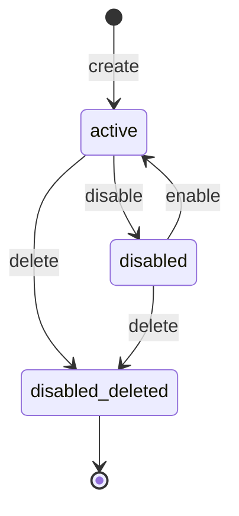
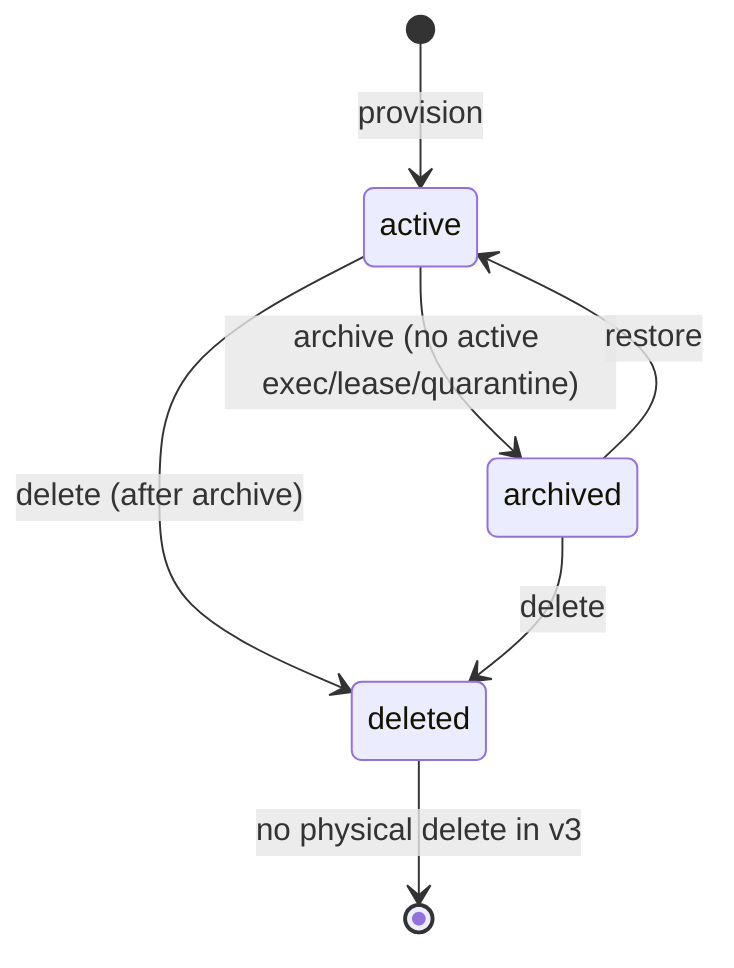
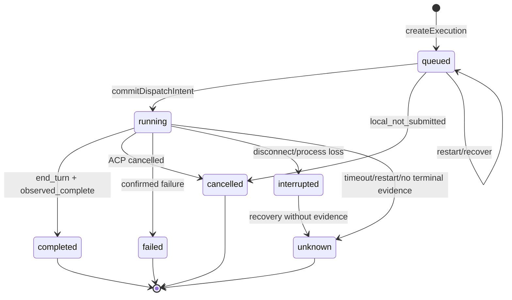
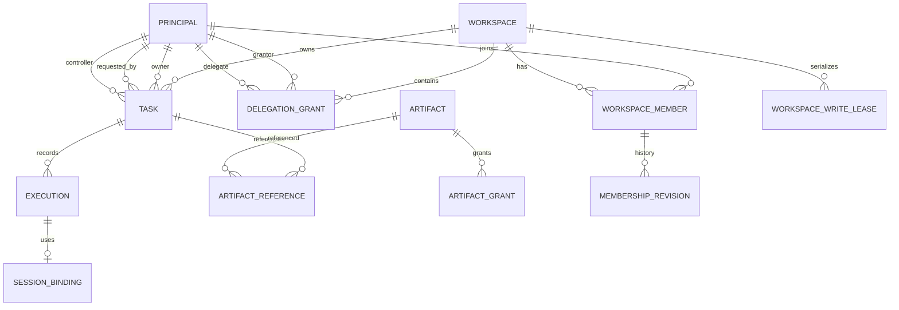

# Phase 2.1A.2 Contracts v3 Design：数据模型与状态机

状态：**Proposed Contracts v3 Design / Implementation Not Started**

日期：2026-11-11（Asia/Shanghai）

基线：

- Phase 2.0 冻结决策：AD-01 至 AD-14（`be36ba7`）
- Phase 2.1A Identity & Workspace：IW-01 至 IW-11（`10369df`）
- Phase 1.1 当前实现：`packages/contracts/v2.d.ts`、`packages/task-store-v2/index.mjs`、`packages/dsh-acp-v2/index.mjs`、`packages/acp-transport/index.mjs`

范围：只设计实体、字段、状态机和权限语义；不实现 Contracts、Store、Executor、ACP Transport、API 或迁移。

> **源文档缺口：** 任务要求阅读的 `docs/phase-2.0-architecture-baseline.md` 在当前仓库不存在。本文不虚构其内容，使用已冻结的 Phase 2.0.1/2.0.2/2.0.3、baseline review 和 Phase 1.1 实际代码作为依据。该缺口记入设计审查的 Open Decision / source gap。

---

## 0. 结论摘要

Contracts v3 的核心是五个分离：

1. **Principal 与业务角色分离**：`actor`、`createdBy`、`requestedBy`、`owner`、`controller` 不合并。
2. **Task 目标状态、Task 生命周期、Execution 状态分离**：Task 完成必须显式确认，不能由单次 Execution 成功自动推导。
3. **Execution 的持久化状态与派生展示状态分离**：保留 AD-07 的七种持久化状态；`dispatching`、`cancelling`、`succeeded` 只作为 API 投影，不新增持久化状态。
4. **Artifact ACL 与 Task ACL 分离**：Artifact 创建时物化 ACL；Task 权限变化不动态改写 Artifact。
5. **数据并行与写并发分离**：Task 可拥有多个 Execution；是否同时写由 Workspace 隔离策略和 `WorkspaceWriteLease` 决定。

v3 的关键决定：

| ID | 决策 |
|---|---|
| C3-01 | Principal/Workspace/Membership/Delegation 是 Store v3 一级实体 |
| C3-02 | Task 使用 goalStatus + lifecycle + controlState；Execution 独立状态机 |
| C3-03 | 持久化 Execution 状态沿用 AD-07；`dispatching`/`cancelling`/`succeeded` 是投影 |
| C3-04 | `awaiting_input` 不进入 v3；Phase 2.3 用 InputRequest，Execution 保持 running |
| C3-05 | Task 取消是显式目标决定；running Execution 的取消仍需真实证据 |
| C3-06 | Artifact 创建时物化 ACL；Grant/Reference 独立 |
| C3-07 | Workspace 业务生命周期与 WorkspaceWriteLease 状态分离 |
| C3-08 | 授权使用 effective Membership/Delegation；不信任 stored status 或客户端身份 |
| C3-09 | 所有终态 Execution 不可覆盖；unknown/interrupted 不自动重试 |
| C3-10 | v3 不提供自动结果合并；selectedExecutionId 由上层显式选择 |

---

## 1. 设计原则与不可破坏的不变量

### 1.1 不变量

1. `Execution` 终态和完成证据不可覆盖；重试创建新 `executionId` 和新 `requestKey`。
2. `unknown` / `interrupted` 不自动重发；新 Execution 必须显式 acknowledgment。
3. `cancel request` 不等于 `cancel confirmation`；只有 ACP 取消响应或证明未发送的本地取消可进入 `cancelled`。
4. Store 是本地已提交事实的权威，不是 DSH 远端执行状态的全知来源。
5. 单 Store 所有者、原子 commit、全局事件 sequence。
6. 不承诺 ACP exactly-once；不把 Session 可恢复性当作结果证据。
7. 任何授权都不能只凭知道 ID、requestKey、cursor 或 payload 中的身份字段。
8. Task goalStatus 不能由单次 Execution 完成自动推进为 `completed`。
9. Artifact ACL 不按当前 Task 角色动态计算。
10. Workspace 写入并发必须有租约或独立工作副本；没有隔离就排队。

### 1.2 v3 与 Phase 1.1 的边界

当前 Phase 1.1：

- `TaskStatus = ExecutionStatus`；
- 每个 Task 最多一个活动 Execution；
- Task 有单值 `activeExecutionId`、`latestExecutionId`；
- `Task.result` 强制等于最新 Execution 的 result；
- 没有 Principal/Workspace/Artifact/selectedExecutionId；
- Store commit 不接收 AuthorizationContext。

v3 **不是**在 v2 字段上追加几个可选字段；它需要新的 Store 文件、新的任务投影和新的写入接口。迁移必须离线、显式、可回滚。

---

## 2. 通用类型与 ID

```text
Timestamp          ISO-8601 字符串，UTC 或带时区；服务端生成
Revision           number，单实体乐观版本
JsonValue          null | boolean | number | string | JsonValue[] | { [key:string]: JsonValue }
PrincipalId        prn_<opaque>
WorkspaceId        ws_<opaque>
TaskId             tsk_<opaque>
ExecutionId        exe_<opaque>
ArtifactId         art_<opaque>
DelegationId       dlg_<opaque>
LeaseId            lease_<opaque>
EventId            evt_<opaque>
BindingId          bind_<opaque>
RequestRecordId    req_<opaque>

FencingToken:
  workspaceId
  epoch
  leaseId
  executionId
```

- ID 只用于标识，不编码角色、显示名、本机账户或路径。
- 所有实体有 `createdAt`、`updatedAt`；可审计实体有 `revision`/`version`。
- 时间由 Hub 服务端生成；客户端时间只作展示，不参与授权/过期判断。
- 金额/大小使用整数；`size` 为字节数。

---

## 3. Principal

### 3.1 实体

```text
Principal:
  principalId              PrincipalId
  principalType            user | agent | system
  displayName              string | null
  status                   active | disabled
  deletedAt                Timestamp | null
  disabledAt               Timestamp | null
  disabledReason           string | null
  createdByPrincipalId     PrincipalId | null
  createdAt                Timestamp
  updatedAt                Timestamp
  version                  number

  agentProfile?:
    registeredByPrincipalId PrincipalId
    connectorKind           local | remote | system
    capabilities            string[]       // 提示，不是授权
```

对外视图 `PrincipalView`：

```text
PrincipalView.status = deleted  if deletedAt != null
                     = disabled if status == disabled
                     = active
```

### 3.2 类型与约束

| 类型 | API 登录/调用 | Workspace Owner/Admin | Task owner/controller | 说明 |
|---|---:|---:|---:|---|
| user | 是（可信连接） | 是 | 是 | Workspace Owner 必须是 User |
| agent | 是（未来 Connector） | 否（v3） | 是 | 独立主体，不继承 User 权限 |
| system | 否 | 否 | 否 | 仅内部迁移/恢复/审计 |

- `system:*` 前缀保留；客户端不能创建或冒充 system principal。
- Agent 的 `agentProfile.registeredByPrincipalId` 只是注册审计，不是权限继承。
- `displayName` 可空；不参与授权。
- 一个 Agent 可以同时持有多个 User 的 Delegation；每个请求绑定一个 `(actor, workspaceId, delegationId)`。

### 3.3 生命周期



- `disable`：status=disabled，递增 version/authorizationRevision；不删除 Membership；effective 变为 suspended；撤销 Delegation；冻结 controller；运行中 Execution 继续。
- `enable`：status=active；只有 stored active 的 Membership 恢复 effective；显式 revoked Membership 不恢复；Controller 不自动 unfreeze。
- `delete`：status=disabled + deletedAt；撤销 Membership/Delegation；不可恢复。
- 删除最后一个 Workspace Owner 默认 `LAST_OWNER`；system 强制路径进入 `ownerless_locked`。

### 3.4 主体对现有对象的影响

| 对象 | disabled | deleted |
|---|---|---|
| Membership | stored 不变，effective suspended | stored revoked |
| Delegation | revoked | revoked |
| Task owner/requestedBy | 历史审计引用，无有效权限 | 历史引用 |
| Task controller | frozen | frozen |
| running Execution | 继续 | 继续 |
| Artifact owner | 保留，需审计处置 | 保留，需转移 |
| ArtifactGrant | 立即无效 | 撤销 |

---

## 4. Workspace

### 4.1 实体

```text
Workspace:
  workspaceId               WorkspaceId
  name                      string
  status                    active | archived | deleted       // 业务生命周期
  ownerPrincipalId          PrincipalId (User)
  rootStatus                bound | unbound                    // unbound 仅用于迁移/只读
  rootRef                   string | null                     // 对外逻辑引用
  rootPath                  string | null                     // 服务端专用，不进入 API/Event/日志
  rootIdentity:
    volumeSerial            string
    fileId                  string
    finalPath               string
    observedAt              Timestamp
  | null                                                      // rootStatus=unbound 时为 null
  workspaceBoundaryEnforcement  cooperative | os-enforced
  quarantineState           normal | quarantined
  quarantineReason          string | null
  quarantinedAt             Timestamp | null
  isolationPolicy           mutex | git-worktree | directory-copy
  governanceState           normal | ownerless_locked
  writeEpoch                integer
  policyVersion             integer
  createdByPrincipalId      PrincipalId
  createdAt / updatedAt
  archivedAt / deletedAt
  deletedFrom               live | archived | null
```

派生访问状态：

```text
WorkspaceAccessState =
  deleted      if status=deleted
  archived     if status=archived
  quarantined  if status=active && quarantineState=quarantined
  active       otherwise
```

- `status` 不包含 `quarantined`；quarantine 是运行时写安全状态，不是业务生命周期。
- `rootPath`/`rootIdentity` 只存在于服务端 Store；API 只返回 `rootRef`、`boundaryEnforcement`、`quarantineState`。
- `rootStatus=unbound` 只允许迁移的 legacy Workspace：可读、可审计、可归档，但禁止新 Execution，直到 Owner/Admin 离线 rebind root；`rootPath/rootIdentity/rootRef` 为 null。
- 新建 Workspace 必须 `rootStatus=bound`；`rootIdentity` 非空。
- `isolationPolicy=mutex` 是默认；`git-worktree`/`directory-copy` 必须有执行器能力证明。

### 4.2 生命周期



- archive：要求无 queued/running Execution、无 held/releasing/frozen 租约、`quarantineState=normal`、无 ownerless_locked；Task goalStatus/lifecycle 不变。
- archived：读写策略只读；默认列表不返回；Task/Execution/Artifact/Event 保留。
- restore：不自动恢复 Execution、Lease、Delegation、Controller。
- delete：软删除；root/Task/Execution/Artifact/Event 保留；只有 system recovery 可读。
- 不提供物理删除；物理清理是独立的离线保留策略。

### 4.3 BootstrapState

```text
BootstrapState:
  bootstrapPrincipalId      User
  workspaceId               WorkspaceId
  ownerPrincipalId          User
  rootFingerprint           string          // 不暴露绝对路径
  completedAt               Timestamp
```

- 正常启动只绑定已有 bootstrap 记录，不自动创建 Principal/Workspace。
- 配置 ID 与记录不一致时启动失败（`BOOTSTRAP_MISMATCH`）。

### 4.4 Workspace 与 Lease 的关系

- Workspace `status`/`quarantineState`/`rootStatus` 决定是否允许新写、新 Execution、新 Task；`rootStatus=unbound` 时只读。
- `WorkspaceWriteLease` 决定当前是否有某个 Execution 持有写租约。
- 一个 `active` Workspace 可以没有租约；有租约时最多一个 `held`（mutex）。
- `quarantined` Workspace 不得获取新写租约；已有租约保持 `frozen/quarantined`，不得依靠租约释放恢复。
- `archived/deleted` Workspace 不获取租约；归档前必须无租约。

---

## 5. Membership 与 DelegationGrant

### 5.1 Membership

```text
MembershipEffectiveStatus = active | suspended | revoked

WorkspaceMember:
  workspaceId + principalId     复合唯一
  role                          owner | admin | operator | viewer
  status                        active | revoked        // stored
  effectiveStatus               active | suspended | revoked  // 投影，不持久化
  version                       number
  lastMembershipRevisionId      string
  grantedByPrincipalId          PrincipalId
  grantedAt / updatedAt
  revokedAt / revokedReason

MembershipRevision:
  membershipRevisionId
  workspaceId + principalId
  version
  storedStatus                  active | revoked
  role
  actorPrincipalId
  time
  reason
  previousRevisionId

MembershipInvite:
  inviteId
  workspaceId
  targetPrincipalId            active Principal
  role                         admin | operator | viewer
  tokenHash
  status                       pending | accepted | revoked | expired
  createdByPrincipalId
  createdAt / expiresAt
  acceptedAt / revokedAt
```

`effectiveMembership`：

```text
if stored.status == revoked:                 revoked
if principal.deletedAt != null:              revoked
if principal.status != active:               suspended
if workspace.status == deleted:              suspended
if workspace.status == archived:             active（只读）
if workspace.quarantineState == quarantined: active（写受限）
if workspace.governanceState == ownerless_locked: active（治理/新工作受限）
else:                                       active
```

授权只看 effective；`WorkspaceMember.status` 只是 stored。

角色约束：

- Owner 唯一；`Workspace.ownerPrincipalId` 与唯一 `role=owner` Membership 一致。
- Owner/Admin 必须是 User；Agent 只能 Operator/Viewer。
- 新成员默认 Viewer。
- Owner 不能直接 revoked；必须先转移。
- 角色变化追加 MembershipRevision；显式 revoked 不会因 Principal enable 复活。

### 5.2 DelegationGrant

```text
DelegationGrant:
  delegationId
  workspaceId
  grantorPrincipalId           User
  delegatePrincipalId          Agent
  scopes[]                     task:read|create|control,
                               execution:read|create|control,
                               artifact:read|write
  resourceScope:
    kind                       workspace | tasks | artifacts
    taskIds? / artifactIds?
  status                       active | revoked | expired
  version                      number
  parentDelegationId           null            // v3 禁止二次委托
  createdAt
  expiresAt                    Timestamp
  revokedAt / revokedBy / revokeReason
```

规则：

- grantor User、delegate Agent，且都是 effective active Workspace 成员。
- 不允许二次委托；Agent 不能创建 Delegation。
- `resourceScope=workspace` 允许 `task:create`；`tasks`/`artifacts` 必须显式 ID，不能是未来匹配。
- `expiresAt` 必填；服务端时钟判断过期。
- v3 不支持原地修改 scope/resourceScope/expiresAt；变更必须撤销旧 grant 并创建新 delegationId，以保留历史。
- Delegation 不替换 ArtifactGrant；`artifact:read` 只是上限之一（AD-06）。
- 撤销/过期：所有受影响 Task `controlState=frozen`；running Execution 继续；queued 不自动 dispatch；snapshot controller ArtifactGrant 撤销；不追溯已接受 dispatch_intent（AD-12/AD-13 语义）。

### 5.3 DelegationRevocationFence

```text
DelegationRevocationFence:
  fenceId
  delegationId
  workspaceId
  revokedAt
  authorizationRevision
  actorPrincipalId
  reason
  status                 pending | reconciling | completed | failed
  processedTaskIds       string[]
  processedGrantIds      string[]
  lastError
  completedAt
```

- Fence 是撤权的授权权威输入；stored `Task.controlState`/`ArtifactGrant.revokedAt` 是可滞后的物化投影。
- `effectiveControlState` 和 effective ArtifactGrant 必须检查 fence/source delegation。
- Reconcile 只物化已生效的撤权，不决定撤权生效时间。
- Fence 提交后，新命令立即拒绝；不等待 reconcile。
- 过期也可复用 fence/reconcile 语义；`revokedAt` 与 `expiredAt` 通过 reason 区分。

### 5.4 有效权限

```text
effectivePermission(actor, op, resource) =
  Principal(actor).active
  AND effectiveMembership(actor, resource.workspaceId) = active
  AND workspaceAllows(resource.workspaceId, op)
  AND membershipRoleAllows(role, op)
  AND delegation/ACL checks if actor is delegated agent
  AND resource-specific ACL (Task visibility / Artifact ACL)
```

Delegated Agent 还必须满足：

```text
delegation.status=active && now<expiresAt
AND actor=delegatePrincipalId
AND op ∈ scopes
AND resource ∈ resourceScope
AND grantor仍在目标 Workspace effective active
AND grantor当前仍拥有该 op/资源的权限
AND actor自身 Membership 仍允许该 op
AND Artifact ACL 仍允许（Artifact 场景）
```

---

## 6. Task v3

### 6.1 实体

```text
Task:
  taskId                       TaskId
  workspaceId                  WorkspaceId
  title                        string | null
  objective                    string                 // 原始目标，不可变
  description                  string | null
  ownerPrincipalId             PrincipalId
  requestedByPrincipalId       PrincipalId | null
  createdByPrincipalId         PrincipalId
  controllerPrincipalId        PrincipalId
  controllerDelegationId       DelegationId | null
  controlState                 active | frozen
  controllerFrozenReason       string | null
  controllerFrozenAt           Timestamp | null
  visibility                   private | workspace
  goalStatus                   open | active | awaiting_decision |
                               completed | failed | cancelled
  lifecycle                    live | archived | deleted
  selectedExecutionId          ExecutionId | null
  latestExecutionId            ExecutionId | null
  duplicateExecutionRisk       boolean
  integrityAlerts              IntegrityAlert[]       // 只追加；确认不删除
  workingDirectory             string | null           // 相对 Workspace root；空字符串表示 root；null=legacy/未归一化
  legacyCwd                    string | null           // 仅迁移/审计
  legacy                       JsonValue | null        // 迁移元数据
  riskAcknowledgements         RiskAcknowledgement[]   // 只追加；见 6.6
  createdAt / updatedAt
  archivedAt / deletedAt
  deletedFrom                  live | archived | null
  revision                     number

RiskAcknowledgement:
  acknowledgementId
  taskId
  executionIds[]              // 当前全部 interrupted/unknown
  actorPrincipalId
  note
  createdAt
  authorizationRevision

IntegrityAlert:
  alertId
  executionId
  code
  time
  acknowledgedAt | null
  acknowledgedByPrincipalId | null
  note | null
```

**`controlState` 是 stored/materialized cache，不是唯一权威。** API 的 `TaskView.controlState` 和所有 Store 写授权使用 effective：

```text
effectiveControlState =
  frozen if controllerDelegationId 指向 revoked/expired/fenced delegation
  frozen if controllerPrincipalId disabled/deleted
  frozen if controllerFrozenAt/fence 存在且未解除
  else stored controlState
```

- `controlStateStored` 可在内部保留用于诊断；`controlState` 对外返回 effective。
- 撤权 fence 先于 materialized field 生效；详见 Store 2.5。
- 不能把 materialized `active` 当作“仍可控制”。

**不把 `executionSummary` 作为权威持久字段。** API 派生：

```text
executionSummary:
  activeExecutionIds[]       queued + running
  unresolvedExecutionIds[]   interrupted + unknown
  latestExecutionId
  selectedExecutionId
  counts                     queued/running/terminal/unknown
  hasIntegrityRisk
  duplicateExecutionRisk
```

`Task.status` 兼容投影：

```text
archived if lifecycle=archived
deleted  if lifecycle=deleted
goalStatus otherwise
```

**goalStatus 与 executionSummary 是正交维度**：`active` 只表示“没有显式目标决定，且至少一个 queued/running”；显式 `completed/failed/cancelled` 是目标决定，允许仍有正在清理的 Execution（尤其 cancel），但禁止新 Execution。不能因为 summary 里还有 running 就把已显式 cancel 的 Task 强行改回 active。

`Task.result` 兼容投影只来自 `selectedExecutionId`（若存在），否则 null/legacy；不得用 latest 冒充 selected。

### 6.2 Task 创建默认值

| 场景 | owner | requestedBy | createdBy | controller | visibility |
|---|---|---|---|---|---|
| User 直接创建 | User | User（自我） | User | User | private（默认） |
| Agent 受 User 委托 | grantor | grantor | Agent | Agent | private |
| Agent 自主 | Agent | null | Agent | Agent | private |

- `Task.owner`/`controller` 必须是该 Workspace 的 effective active 成员；Agent 可以是 owner/controller。
- `createdBy`/`requestedBy` 不可变；`owner`/`controller` 可变但必须审计。
- `Task.owner` 与 `controller` 可以不同。
- `Task.visibility=private` 是默认；`workspace` 必须显式选择。
- 新建 Task 的 `workingDirectory` 必须是 Workspace root 下的相对路径；绝对路径/`..`/UNC 拒绝；`null` 只允许迁移的 legacy Task，且该 Task 在归一化前禁止新 Execution。

### 6.3 Task 状态转换表

| 当前 goalStatus | 触发 | 授权 | 结果 | 持久化副作用 | Event |
|---|---|---|---|---|---|
| — | createTask | `task:create` | open | Task + owner/controller + audit | task.created |
| open | 首个 Execution 进入 queued | `execution:create` | active | Execution queued；Task latest | execution.created |
| active | commitDispatchIntent | `execution:control` | active（goalStatus 不变） | Execution/Lease/dispatchIntent | execution.dispatched |
| active | 最后一个 queued/running 离开 | 系统聚合 | awaiting_decision | Task goalStatus；summary 派生 | task.awaiting_decision |
| awaiting_decision | 新 Execution 进入 queued/running | `execution:create` + risk ack | active | 新 Execution；不清除旧风险 | execution.created |
| open/active/awaiting_decision | cancelTask | controller/owner/admin | cancelled | 取消所有 queued/running；记录 cancel requests；不伪造 Execution 终态 | task.cancelled + execution.cancel_requested |
| awaiting_decision | completeTask | controller/owner/admin；selected completed；无 active；风险已记录 | completed | Task goalStatus；事件；不改 Execution | task.completed |
| awaiting_decision | failTask | controller/owner/admin；无 active；风险已记录 | failed | Task goalStatus；事件 | task.failed |
| completed/failed/cancelled | 普通 Execution 事件 | — | 不迁移 | 拒绝 `INVALID_TASK_TRANSITION` | — |
| completed/failed/cancelled | 新 Execution | — | 拒绝 | 创建新 Task | — |
| archived/deleted | 新 Execution | — | 拒绝 | 先 restore；不自动执行 | — |
| live | archiveTask | controller/owner/admin；无 active | lifecycle archived | goalStatus 不变 | task.archived |
| archived | restoreTask | owner/admin | life live | goalStatus 不变 | task.restored |
| live/archived | deleteTask | owner/admin；无 active | lifecycle deleted | `deletedFrom` 记录 | task.deleted |
| deleted | restoreTask | owner/admin | 原 lifecycle | 不自动执行 | task.restored |

说明：

- `active` 是“目标未决且至少一个 queued/running”；`cancelled` 是显式目标决定，可能仍有正在清理的 Execution（`executionSummary` 显示），但禁止新 Execution。
- `completeTask`/`failTask` 不得在 active 时执行；必须等所有 Execution 结算或显式 cancel。
- `cancelTask` 不等待 cancel confirmation；它记录目标取消和 cancel requests；Execution 仍按真实证据结算。
- `archiveTask`/`deleteTask` 要求无 queued/running；unknown/interrupted 不阻塞归档，但必须在 summary 暴露风险。
- `restoreTask` 不把 completed/failed/cancelled 变成 active。

### 6.4 complete/fail/cancel 的语义

- `completeTask`：必须指定 `selectedExecutionId`，且该 Execution 为 `completed`；没有 queued/running；所有 `interrupted`/`unknown` 风险已显式记录；不能静默忽略。
- `failTask`：没有 queued/running；记录 failure reason/风险；不修改 Execution。
- `cancelTask`：显式目标取消；对每个 queued/running 写 `cancel.requestedAt`；不把 running 直接写 cancelled；返回 Task + 每个 Execution 的请求结果。
- `cancelExecution`：只请求/确认一个 Execution；不改变 Task goalStatus。
- `archiveTask`：只改 lifecycle；不删除历史/Artifact。
- `deleteTask`：软删除；不删除 Execution/Artifact；Artifact 由自己的 ACL/生命周期决定。

### 6.5 可见性

`private` 可读：

1. Task owner；
2. requestedBy（若有）；
3. active controller（未冻结时）；
4. Workspace Owner/Admin 审计；
5. 有效 Delegation 且 scope 含 `task:read`、resourceScope 覆盖该 Task 的 Agent；
6. 未来显式 TaskGrant（v3 不开放任意 ACL）。

`workspace` 可读：Workspace 的 effective active 成员；控制权仍只属于 controller/owner/admin。

- `createdBy` 不自动获得 private 读权。
- 知道 taskId 不是授权。
- `Task` 的 owner/controller 变更必须审计。

### 6.6 风险确认

- `RiskAcknowledgement.executionIds` 必须等于当前 `unresolvedExecutionIds` 集合（顺序无关）；不能只确认部分。
- 确认只记录“知道风险”，不清除 `unknown`/`interrupted`，不改 result，不清除 `duplicateExecutionRisk`。
- 新 Execution 的 `acknowledgeUnknownExecutionIds` 必须与当前 unresolved 集合一致；否则 `UNKNOWN_EXECUTION`。
- 确认记录不可变；重复确认只追加新的记录或幂等返回，不覆盖旧记录。
- `completeTask`/`failTask` 的 risk note 也必须引用/记录当前 unresolved 集合；不能空数组绕过。

---

## 7. Execution v3

### 7.1 实体

```text
Execution:
  executionId                ExecutionId
  taskId                     TaskId
  workspaceId                WorkspaceId
  status                     queued | running | completed | failed |
                             cancelled | interrupted | unknown
  submission                 not_started | dispatch_intent | response_observed
  prompt                     string                       // 不可变
  input:
    cwd                      string                       // Workspace-relative，不是宿主绝对路径
    workspaceSnapshot        WorkspaceSnapshot
  requestKey                 string | null                // 兼容/审计；幂等以 RequestRecord 为准
  requestRecordId            RequestRecordId | null
  sessionBindingId           BindingId | null
  executor:
    executorId               string
    principalId              PrincipalId                  // 实际执行主体
    runtimeId                string | null
  createdByPrincipalId       PrincipalId                  // 提交命令的 actor
  createdAt / updatedAt
  startedAt / deadlineAt / finishedAt
  lastNotificationAt         Timestamp | null
  result                     JsonValue
  resultIntegrity            partial | observed_complete | uncertain
  completionEvidence         CompletionEvidence | null
  cancel:
    requestedAt              Timestamp | null
    requestedByPrincipalId   PrincipalId | null
    sentAt                   Timestamp | null
    confirmedAt              Timestamp | null
    outcome                  confirmed | not_submitted | unconfirmed | null
  dispatchIntent:
    intentId                 string
    committedAt              Timestamp
    authorizationRevision    number
    leaseId                  LeaseId | null
    fencingToken             FencingToken | null
  diagnostics                Diagnostic[]                 // 上限 32
  unknownReason              string | null
  duplicateExecutionRisk     boolean
  revision                   number
```

`WorkspaceSnapshot`：

```text
kind                mutex | git-worktree | directory-copy | shared-readonly
workspaceId
baseRevision        string | null
leaseId             LeaseId | null
fencingToken        FencingToken | null
cwd                 string              // Workspace-relative；Adapter 通过 root handle 解析
```

### 7.2 持久化状态与派生展示状态

**v3 不新增 AD-07 之外的持久化状态。** API 可以返回 `displayState`：

| 持久化 status/submission/cancel | displayState |
|---|---|
| queued, not_started | queued |
| running, dispatch_intent, no输出且未终态 | dispatching（只证明 intent，不证明 ACP 已接收） |
| running, dispatch_intent, 已有输出但未终态 | running |
| queued/running + cancel.requestedAt | cancelling |
| completed | completed（别名 succeeded） |
| failed | failed |
| cancelled | cancelled |
| interrupted | interrupted |
| unknown | unknown |

- `dispatching` 不是 Store 状态；它是 `running + dispatch_intent + 尚未收到终态` 的投影。
- `cancelling` 不是 Store 状态；它是 cancel request 已存在、终止未确认的投影。
- `succeeded` 只是 `completed` 的展示别名；Contracts v3 不引入第二个终态。
- `awaiting_input` 不进入 v3；Phase 2.3 用 InputRequest，Execution 仍是 `running`，直到输入返回或终态。

### 7.3 Execution 状态机



规则：

- `queued` 可以在重启后保持；不自动 dispatch。
- `commitDispatchIntent` 后 `status=running`、`submission=dispatch_intent`；这是“可能已发送”的持久事实。
- 只有 `completionEvidence`/取消证据支持的终态才能写 `completed`/`cancelled`；`failed` 需要确认错误。
- `interrupted` 是非终态风险；恢复只能转 `unknown` 或保留已提交终态，不能凭 Session 可恢复性转 completed。
- `unknown` 是终态；不自动重试。
- `terminal` 为 `completed|failed|cancelled|unknown`；`interrupted` 不是终态，但不自动重发。
- 终态不可覆盖；diagnostics/cancel timestamps 可追加。

### 7.4 关键竞态

1. **Session 已创建但未 dispatch**：`queued` + binding（可能）；恢复保留 queued，不自动 prompt；可能产生孤立 Session，需要 cleanup/reconcile。
2. **dispatch_intent 已持久化但发送未知**：`running + dispatch_intent`；恢复不能证明未发送，进入 `unknown`，禁止自动重发。
3. **prompt 已发送但 Hub 未持久化结果**：`running`/`unknown`；没有 ACP 结果回放，不能伪造 completed。
4. **Hub 重启无法判断 DSH 是否执行**：`unknown` + `RESULT_UNAVAILABLE` 诊断；要求人工/显式 acknowledgment。
5. **cancel 已发送但未确认**：`cancel.requestedAt/sentAt` 存在，status 仍 running/interrupted；`confirmedAt` 仅由 ACP cancelled 或证明未发送的本地取消填写。
6. **late notification**：不能可靠关联原 Execution 的文本/通知进入 quarantine 诊断，最多 32 项；不覆盖终态；Task 可产生 integrity alert；不能据此生成 result 或 completed。

### 7.5 取消与 Task 取消

- `cancelExecution`：写 `cancel.requestedAt`；已 queued 且确定未发送可本地取消；running 只发送 ACP cancel，等待证据；返回请求结果，不返回伪造终态。
- `cancelTask`：写 Task `goalStatus=cancelled` + 所有 active execution 的 cancel request；Execution 仍按真实证据结算；Task 可显示执行清理。
- `cancelTask` 后不能创建新 Execution；已运行 Execution 的终态仍保存。
- `unknown`/`interrupted` 的存在不会阻止 `cancelTask`，但必须保留 unresolved risk。

### 7.6 SessionBinding

```text
SessionBinding:
  bindingId                BindingId
  executionId              ExecutionId
  taskId                   TaskId
  workspaceId              WorkspaceId
  sessionId                string | null
  cwd                      string              // 服务端使用；API View 不返回宿主绝对路径
  runtimeId                string | null
  generation               string
  availability             active | closed | unknown
  recoveryRequired         boolean
  createdAt / updatedAt
```

- 一个 Execution 至多一个 active Binding；一个 Session 同时至多一个 active Execution。
- 同一 Session 可以按顺序被同一 Task 的后续 Execution 复用，但必须新建 Binding/Execution，不能改写旧记录。
- `session/new` 成功后、dispatch intent 前崩溃：Binding 可能存在但 Execution 仍 queued；恢复不自动 prompt。
- `availability=unknown` 或 `recoveryRequired=true` 时，不得直接创建新 Execution；先 cleanup/reconcile。
- Binding 的 `sessionId`/`cwd` 是身份字段，不得被后续 Binding 静默覆盖。

### 7.7 结果与证据

- `resultIntegrity=observed_complete` 仅用于 completed。
- `completed` 需要 `stopReason=end_turn` + 输出 flush + 结果在同一终态事务。
- `cancelled` 需要 `stopReason=cancelled` 或 `local_not_submitted` 证据。
- `failed` 需要确认错误；timeout 不是 completed/failed 的证明。
- `unknown`/`interrupted` 不能带 completionEvidence。
- `unknown` 不能被自动改成 failed；`failed` 也不能覆盖已提交的 unknown。

---

## 8. Artifact v3

### 8.1 实体

```text
Artifact:
  artifactId                 ArtifactId
  workspaceId                WorkspaceId
  ownerPrincipalId           PrincipalId
  sourceTaskId               TaskId | null
  sourceExecutionId          ExecutionId | null
  storageRef                 string                 // 不透明，不暴露本机路径
  storageKind                string                 // 后端标识
  sha256                     string
  size                       integer
  mime                       string
  visibility                 private | workspace
  permissionMode             snapshot | explicit    // v3 只使用 snapshot
  retentionPolicy            string | null
  createdByPrincipalId       PrincipalId
  createdAt / updatedAt
  deletedAt                  Timestamp | null
  purgedAt                   Timestamp | null
  version                    number

ArtifactReference:
  artifactId + taskId + executionId + relation(produced|referenced)
  createdAt / createdByPrincipalId
  unique by (artifactId, taskId, executionId, relation)

ArtifactGrant:
  grantId
  artifactId
  granteePrincipalId         PrincipalId
  scope                      read | write
  grantedByPrincipalId       PrincipalId
  origin                     explicit | task-snapshot-requester |
                             task-snapshot-controller
  sourceDelegationId         DelegationId | null   // snapshot-controller 时记录
  createdAt
  expiresAt                  Timestamp | null
  revokedAt / revokedReason
```

### 8.2 创建时 ACL

创建 Artifact 的同一事务中物化：

```text
Artifact.ownerPrincipalId = source Task.ownerPrincipalId
Artifact.visibility = source Task.visibility
snapshot requester grant: requestedBy（若非 owner，scope=read）
snapshot controller grant: controller（若非 owner/requester，scope=read）
```

- 读取时只使用 Artifact 自身 owner/visibility/Grant，不查询当前 Task 角色。
- Controller 转移/冻结同步只针对 `origin=task-snapshot-controller` 的 Grant。
- Task owner 转移不改变 Artifact owner；需要显式 transfer。
- Task visibility 变化不改变 Artifact；发布审核事件。

### 8.3 Artifact 读取/写入

- private 读取：owner、snapshot requester/controller grant、显式 ArtifactGrant、Workspace Owner/Admin 审计。
- workspace 读取：Workspace effective active 成员，前提是 `Artifact.visibility=workspace`。
- 写入：Artifact owner 或对来源 Task 有写权限且 Artifact ACL 允许的 controller；Workspace 角色本身不授予写入。
- `artifact:grant`/transfer：Artifact owner 或 Workspace Owner/Admin 的显式管理操作并审计。
- 跨 Workspace 共享不在 v3 开放；未来必须独立 `ArtifactShare`/AD。

### 8.4 生命周期与删除

- `softDeleteArtifact`：设置 `deletedAt`，隐藏；不删除引用/存储。
- 删除 Task 不删除 Artifact；解除引用不删除仍被其他引用的 Artifact。
- `purgeArtifact`（v3 不开放普通 API；离线/内部）条件：
  1. `deletedAt` 已超过 retention；
  2. 没有 active `ArtifactReference` 指向它；
  3. 没有未撤销的 Grant；
  4. 通过 IW-09 path guard 定位 storageRef；
  5. 写入 `purgedAt` 并审计；
  6. 物理删除后保留最小 tombstone（artifactId/workspaceId/hash/时间）。
- 物理删除不能只按路径；必须通过 Workspace root handle / staging 约束。
- v3 API 只提供 soft-delete；物理 purge 留到离线管理或后续阶段。

---

## 9. Workspace 并发、工作副本与租约

### 9.1 数据并行与写并发

- 数据模型：一个 Task 可有多个 Execution（queued/running/terminal）。
- 写并发：由 `isolationPolicy` 和 `WorkspaceWriteLease` 决定。
- `mutex`：每 Workspace 最多一个 `held` 写租约；其他 Execution 排队。
- `git-worktree`/`directory-copy`：每个 Execution 独立副本，不持有原 Workspace 写租约。
- `shared-readonly`：仅当执行器证明不写；v3 不作为默认创建选项。
- 不自动合并并行结果；`selectedExecutionId` 由上层显式选择。

### 9.2 WorkspaceWriteLease

```text
WorkspaceWriteLease:
  leaseId
  workspaceId
  executionId
  state                held | releasing | released | frozen | quarantined
  fencingToken:
    workspaceId
    epoch
    leaseId
    executionId
  acquiredAt
  renewedAt
  expiresAt
  releasedAt
  releaseEvidence      process_tree_terminated | fencing_enforced | null
  releaseReason
```

规则：

- `mutex` 下每个 Workspace 最多一个 `held`。
- 租约与 `commitDispatchIntent` 在同一事务获取；没有租约不发送 prompt。
- `held` 期间可 `renewWorkspaceLease`，只延长 `expiresAt`，不改变 epoch/fencingToken；Workspace quarantine 或 Execution 终态后拒绝续期。
- Lease 超时本身不自动释放；Hub 存活但无法确认清理时进入 frozen；Hub 崩溃后恢复按 AD-13 冻结/quarantine。
- `held` 期间 Execution 终态 + Session/进程清理完成后，进入 `releasing`；清理确认后 `released`。
- `unknown`/`interrupted`/清理失败：`frozen`，不自动释放。
- 强制释放只接受 AD-13 证据：进程树终止证明或实际生效的 fencing；仅 workspace 隔离不允许释放旧租约。
- 无证据只能 `Workspace.quarantineState=quarantined` + lease `quarantined/frozen`；不得交给新 Execution。
- `fencingToken` 只有执行器/存储层实际拒绝旧 token 时才算 fencing；仅保存字段不算。
- `Workspace.writeEpoch` 每次获取/强制释放/恢复递增。

### 9.3 Controller 转移

- `transferController` 是单事务：旧 controller 失效/冻结，新 controller 校验 effective operator+，更新 `controllerPrincipalId`/`controllerDelegationId`/`controlState`。
- 运行中的 Execution 不因 transfer 取消；继续持有 lease。
- 新 controller 不能在同一事务创建新 Execution（先完成 transfer；下次命令）。
- 旧 controller 的 snapshot ArtifactGrant 撤销，新 controller 创建新 grant（AD-06）。
- 所有旧连接/订阅重新授权。

### 9.4 旧 Executor 仍在运行

- Hub 断连不等于 DSH 子进程停止（Phase 1.1 已确认）。
- 如果没有进程终止证明或实际 fencing，不能把同一 Workspace 写租约交给新 Execution。
- 可以：
  - 使用 worktree/copy 新副本（旧租约保持 frozen，旧 Workspace 不释放）；
  - 进入 quarantine；
  - 由有证据的离线恢复释放。
- 不能：仅管理员 `force=true`、仅时间过去、仅 Hub 重启。

---

## 10. 授权模型摘要

### 10.1 AuthorizationContext

```text
AuthorizationContext:
  connectionId
  actorPrincipalId
  actorType
  workspaceId
  requestedByPrincipalId | null
  delegationId | null
  authorizationRevision
  principalVersion
  membershipVersion
  delegationVersion
  workspacePolicyVersion
  managementScope?             // 仅未来管理接口
```

- 由服务端连接/Store 状态生成，客户端不能构造/覆盖。
- 每次写 commit 重新计算 effective Membership/Delegation/ACL；不信任缓存。
- `actor` 来自连接；`requestedBy` 来自 grantor 或 User 自身；`owner/controller` 来自 Task 字段/命令。

### 10.2 权限交集

Agent 有效权限 = Agent Membership ∩ grantor 当前权限 ∩ Delegation scope/resource ∩ 目标资源 ACL。

- 任何一项失效即拒绝。
- `workspace:create` 不是 Workspace RBAC，也不在 Local Bootstrap；只属于离线 provisioning/未来管理上下文（IW-10）。
- 撤销/过期不追溯已接受的 `dispatch_intent`，但阻断新命令。

### 10.3 读过滤

- `getTask/listTasks`：先 Workspace Membership，再 Task visibility。
- `getExecution/listExecutions`：先 Task 可见性，不能绕过 Task。
- `getArtifact/listArtifacts`：Artifact ACL；不是 Task ACL。
- `getEvents/subscribeEvents`：scope + workspace + 资源可见性；每次重新授权。
- 非成员返回 `*_NOT_FOUND`，成员但不可见返回 `*_NOT_VISIBLE`，避免跨租户存在性泄漏。

---

## 11. ER 图



---

## 12. 实体不变量与 Store 校验

Store v3 必须验证：

1. ID 全局唯一；所有引用属于同一 Workspace（未来跨 Workspace 分享除外）。
2. `(workspaceId, principalId)` Membership 唯一；Owner 唯一且是 User。
3. Membership stored/effective 分离；`MembershipRevision` append-only。
4. Delegation grantor User、delegate Agent、不跨 Workspace、无二次委托。
5. Task owner/controller 在赋值时是 effective active 成员；Agent 不能 Owner/Admin Workspace。
6. `selectedExecutionId`/`latestExecutionId` 指向同一 Task 的 Execution。
7. Execution 的 `taskId`/`workspaceId`/`bindingId` 归属一致；终态不可变。
8. 一个 SessionBinding 只属于一个 Execution；同一 Session 不能跨 Task 并行。
9. 同一 Task 的多个 active Execution 必须满足 Workspace 隔离/租约规则。
10. `effectiveControlState=frozen` 的 Task 不能创建/控制 Execution；stored `controlState` 不能覆盖 fence。
11. Artifact owner/grantee 是 effective active 成员；Artifact reference 归属正确；`sourceDelegationId` 失效时 grant 立即无效。
12. `WorkspaceWriteLease` 最多一个 held（mutex）；与 Execution dispatch/终态/清理关联。
13. Event 关联完整；事件 scope/audience 与 Workspace 一致。
14. `authorizationRevision` 单调递增；所有影响授权的变更递增。
15. `rootIdentity`/`quarantineState` 与 Workspace 路径能力一致；`rootStatus=bound` 时 `rootIdentity` 非空，`unbound` 时只能只读且禁止新 Execution；不可验证时 quarantine。

---

## 13. 待确认的 Contracts 决策

以下不阻塞本设计，但必须在 Contracts v3 冻结前确认：

1. **`dispatching`/`cancelling` 是否持久化**：本文建议不持久化，作为 AD-07 状态 + submission/cancel 的 API 投影；若要求持久化，需新增 AD。
2. **`awaiting_input`**：本文明确不进入 v3；Phase 2.3 InputRequest。
3. **`Task.title`/`description`**：本文保留 `objective` 为权威，title/description 为可选展示；若产品要求结构化标题，需另行冻结。
4. **`Task.result` 兼容投影**：是否保留在 v3 API；本文保留兼容投影，但 Store 不以它作为权威。
5. **Artifact 物理 purge**：v3 不开放普通 API；保留离线流程，需确认保留期。
6. **Workspace status `quarantined`**：本文使用 `status=active|archived|deleted` + `quarantineState`；如果 Contracts 要求单枚举，需要新增投影而非改 Store。
7. **Task `cancelTask` 与 running Execution 并存**：本文允许 `goalStatus=cancelled` 与清理中的 Execution 并存；若要求取消必须等全部终态，需要改 API 语义。
8. **跨 Workspace Artifact 分享**：v3 不开放；未来单独 AD。

---

## 14. 结论

Contracts v3 的稳定核心是：

- Principal/Workspace/Membership/Delegation 的可审计身份与授权；
- Task 目标状态与 Execution 执行状态的严格分离；
- 多 Execution 数据模型与 Workspace 写租约的分离；
- Artifact 创建时 ACL 与独立 Grant/Reference；
- 所有终态和 unknown 证据保留 Phase 1.1 的可靠性边界。

本文件只冻结数据模型和状态语义，不实现 Store/API/迁移。Store v3、API v3、ACP Adapter 边界和 v2→v3 迁移见 `docs/phase-2.1A.2-store-api-v3-design.md`。
