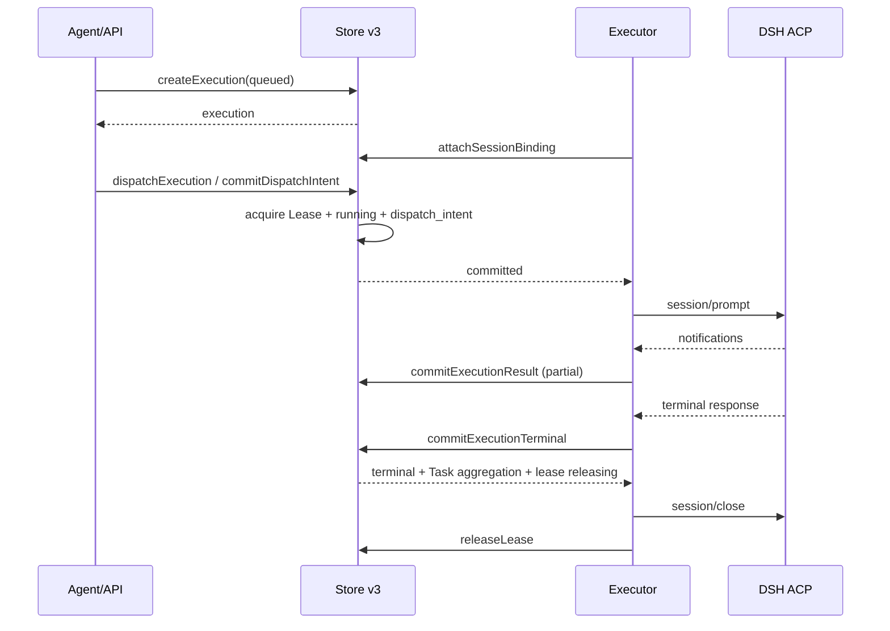

# Phase 2.1A.2 Store v3 / API v3 Design：原子存储、接口与迁移

状态：**Proposed Store/API v3 Design / Implementation Not Started**

日期：2026-11-11（Asia/Shanghai）

基线：

- AD-01 至 AD-14
- IW-01 至 IW-11（特别是 IW-09 root path、IW-10 Local Bootstrap、IW-11 Membership）
- `docs/phase-2.1A.2-contracts-v3-design.md`

范围：只设计 Store、API、Event、ACP Adapter 边界和 v2→v3 迁移；不实现代码、不修改配置。

---

## 0. 决策摘要

| ID | 决策 |
|---|---|
| S3-01 | Store v3 仍是单所有者、原子快照 `state-v3.json`；不引入第二写入者或静默双写 |
| S3-02 | 所有写操作走 `commitAuthorized`；最终授权检查和状态/事件写入在同一临界区 |
| S3-03 | `expectedRevision` + `expectedAuthorizationRevision` + effective 授权重新计算 |
| S3-04 | requestKey 作用域为 AD-10 五元组；replay 必须先重新授权 |
| S3-05 | Event 使用全局单调 sequence；scope 为 workspace/system；cursor 不是凭证 |
| S3-06 | `commitExecutionTerminal` 是唯一终态入口；不把 terminal result 与 terminal status 拆开 |
| S3-07 | `commitDispatchIntent` 原子获取 WorkspaceWriteLease；没有租约不发送 prompt |
| S3-08 | API v3 使用 typed commands；不存在可绕过授权的通用 `commit(changes)` 或客户端 actor |
| S3-09 | ACP Adapter 只映射执行生命周期，不决定 Task 目标完成 |
| S3-10 | v2→v3 离线迁移；不猜测 owner/workspace/Artifact/Delegation；不可映射数据进入 quarantine/manual recovery |

---

## 1. Store v3 的物理与逻辑模型

### 1.1 文件与所有权

```text
<dataDirectory>/
  state-v3.json          # 唯一权威快照
  store-v3.lock          # 单所有者锁
  migration-v3/          # 迁移临时目录/报告
  backups/               # 离线备份（可选，不参与运行）
```

- Store v3 使用新的 `state-v3.json` 和 `store-v3.lock`，不原地改写 v2。
- v2 文件只作为只读迁移输入；v3 运行时不读取 v2。
- 同一目录同时只能有一个 Hub 持有 Store v3 锁；第二个实例启动失败 `STORE_LOCKED`。
- Store 单所有者提供进程内串行化；所有写 commit 在同一临界区完成。
- 快照写入使用临时文件 + fsync + rename；失败不替换旧文件。
- 不引入“内存数据库 + 异步落盘”作为权威；不承诺断电零损失以外的额外保证。

### 1.2 Store 集合

```text
StoreStateV3:
  version                    3
  revision                   integer
  sequence                   integer
  authorizationRevision      integer
  bootstrapState             BootstrapState
  authorizationState         { authorizationRevision }
  principals[]               Principal
  workspaces[]               Workspace
  workspaceMembers[]         WorkspaceMember
  membershipRevisions[]      MembershipRevision
  membershipInvites[]        MembershipInvite
  delegations[]              DelegationGrant
  tasks[]                    Task
  executions[]              Execution
  sessionBindings[]          SessionBinding
  artifacts[]                Artifact
  artifactReferences[]       ArtifactReference
  artifactGrants[]           ArtifactGrant
  workspaceLeases[]          WorkspaceWriteLease
  requests[]                 RequestRecord
  events[]                   DomainEvent
  migrationRecords[]         MigrationRecord   // 可选，迁移审计
```

- `authorizationRevision` 是全局单调授权版本；`authorizationState` 是它的持久化投影，二者必须一致。
- `bootstrapState` 记录首次 provisioning 的 principal/workspace/owner 和 root 绑定；不进入公开 API。
- 所有记录保存 `revision`/`version`（按实体定义），以便乐观并发和审计。
- `sessionBindings` 不是 Task 级单例；每个 Binding 属于一个 Execution，Session 可在顺序 Execution 中复用。

### 1.3 容量初值（Provisional）

当前 v2 的 32 MiB / 20,000 events / 1,000 tasks / 5,000 executions 不足以容纳 v3 的身份历史、MembershipRevision、Artifact 和事件。建议 v3 初始工程目标：

```text
maxBytes              256 MiB
maxEvents             200,000
maxTasks              10,000
maxExecutions         50,000
maxArtifacts          20,000
maxMembershipRevisions 50,000
```

这些数值是容量测试的起点，不是已证明的生产上限。Store v3 必须在实现前用最坏快照测试原子 rename/序列化时间；超过上限必须拒绝新工作，不能静默修剪审计历史。容量策略在 Review 中列为 P1。

---

## 2. AuthorizationContext 与 commitAuthorized

### 2.1 可信上下文

```text
AuthorizationContext:
  connectionId
  actorPrincipalId
  actorType                 user | agent | system
  workspaceId               WorkspaceId
  requestedByPrincipalId    | null
  delegationId              | null
  authorizationRevision
  principalVersion
  membershipVersion
  delegationVersion
  workspacePolicyVersion
  managementScope?          // 仅未来管理上下文
```

- `actor` 由连接建立时认证；不来自 API 参数。
- `requestedBy` 由 User 自身或 DelegationGrant.grantor 推导。
- `delegationId` 由连接绑定或 `selectDelegation` 控制命令绑定；普通业务参数不接受它作为证明。
- `workspaceId` 可以是 API selector；Store 必须验证 Membership，不能仅凭它。
- 每次写请求从 Store 当前快照重新生成版本；不能复用长期缓存。
- `managementScope=multi_workspace` 只用于未来独立管理接口，不出现在 Local Bootstrap（IW-10）。

### 2.2 commitAuthorized 签名

```text
commitAuthorized({
  operation: OperationName,
  context: AuthorizationContext,
  expectedRevision: number,
  expectedAuthorizationRevision: number,
  target: ResourceRef,
  input: JsonObject,
  request?: { key: string }
}) -> {
  result: JsonValue,
  events: EventId[],
  revision: number,
  authorizationRevision: number,
  replayed: boolean
}
```

`input` 只包含业务字段；Store 计算 canonical inputHash，不接受客户端提供 `actor`、`requestedBy`、`authorized` 或 `delegationProof`。

### 2.3 单次 commit 的顺序

```text
lock
  -> check expectedRevision
  -> check expectedAuthorizationRevision/entity versions
  -> load current Principal/Workspace/Membership/Delegation
  -> recompute effective auth
  -> check resource Task/Artifact/Execution ACL
  -> check operation preconditions and leases
  -> resolve requestKey (scope + inputHash); replay if same
  -> build changes + events
  -> validate complete next state and capacity
  -> serialize temp + fsync + rename
  -> update in-memory snapshot/revision/sequence/authRevision
unlock
```

关键约束：

- 授权检查与变更在同一个 commit 内；不允许先独立 `authorize()` 后 `commit(changes)`。
- Store 不信任 `context` 中“已通过”的布尔值；它必须重新查当前状态。
- 事件与业务状态在同一个 next state 中；事件 append 失败则整个 commit 失败。
- 所有失败在持久化前发生；不产生部分 Task/Execution/Request/Event 写入。
- `expectedRevision` 失败返回 `REVISION_CONFLICT`；授权版本失败返回 `AUTHORIZATION_STALE`；授权实体失效返回 `AUTHORIZATION_REVOKED`。
- `AUTHORIZATION_STALE` 的写操作不自动重试；调用方可用相同 requestKey 重试，重试仍需完整授权。

### 2.4 读接口

```text
readAuthorized(context, query) -> filtered snapshot page
```

- 读接口在同一 Store snapshot 上过滤；不在 API 层先返回全集再由客户端隐藏。
- `listWorkspaces`、`getTask`、`listTasks`、`getExecution(s)`、`getArtifact(s)`、`getEvents` 全部走该接口。
- 读操作不写 Store；撤权前已经返回的数据不能被追溯收回，这是 read API 固有边界。
- 返回 `snapshotRevision`/`authorizationRevision` 供调用方判断新鲜度。

### 2.5 撤销的原子事务

`revokeDelegation` / `disablePrincipal` / `revokeMembership` 必须在同一 commit：

- 更新 Delegation/Membership/Principal 状态；
- `authorizationRevision++`；
- 冻结 `controllerDelegationId`/`controllerPrincipalId` 关联 Task；
- 撤销 `origin=task-snapshot-controller` ArtifactGrant；
- 关闭/失效相关连接的下一请求；
- 写授权/成员/委托事件；
- 不取消 running Execution，不伪造终态。

如果受影响 Task/ArtifactGrant 集合超过 Store 容量或事务上限，不能拆成多个可被新命令利用的事务；必须：

1. 先在同一 commit 写 `revoked` + `authorizationRevision` + 一个 `revocationFence`；
2. 所有授权检查看到 revoked/fence 即拒绝；
3. 在后续可重试的 reconciliation 中物化 Task `frozen`/grant 撤销；
4. 在 materialization 完成前返回 `AUTHORIZATION_RECONCILING`，不允许新控制命令。

这是对“撤销事务必须完全物化”的容量折中；当前 v3 仍以原子物化为默认，容量边界见 Review P1。

### 2.6 Delegation 到期

- 到期是时间条件，不是后台任务；`commitAuthorized` 必须用服务端时间判断 `now >= expiresAt`，即使 `status` 尚未物化也拒绝新命令。
- `authorizationReconciler` 在启动和按最早 `expiresAt` 调度时物化 `expired`、冻结 controller、撤销 snapshot ArtifactGrant、写事件。
- 物化前读取投影必须把 controller 显示为 frozen；不能只显示 stored `active`。
- 过期/物化失败不能释放 Lease、不能取消 running Execution、不能自动创建新 Execution。
- `expiresAt` 不能由客户端时钟延长；grant 不自动续期。

---

## 3. Store v3 原子操作目录

记号：

- **Auth**：需要的授权；
- **Pre**：状态前置条件；
- **Atomic**：同一 commit 必须一起写入的内容；
- **Side effect**：commit 后是否触发外部动作。

### 3.1 Identity / Workspace

| 操作 | 输入 | 输出 | Auth / Pre | Atomic 写入 | Event / Side effect |
|---|---|---|---|---|---|
| `createWorkspace` | name, rootRef/rootPath, ownerPrincipalId, isolationPolicy | Workspace | 仅离线 provisioning/未来管理上下文；owner active User；rootStatus=bound | Workspace + owner Membership + authorizationRevision + bootstrap/audit | `workspace.created`; 不启动执行 |
| `updateWorkspace` | workspaceId, name/policy patch | Workspace | Owner/Admin；policyVersion | Workspace + policyVersion + authRev | `workspace.updated` |
| `archiveWorkspace` | workspaceId | Workspace | Owner/Admin；无 active Execution/Lease/quarantine | status archived + policyVersion + authRev | `workspace.archived` |
| `restoreWorkspace` | workspaceId | Workspace | Owner/Admin；archived | status active + policyVersion + authRev | `workspace.restored`; 不自动恢复执行 |
| `deleteWorkspace` | workspaceId | Workspace | Owner；无 active/lease；archived | status deleted + deletedFrom + policyVersion + authRev | `workspace.deleted` |
| `transferWorkspaceOwner` | workspaceId,newOwner,reason | Workspace + Memberships | Owner；new active User | ownerPrincipalId + old/new Membership + policyVersion/authRev | `workspace.owner_transferred` |
| `quarantineWorkspace` | workspaceId, reason, evidence | Workspace + Lease | Owner/Admin + path/lease evidence | quarantineState + lease state + authRev | `workspace.quarantined`; 禁止新写 |
| `recoverWorkspace` | workspaceId, evidence | Workspace + Lease | system recovery/offline；证据 | quarantine normal/lease released/recovered | `workspace.recovered` |
| `createPrincipal` | type, displayName, creator | Principal | bootstrap/system admin | Principal + audit + authRev | `principal.created` |
| `disablePrincipal` | principalId, reason | Principal + affected Task IDs | system/self/admin；last owner check | Principal disabled + memberships effective + delegations revoked + Task frozen + authRev | `principal.disabled`, `controller.frozen` |
| `enablePrincipal` | principalId | Principal | system/admin | Principal active + authRev | `principal.enabled`; 不恢复 revoked Membership/Delegation |
| `deletePrincipal` | principalId | Principal | system/admin；last owner check | disabled/deletedAt + memberships revoked + delegations revoked + authRev | `principal.deleted` |
| `addMember` | workspaceId, principalId, role | Membership + Revision | Owner/Admin；角色合法 | Membership + MembershipRevision + authRev | `membership.added` |
| `updateMemberRole` | workspaceId, principalId, role | Membership + Revision | Owner/Admin；不能移除最后 Owner | changed role + Revision + authRev | `membership.role_changed` |
| `removeMember` | workspaceId, principalId, reason | Membership + Revision | Owner/Admin；非 Owner/最后 Owner | revoked + Revision + delegation revoke + Task freeze + authRev | `membership.removed`, `controller.frozen` |

`updateMembership` 是 add/updateRole/remove 的语义总称；v3 **不暴露**一个可任意 patch role/status 的 generic 接口，避免绕过 Owner 唯一性、last-owner 和 history 规则。API 层分别提供 `addMember`/`updateMemberRole`/`removeMember`/`leaveWorkspace`。
| `createDelegation` | workspaceId, grantee, scopes, resourceScope, expiresAt | Delegation | User grantor effective active；scope ≤ grantor；delegate Agent/member | Delegation + authRev | `delegation.created` |
| `revokeDelegation` | delegationId, reason | Delegation + affected Task IDs | grantor/delegate/Owner/Admin | revoked + affected Task frozen + snapshot grants revoked + authRev | `delegation.revoked`, `controller.frozen` |
| `createInvite` | workspaceId, targetPrincipalId, role | Invite | Owner/Admin | Invite + authRev | `membership.invited` |
| `acceptInvite` | inviteId | Membership + Revision | target principal effective active | Membership + Revision + authRev | `membership.added` |
| `selectDelegation` | delegationId | Connection context | delegate=actor；workspace match | no business mutation（只绑定连接） | `connection.delegation_selected`（system audit） |

### 3.2 Task

| 操作 | 输入 | 输出 | Auth / Pre | Atomic 写入 | Event / Side effect |
|---|---|---|---|---|---|
| `createTask` | workspaceId, objective, title?, visibility?, workingDirectory?, owner? | Task | `task:create`; owner/controller effective active | Task + Review/audit + request record + authRev | `task.created`; 不创建 Execution |
| `updateTask` | taskId, patch(title/description/workingDirectory) | Task | controller/owner/admin；allowed fields | Task revision + event + request | `task.updated` |
| `changeTaskVisibility` | taskId, visibility, reason | Task | owner/admin | Task visibility + authRev + event | `task.visibility_changed`; 不改 Artifact |
| `selectExecution` | taskId, executionId | Task | controller/owner/admin；Execution same task/terminal | selectedExecutionId + event | `task.execution_selected` |
| `completeTask` | taskId, selectedExecutionId, riskNote | Task | controller/owner/admin；selected completed；no active；risk recorded | goalStatus completed + event | `task.completed` |
| `failTask` | taskId, reason, riskNote | Task | controller/owner/admin；no active | goalStatus failed + event | `task.failed` |
| `cancelTask` | taskId, reason | Task + execution cancel results | controller/owner/admin | goalStatus cancelled + cancel requests + events | `task.cancelled`; 取消通知是外部后续 |
| `archiveTask` | taskId | Task | controller/owner/admin；no active | lifecycle archived + event | `task.archived` |
| `restoreTask` | taskId | Task | owner/admin；archived/deleted | lifecycle restored + event | `task.restored` |
| `deleteTask` | taskId, reason | Task | owner/admin；no active | lifecycle deleted + deletedFrom + event | `task.deleted` |
| `transferOwner` | taskId, newOwner, reason | Task | owner/admin；new effective active member | owner + audit + authRev | `task.owner_transferred` |
| `transferController` | taskId, newController, reason | Task | owner/admin；new effective operator+ | controller/controlState/delegation + snapshot grant sync + authRev | `controller.transferred` |
| `acknowledgeUnknownExecution` | taskId, executionIds, note | Task | controller/owner/admin；IDs unresolved | risk acknowledgment record + event | `task.risk_acknowledged`; 不清除 unknown |
| `acknowledgeIntegrityAlerts` | taskId, alertIds, note | Task | controller/owner/admin；alerts belong to task | alert acknowledgement + event | `task.integrity_acknowledged`; 不删除 alert/risk |

### 3.3 Execution

| 操作 | 输入 | 输出 | Auth / Pre | Atomic 写入 | Event / Side effect |
|---|---|---|---|---|---|
| `createExecution` | taskId, prompt, requestKey, acknowledgeUnknownExecutionIds? | Execution | `execution:create`; controller; task live；workingDirectory 非 null；Workspace rootStatus=bound；no frozen；risks acknowledged | Execution queued/not_started + request record + Task latest + authRev | `execution.created`; 不发送 |
| `commitDispatchIntent` | executionId, isolation decision | Execution + Lease | controller；queued/not_started；Workspace writable；lease available | status running + submission dispatch_intent + dispatchIntent + lease held + authRev | `execution.dispatched`; 之后 Adapter 才可 prompt |
| `commitExecutionResult` | executionId, outputPatch/resultPatch, resultIntegrity | Execution | controller/executor；running；not terminal | result/integrity/lastNotification + event | `execution.output`; 不写终态 |
| `commitExecutionInterrupted` | executionId, diagnostics/reason | Execution | controller/executor；running；无终态 | status interrupted + diagnostics + Task aggregation + event | `execution.interrupted`; 非终态 |
| `commitExecutionTerminal` | executionId, terminalStatus=completed/failed/cancelled/unknown, result, evidence, diagnostics | Execution + Task | controller/executor；running（completed/failed/cancelled）或 interrupted（仅 unknown）；evidence valid | Execution terminal + result/evidence + Task aggregation + lease releasing + event + authRev | `execution.settled`; 不自动完成 Task |
| `requestExecutionCancel` | executionId, reason | Execution | controller/owner/admin；not terminal | cancel.requestedAt/By + event | `execution.cancel_requested`; 外部 cancel 后续 |
| `commitExecutionCancelSent` | executionId | Execution | executor；not terminal | cancel.sentAt + event | `execution.cancel_sent`; 只证明通知写出 |
| `commitExecutionTerminal`（cancel 分支） | cancelled + cancelled evidence | Execution + Task | ACP cancelled/local_not_submitted | status cancelled + confirmedAt + Task aggregation | `execution.settled` |
| `reconcileExecution` | executionId, evidence | Execution | system/owner/admin；restart/unknown | unknown/interrupted/cleanup + event | `execution.reconciled` |
| `attachSessionBinding` | executionId, binding | Execution + Binding | executor/controller；queued/running | Binding + execution.bindingId + event | `session.bound`; 先于 dispatch |
| `renewWorkspaceLease` | leaseId, newExpiresAt | Lease | executor/owner；held；workspace writable | expiresAt/renewedAt + event | `lease.renewed` |
| `releaseLease` | leaseId, releaseEvidence | Lease | owner/admin/system；terminal + cleanup | releasing -> released/frozen | `lease.released`/`lease.frozen` |

### 3.4 Artifact

| 操作 | 输入 | 输出 | Auth / Pre | Atomic 写入 | Event / Side effect |
|---|---|---|---|---|---|
| `createArtifact` | workspaceId, sourceTask/Execution, storageRef, sha256, mime, visibility | Artifact + grants + reference | task controller/executor；source visible | Artifact + snapshot grants + reference + authRev | `artifact.created` |
| `updateArtifact` | artifactId, metadata/visibility | Artifact | artifact owner/Workspace admin audit | Artifact + event | `artifact.updated` |
| `updateArtifactGrant` | artifactId, grantee/scope/action | ArtifactGrant | Artifact owner/Workspace admin | Grant add/revoke + authRev | `artifact.grant_changed` |
| `addArtifactReference` | artifactId, taskId, executionId, relation | Reference | access + same workspace | Reference + event | `artifact.referenced` |
| `removeArtifactReference` | referenceId | Reference | access | soft removal of reference + event | `artifact.unreferenced`; 不删除 Artifact |
| `softDeleteArtifact` | artifactId, reason | Artifact | owner/Workspace admin | deletedAt + event | `artifact.soft_deleted` |
| `purgeArtifact` | artifactId | tombstone | offline/system；retention/no refs | purgedAt + tombstone + audit | `artifact.purged`; 外部文件删除 |

### 3.5 Event

| 操作 | 输入 | 输出 | Auth / Pre | Atomic 写入 | Event / Side effect |
|---|---|---|---|---|---|
| `appendEvent` | **internal only** | Event | 只能由已授权的 commit 调用 | Event + sequence + revision | 不允许外部直接调用；事件必须与状态同事务 |

- `appendEvent` 不是公共 API；对外不存在“只写事件”的入口。
- 任何事件写入都必须有同一 commit 的状态变更和授权上下文。

### 3.6 关键操作的原子规则

#### createTask

- 授权在 Store 内重新检查 `task:create`、Workspace writable、owner 是 effective active 成员。
- 生成 `taskId`、owner/controller、`goalStatus=open`、`lifecycle=live`，不创建 Execution。
- 若由 Delegated Agent 创建：`requestedBy=grantor`、`owner=grantor`、`controller=actor`、`delegationId` 固定。
- 请求记录与 Task 同事务；replay 不创建第二个 Task。

#### createExecution

- 只创建 `queued/not_started`；不获取写租约、不发送 ACP。
- Task 必须 `lifecycle=live`、`controlState=active`；`goalStatus` 不能是 completed/failed/cancelled。
- 若 Task 有 unresolved Execution，必须显式确认全部；确认记录与 Execution 同事务。
- 多个 queued 允许；是否可运行由 dispatch/lease 决定。

#### commitDispatchIntent

- 必须从 `queued/not_started` 到 `running/dispatch_intent`。
- 在同一 commit 获取 `WorkspaceWriteLease`（mutex）或记录独立副本（worktree/copy）。
- 如果租约不可用：返回 `WORKSPACE_BUSY`/`LEASE_UNAVAILABLE`，Execution 保持 queued，不发送。
- 提交成功是“命令已接受”的线性化点；外部 prompt 在此之后发送。
- 如果 Workspace 已 quarantine/frozen，拒绝。

#### commitExecutionResult（partial）

- 只追加有界 output/result patch 和 `lastNotificationAt`；不得写 terminal status/evidence。
- 终态结果不能走此接口；否则会把 terminal result 与 terminal state 拆成两个 commit，违反 Phase 1.1。
- `resultIntegrity` 可在非终态为 partial/uncertain；`observed_complete` 只能由 terminal 事务写。

#### commitExecutionTerminal

- 单一入口；同一事务写：
  - terminal status；
  - final result；
  - `resultIntegrity`；
  - `completionEvidence`；
  - diagnostics；
  - Task aggregation（no active -> awaiting_decision，除非已有显式目标决定）；
  - WorkspaceLease `held -> releasing`；
  - event。
- `completed` 要求 `end_turn` + `observed_complete` + result；`cancelled` 要求 cancelled/local_not_submitted 证据；`failed` 要求确认错误；`unknown`/`interrupted` 不能带 completionEvidence。
- 终态提交失败不能报告成功；不能先返回 result 再补终态。
- 不自动把 Task goalStatus 改 completed/failed；只进入 awaiting_decision。

#### requestExecutionCancel

- 只写 request，不写 terminal。
- queued/not_started 的本地取消：只有在 adapter 尚未调用 `session/prompt` 且 Store 能证明未发送时，才可写 `cancelled/local_not_submitted`。
- running：返回请求，adapter 发送 cancel；`confirmedAt` 由 ACP cancelled 或本地未提交证据填写。
- cancel 后仍可能有 late notification；按 7.4 隔离。

#### acknowledgeUnknownExecution

- 记录 `taskId + executionIds + note + actor + time`；不清除 `unknown`/`interrupted`，不改变历史结果。
- 新 Execution 的 `acknowledgeUnknownExecutionIds` 必须覆盖当前全部 unresolved ID；否则 `UNKNOWN_EXECUTION`。
- acknowledgment 是风险确认，不是结果证明。

#### revokeDelegation

- 同一 commit：revoked + authRev + 受影响 Task frozen + snapshot controller grants revoked + events。
- running Execution 继续；queued 不自动 dispatch；不追溯已接受 dispatch_intent。
- 受影响集合不能部分提交；容量不足按 2.5 的 fence/reconcile 方案，返回 `AUTHORIZATION_RECONCILING`。

#### createArtifact

- 同一 commit：Artifact + owner/visibility + requester/controller snapshot Grant + reference + event。
- 不允许 Artifact 已存在但 ACL 未建立。
- Task 角色变化不自动改 Artifact；只有 controller 转移/冻结的 snapshot grant 同步。
- Artifact `storageRef` 不是宿主绝对路径；文件操作走 IW-09 path guard。

---

## 4. 幂等性

### 4.1 RequestRecord

```text
RequestRecord:
  requestRecordId
  scopeHash
  workspaceId
  actorPrincipalId
  delegationId        | null
  operation
  clientRequestKey
  inputHash
  resultRef           { taskId?, executionId?, artifactId? }
  authorizationRevision
  createdAt
  status              committed
```

`scopeHash` 计算：

```text
sha256(canonical({
  workspaceId,
  actorPrincipalId,
  delegationId: null | id,
  operation: canonical operation name,
  clientRequestKey
}))
```

### 4.2 规则

- 唯一键：`scopeHash`（AD-10 五元组）；不是全局 key。
- `inputHash` 由 Store 对 canonical input 计算；不包含 actor/delegation 字段。
- 同一 scope + 相同 inputHash：先重新授权；授权通过返回原结果，`replayed=true`，不写新事件、不产生外部副作用。
- 同一 scope + 不同 inputHash：`IDEMPOTENCY_CONFLICT`。
- 不同 actor/delegation/workspace/operation：即使 clientRequestKey 相同，也是不同请求。
- Delegation 撤销/过期、Membership 失效、Task 不可读：replay 返回 `AUTHORIZATION_REVOKED`，不返回旧结果。
- requestKey 不是授权凭证；知道 key 不能跨主体读取/重放。
- 记录不修改；replay 不更新 createdAt。
- 保留期：至少保留到 `resultRef` 指向的 Task/Execution/Artifact 被永久清理；且不少于 90 天。因为 v3 默认不物理删除 Task，实际会长期保留。容量不足时不能静默丢弃并允许重放产生新对象。

### 4.3 幂等与外部副作用

- `createTask`、`updateTask`、membership/delegation/artifact 元数据：幂等只保证不重复写。
- `commitDispatchIntent`：同一 requestKey replay 返回原 Execution/Lease，不再发送 prompt。
- `requestExecutionCancel`：replay 不重复发送 cancel；仍返回当前请求状态。
- `commitExecutionTerminal`：同一终态 replay 返回原结果；不同终态返回冲突。
- 外部 ACP 调用本身没有幂等键；requestKey 只保护 Hub 本地写入，不能保证 DSH 不重复执行。

---

## 5. Event Log

### 5.1 Event 结构

```text
DomainEvent:
  eventId
  sequence              global monotonic
  scope                 workspace | system
  workspaceId           | null
  type
  schemaVersion
  actorPrincipalId      | null
  source                user | agent | hub | executor | system
  taskId                | null
  executionId           | null
  artifactId            | null
  correlationId         | null
  causationId           | null
  audience              tenant | admin | system
  time
  data                  bounded JSON
```

- 全局 `sequence` 是唯一序列；不引入每 Workspace 第二套 sequence。
- workspace 事件必须带 `workspaceId`；system 事件 workspaceId=null。
- `data` 只放 ID/状态/摘要/计数；不放 result 正文、rootPath、token、文件内容。
- 单事件 ≤ 4 KiB UTF-8；超限拒绝状态提交。
- `eventId` 稳定；不重写历史事件。
- `correlationId` 关联跨实体命令；`causationId` 指向直接触发事件。

### 5.2 事务与顺序

- Event 与状态在同一个 `commitAuthorized` 中追加。
- `sequence` 在 next state 中递增；`revision` 与 commit 一致。
- 事件写入失败 → 整个 commit 失败，状态不持久化。
- 不存在“状态成功、事件稍后补”的双写。

### 5.3 Cursor 与读取

```text
getEvents({ scope, workspaceId?, afterSequence, limit })
subscribeEvents({ scope, workspaceId?, afterSequence }, listener)
```

- `cursor = {scope, workspaceId, sequence}`；不是授权凭证。
- 每次读取/推送重新检查 effective Membership、Task/Artifact 可见性、scope/audience。
- workspace scope 必须 workspaceId；system scope 只允许 system/admin。
- `sequence` 是全局值，允许跨 Workspace 空洞；不能把连续当无丢失。
- `afterSequence` 只能前进；超过当前 sequence 返回空/`INVALID_CURSOR`。
- 历史被容量归档后，cursor 低于最早保留 sequence 返回 `CURSOR_EXPIRED`；不能静默返回空。
- 成员/委托失效：后续读取 `AUTHORIZATION_REVOKED`，订阅立即关闭，不静默返回空。
- Task/Artifact 不可见时不能通过事件探测存在性。
- `limit` 有上限；不返回全量。

### 5.4 Event 类型（最小集合）

```text
task.created/updated/archived/restored/deleted
task.awaiting_decision/completed/failed/cancelled
execution.created/dispatched/output/settled/cancel_requested/cancel_sent/reconciled
session.bound/cleanup/reconciled
artifact.created/updated/referenced/unreferenced/soft_deleted/purged
membership.added/role_changed/removed/re_added
delegation.created/revoked/expired
controller.transferred/frozen/unfrozen
workspace.created/updated/archived/restored/deleted/quarantined/recovered
principal.created/disabled/enabled/deleted
authorization.denied
```

事件 type 是 schema 的一部分；payload 版本由 `schemaVersion` 演进。

---

## 6. API v3

### 6.1 传输与公共 envelope

stdio 保持现有形态，但协议版本升级：

```text
request:  { id, protocolVersion: 3, method, args: [] }
response: { id, result, snapshotRevision?, authorizationRevision? }
error:    { id, error: { code, message, details? } }
event:    { type: "event", event }
ready:    { type: "ready", protocolVersion: 3, actor, workspaces }
```

- `id` 只关联响应；`requestKey` 才是持久幂等键。
- 客户端不能提供 `actorPrincipalId`、`requestedBy`、`authorized`、`delegationProof`。
- `workspaceId` 可以是 selector，但 Store 重新授权。
- 所有写方法支持 `requestKey`（除明确非幂等的 connection control），读方法不支持幂等。
- `ready` 只返回 actor/workspace 摘要，不返回 rootPath/rootIdentity。

视图类型（字段来源见 Contracts）：

```text
PrincipalView = Principal 去掉内部凭据/路径字段 + status 投影
WorkspaceView = Workspace 去掉 rootPath/rootIdentity，保留 rootRef、rootStatus、
                workspaceBoundaryEnforcement、quarantineState
TaskView = Task 去掉 legacyCwd/legacy + executionSummary + status 兼容投影
           + result 兼容投影
ExecutionView = Execution + displayState + bindingSummary（不含宿主绝对路径）
ArtifactView = Artifact + ACL summary（不含宿主绝对路径）
EventPage = { events[], nextSequence, hasMore }
```

### 6.2 Identity / Workspace API

| API | 输入 | 输出 | AuthContext | 幂等 | 主要错误/Event | 外部副作用 |
|---|---|---|---|---|---|---|
| `initialize` | none | `{actor, workspaces, protocolVersion}` | connection identity | no | `BOOTSTRAP_*` | 无 |
| `getSelf` | none | PrincipalView | self | no | `AUTHORIZATION_REVOKED` | 无 |
| `getPrincipal` | principalId | PrincipalView | self/Workspace Owner/Admin/system | no | `PRINCIPAL_NOT_FOUND`/`FORBIDDEN` | 无 |
| `listPrincipals` | filter/cursor? | PrincipalView[] | system admin only | no | `FORBIDDEN` | 无 |
| `getWorkspace` | workspaceId | WorkspaceView | effective member | no | `WORKSPACE_NOT_FOUND`, `WORKSPACE_QUARANTINED` | 无 |
| `listWorkspaces` | includeArchived? | WorkspaceView[] | membership | no | `FORBIDDEN` | 无 |
| `createWorkspace` | name, owner, root | Workspace | **management context only**；Local Bootstrap 禁止 | requestKey | `WORKSPACE_CREATE_NOT_ALLOWED`；`workspace.created` | 无 |
| `updateWorkspace` | workspaceId, patch | Workspace | Owner/Admin | requestKey | `REVISION_CONFLICT`; `workspace.updated` | 无 |
| `transferWorkspaceOwner` | workspaceId,newOwner,reason | Workspace + 2 Memberships | Owner | requestKey | `LAST_OWNER`/`OWNER_MUST_BE_USER`; `workspace.owner_transferred` | 无 |
| `archiveWorkspace` | workspaceId | Workspace | Owner/Admin | requestKey | `WORKSPACE_BUSY`; `workspace.archived` | 无 |
| `restoreWorkspace` | workspaceId | Workspace | Owner/Admin | requestKey | `workspace.restored` | 无 |
| `deleteWorkspace` | workspaceId | Workspace | Owner | requestKey | `workspace.deleted` | 无 |
| `quarantineWorkspace` | workspaceId, reason, evidence | Workspace | Owner/Admin/system | requestKey | `workspace.quarantined` | 无 |
| `recoverWorkspace` | workspaceId, evidence | Workspace | system/offline | requestKey | `workspace.recovered` | 无 |
| `listMembers` | workspaceId | MemberView[] | effective member | no | `FORBIDDEN` | 无 |
| `createInvite` | workspaceId,target,role | Invite | Owner/Admin | requestKey | `membership.invited` | 无 |
| `acceptInvite` | inviteId | Membership | target principal | requestKey | `membership.added` | 无 |
| `updateMemberRole` | workspaceId,principal,role | Membership + Revision | Owner/Admin | requestKey | `LAST_OWNER`; `membership.role_changed` | 无 |
| `removeMember` | workspaceId,principal,reason | Membership + Revision | Owner/Admin | requestKey | `LAST_OWNER`; `membership.removed` | 无 |
| `leaveWorkspace` | workspaceId | Membership | self | requestKey | `LAST_OWNER`; `membership.removed` | 无 |
| `createDelegation` | workspaceId,grantee,scopes,resourceScope,expiresAt | Delegation | User grantor | requestKey | `DELEGATION_SCOPE`; `delegation.created` | 无 |
| `getDelegation` | delegationId | Delegation | grantor/delegate/Owner/Admin | no | `AUTHORIZATION_REVOKED` | 无 |
| `listDelegations` | workspaceId | Delegation[] | grantor/delegate/Owner/Admin | no | `FORBIDDEN` | 无 |
| `revokeDelegation` | delegationId,reason | Delegation + affected IDs | grantor/delegate/Owner/Admin | requestKey | `delegation.revoked`; `controller.frozen` | 无 |
| `selectDelegation` | delegationId | ConnectionContext | delegate=actor | control | `DELEGATION_RESOURCE` | 无 |

### 6.3 Task / Execution API

| API | 输入 | 输出 | AuthContext | 幂等 | 主要错误/Event | 外部副作用 |
|---|---|---|---|---|---|---|
| `createTask` | workspaceId,objective,title?,visibility?,workingDirectory?,owner? | Task | `task:create` | requestKey | `task.created` | 无 |
| `getTask` | taskId | TaskView | task visibility | no | `TASK_NOT_FOUND`/`TASK_NOT_VISIBLE` | 无 |
| `listTasks` | workspaceId, visibility?, cursor? | TaskView[] | workspace + visibility | no | `FORBIDDEN` | 无 |
| `updateTask` | taskId, patch | Task | controller/owner/admin | requestKey | `INVALID_TASK_TRANSITION`; `task.updated` | 无 |
| `changeTaskVisibility` | taskId,visibility,reason | Task | owner/admin | requestKey | `task.visibility_changed` | 无 |
| `archiveTask` | taskId | Task | controller/owner/admin；no active | requestKey | `TASK_BUSY`; `task.archived` | 无 |
| `restoreTask` | taskId | Task | owner/admin | requestKey | `task.restored` | 无 |
| `deleteTask` | taskId,reason | Task | owner/admin；no active | requestKey | `task.deleted` | 无 |
| `transferOwner` | taskId,newOwner,reason | Task | owner/admin | requestKey | `task.owner_transferred` | 无 |
| `transferController` | taskId,newController,reason | Task | owner/admin | requestKey | `controller.transferred` | 无 |
| `selectExecution` | taskId,executionId | Task | controller/owner/admin；terminal | requestKey | `EXECUTION_NOT_TERMINAL`; `task.execution_selected` | 无 |
| `completeTask` | taskId,selectedExecutionId,riskNote | Task | controller/owner/admin；selected completed；no active | requestKey | `TASK_BUSY`/`UNKNOWN_EXECUTION`; `task.completed` | 无 |
| `failTask` | taskId,reason,riskNote | Task | controller/owner/admin；no active | requestKey | `task.failed` | 无 |
| `cancelTask` | taskId,reason | Task + cancel results | controller/owner/admin | requestKey | `task.cancelled` | 后续 cancel 通知 |
| `createExecution` | taskId,prompt,requestKey,ackIds | Execution | task control; live | requestKey | `UNKNOWN_EXECUTION`; `execution.created` | 无 |
| `getExecution` | executionId | ExecutionView | task visibility | no | `EXECUTION_NOT_FOUND` | 无 |
| `listExecutions` | taskId | ExecutionView[] | task visibility | no | `TASK_NOT_FOUND` | 无 |
| `dispatchExecution` | executionId | Execution + Lease | controller; queued | requestKey | `WORKSPACE_BUSY`; `execution.dispatched` | **prompt**（commit 后） |
| `cancelExecution` | executionId,reason | Execution | controller/owner/admin | requestKey | `execution.cancel_requested` | **cancel 通知** |
| `acknowledgeUnknownExecution` | taskId,executionIds,note | Task | controller/owner/admin | requestKey | `UNKNOWN_EXECUTION`; `task.risk_acknowledged` | 无 |
| `acknowledgeIntegrityAlerts` | taskId,alertIds,note | Task | controller/owner/admin | requestKey | `task.integrity_acknowledged` | 无 |
| `getExecutionResult` | executionId | `{result,resultIntegrity,completionEvidence}` | task visibility | no | `RESULT_UNAVAILABLE` | 无 |
| `reconcileExecution` | executionId,evidence | Execution | owner/admin/system | requestKey | `execution.reconciled` | 可能 cleanup/close |
| `closeSession` | executionId | Binding | controller/admin | requestKey | `CLEANUP_FAILED` | **ACP close** |
| `closeTask` | taskId | Task | controller/owner/admin | requestKey | deprecated v2 compat；不推荐新客户端 | cancel + archive |

**`startExecution` 兼容说明：** v2 的 `startExecution` 语义是“创建并调度”；v3 推荐拆成 `createExecution`（queued，无外部副作用）+ `dispatchExecution`（commitDispatchIntent + Adapter prompt）。如果保留 `startExecution` 便捷方法，它必须是两个 Store commit 的组合，不能把“创建”和“外部发送”伪装成一个原子操作。`createExecution` 成功后已产生 queued Execution；`dispatchExecution` 失败时它保持 queued。

### 6.4 Artifact API

| API | 输入 | 输出 | AuthContext | 幂等 | 主要错误/Event | 外部副作用 |
|---|---|---|---|---|---|---|
| `createArtifact` | sourceTask/sourceExecution, storageRef, sha256,size,mime,visibility | Artifact | task control/executor | requestKey | `artifact.created` | 文件读取/登记 |
| `registerArtifact` | workspaceId,storageRef,metadata,source? | Artifact | `artifact:write` | requestKey | `artifact.created` | 文件读取/登记 |
| `getArtifact` | artifactId | ArtifactView + ACL summary | Artifact ACL | no | `ARTIFACT_NOT_FOUND`/`NOT_VISIBLE` | 无 |
| `listArtifacts` | workspaceId/taskId, cursor? | ArtifactView[] | Artifact ACL | no | `FORBIDDEN` | 无 |
| `updateArtifactGrant` | artifactId, grantee/scope/action | ArtifactGrant | artifact owner/Owner/Admin | requestKey | `artifact.grant_changed` | 无 |
| `softDeleteArtifact` | artifactId,reason | Artifact | artifact owner/Owner/Admin | requestKey | `artifact.soft_deleted` | 无（不删文件） |
| `listArtifactReferences` | artifactId | Reference[] | Artifact ACL | no | `ARTIFACT_NOT_FOUND` | 无 |
| `addArtifactReference` | artifactId,taskId,executionId,relation | Reference | source task control | requestKey | `artifact.referenced` | 无 |
| `removeArtifactReference` | referenceId | Reference | source task control | requestKey | `artifact.unreferenced` | 无 |

### 6.5 Event / Command / Message

| API | 输入 | 输出 | AuthContext | 幂等 | 主要错误/Event | 外部副作用 |
|---|---|---|---|---|---|---|
| `getEvents` | scope, workspaceId?, afterSequence, limit | EventPage | effective membership + resource visibility | no | `AUTHORIZATION_REVOKED`, `CURSOR_EXPIRED` | 无 |
| `subscribeEvents` | scope, workspaceId?, afterSequence | subscription | effective membership + resource visibility | no | 失效即关闭；`AUTHORIZATION_REVOKED` | 无 |

- **Command**：上表的 typed write API。没有通用 `submitCommand({type,payload})`，避免绕过 typed 授权/状态机。
- **Event**：`getEvents`/`subscribeEvents`，见第 5 节；Event 是已发生事实，不是命令。
- **Message**：Phase 2.2；v3 不提供 Message/ACK/重投。不能用 Event 冒充 Message，也不能用 Message 作为 Task 结果真相。
- 长时命令只返回“已接受/已创建”的 Execution；结果通过 `getExecutionResult`/events 获取，不阻塞等待 ACP 完成。
- 外部副作用命令：`dispatchExecution`、`cancelExecution`、`closeSession`、Artifact 文件登记/导入。其余为 Store 写入。

### 6.6 公共错误

```text
AUTHORIZATION_STALE
AUTHORIZATION_REVOKED
FORBIDDEN
VALIDATION
REVISION_CONFLICT
IDEMPOTENCY_CONFLICT
UNKNOWN_EXECUTION
TASK_BUSY
TASK_NOT_FOUND
TASK_NOT_VISIBLE
EXECUTION_NOT_FOUND
EXECUTION_NOT_TERMINAL
WORKSPACE_NOT_FOUND
WORKSPACE_ARCHIVED
WORKSPACE_QUARANTINED
WORKSPACE_BUSY
WORKSPACE_CREATE_NOT_ALLOWED
WORKSPACE_SCOPE_VIOLATION
LEASE_UNAVAILABLE
UNSAFE_RELEASE
ARTIFACT_NOT_FOUND
ARTIFACT_NOT_VISIBLE
CAPACITY
STORAGE_FAULT
MIGRATION_REQUIRED
MIGRATION_INCOMPLETE
CURSOR_EXPIRED
```

- 非成员访问资源返回 `NOT_FOUND`，成员但不可见返回 `NOT_VISIBLE`；不能通过错误差异泄漏跨 Workspace。
- 授权失败不产生 Task/Execution/Request/Event 的部分写入。
- `AUTHORIZATION_STALE` 可重试；`AUTHORIZATION_REVOKED` 不可通过 replay 绕过。

---

## 7. DSH ACP Adapter 边界

### 7.1 抽象接口（未来实现）

```text
ExecutionAdapter:
  probe(): AdapterCapabilities
  createSession(execution): SessionResult
  resumeSession(binding): SessionResult
  prompt(session, execution): PromptResult
  cancel(session, execution): CancelResult
  close(session): CloseResult
  notifications(): AsyncIterable<Notification>
  cleanup(session): CleanupResult
```

Adapter 只负责 ACP 映射；它不决定 Task goalStatus，不把 Session 可恢复性当结果。

### 7.2 能力矩阵

| 能力 | ACP 现状 | Hub 处理 |
|---|---|---|
| `session/new` | 原生支持 | Adapter 创建；绑定 Execution |
| `session/resume` | 需要 `sessionCapabilities.resume` 能力 | 探测；不支持则 `UNSUPPORTED`，不伪造恢复 |
| `session/prompt` | 原生支持 | `commitDispatchIntent` 后发送；无 exactly-once |
| `session/cancel` | 原生通知 | 只代表通知；不保证终止 |
| `session/close` | 原生支持 | 清理；失败保留 Binding unknown/recoveryRequired |
| notification | `session/update` 即时消息 | 不重放；无 turnId |
| session list/recovery | 未证明 | Adapter 不假设；维护本地 Binding；不伪造历史 |
| turnId | 无 | 不能按 turnId 归属；按执行/Session 生命周期 |
| notification replay | 无 | 不提供；断连后不重建已丢失输出 |
| exactly-once dispatch | 无 | 只保证本地 dispatch_intent 不自动重发 |
| Artifact 列举 | 未证明 | 不承诺 `getArtifacts`；未来 probe |
| 交互式输入 | 未证明 | v3 继续 `running`；Phase 2.3 InputRequest |
| 桌面 UI Session 同步 | 无 | 不假设；Hub 只拥有自己的 Binding |
| 远端历史加载 | 无 | 不把 Session resume 当历史结果 |

### 7.3 时序



- `dispatch_intent` commit 成功后才允许 prompt；commit 失败不得发送。
- 取消请求先持久化，再发送 cancel；cancel 发送不写 confirmedAt。
- 终态结果和 status 必须同一事务。
- 断连/进程丢失 -> unknown/interrupted；不自动重发。

---

## 8. v2 → v3 迁移

### 8.1 迁移前置

1. 停止 v2 Hub，取得 v2 Store 独占锁；记录 revision/sequence/校验和。
2. 备份整个 v2 目录；只在副本上构建 v3。
3. 显式提供：
   - `workspaceId`
   - `ownerPrincipalId`（User）
   - `workspaceRoot`（可选；缺失则 legacy Task 只读）
   - `ownerDisplayName`
   - `migrationPrincipalId`（默认 `system:migration`）
4. 校验 owner 是 User、Workspace 不存在、root 通过 IW-09 admission。
5. v2 文件只读；v3 目录必须不存在或为空。

### 8.2 字段映射

| v2 字段/结构 | v3 目标 | 迁移方式 | 无法恢复时 |
|---|---|---|---|
| Task.taskId | Task.taskId | 保留 | — |
| Task.cwd | Task.legacyCwd + workingDirectory=null | 只审计保留；不推断 root | 旧 Task 只读，禁止新 Execution 直到 Owner/Admin 规范化 |
| Task.objective | Task.objective | 原文保留 | — |
| Task.lifecycle=open/closed | lifecycle=live/archived | closed 保留 legacyClosed | 不伪造 archivedAt |
| Task.status | goalStatus + legacyStatus | queued/running→active；completed/failed/cancelled/interrupted/unknown→awaiting_decision | 不把 terminal 自动当目标完成 |
| Task.latestExecutionId | latestExecutionId | 保留；校验指向 | 指向不存在则中止迁移 |
| Task.activeExecutionId | 派生 activeExecutionIds | 不再作为权威单值 | 与 Execution 冲突则失败 |
| Task.unresolvedExecutionIds | executionSummary.unresolvedExecutionIds | 从 Execution 重算并比对 | 不一致则失败/quarantine |
| Task.duplicateExecutionRisk/integrityAlerts | 同名/风险字段 | 保留 | 不静默清空 |
| Task.result | legacyResult/兼容投影 | 不设为 selected | 不伪造 selected |
| Task.sessionId | legacySessionId | 保留审计 | 不作为 v3 Binding |
| 无 | workspaceId | 显式迁移参数 | 缺失则中止 |
| 无 | ownerPrincipalId | 显式 User | 缺失则中止 |
| 无 | requestedByPrincipalId | null | 不猜测 |
| 无 | createdByPrincipalId | system:migration | — |
| 无 | controllerPrincipalId | owner | 不自动给 Agent |
| 无 | visibility | private | 不公开 legacy |
| 无 | selectedExecutionId | null | 不猜最新 |
| Execution.executionId/taskId | 同名 | 保留 | — |
| Execution.prompt | input.prompt | 原文保留 | — |
| Execution.status | status | 保留；不把 interrupted/unknown 改成 failed | 未知映射中止 |
| Execution.submission | submission | 保留 | — |
| Execution.bindingId | bindingId | 若存在 Binding 则保留 | 无 Binding 则 null |
| Execution.result/resultIntegrity/completionEvidence | 同名 | 保留；校验证据 | 伪证据中止 |
| Execution.cancel | cancel | 保留请求/确认时间 | 不伪造 confirmedAt |
| Execution.diagnostics | diagnostics | 保留/截断 | 不丢错误 |
| Execution.requestKey | requestKey/RequestRecord | 保留审计 | 无 request record 不重建 |
| v2 Request.key | RequestRecord.scope=legacy | 只允许 migration principal 重放窗口 | 不跨 Workspace 重新解释 |
| Binding.bindingId/taskId/sessionId/cwd/runtimeId/generation/availability/recoveryRequired | v3 Binding | 保留；补 executionId | 无 executionId 标 legacy_unbound |
| DomainEvent.eventId/sequence/time/type/data | v3 Event | 保留 ID/sequence/time/type/data | 不重写、不伪造 |
| v2 无 workspace | Event.workspaceId | 迁移 Workspace | 缺失则中止 |
| 迁移参数无 workspaceRoot | Workspace.rootStatus=unbound | 只读；不生成 rootIdentity/rootRef | 新 Execution 返回 `WORKSPACE_ROOT_UNBOUND` |
| v2 无 Artifact | 不生成 Artifact | 不把 result 当文件产物 | — |
| v2 Task.revision | legacyRevision | 仅审计 | — |

### 8.3 旧 Execution 边界

- v2 每个 Task 最多一个 active Execution；迁移保留该历史事实，不凭空创建并行 Execution。
- v2 `interrupted`/`unknown` 保留风险；不自动转终态。
- v2 Execution 与 Binding 的对应关系必须能从 `bindingId` 验证；无法归属的 Binding 标记 `legacy_unbound`，不猜测。
- v2 `Task.result` 不与 selectedExecution 绑定；`selectedExecutionId=null`。
- v2 requestKey 全局作用域不直接升级；只作为 legacy scope，必须重新授权。
- v2 `Task.status=completed` 只迁移为 `awaiting_decision`，不能变成 v3 `completed`。

### 8.4 迁移步骤与失败

1. 校验 v2 版本/锁/引用/事件 sequence；生成迁移计划。
2. 创建 `system:migration`、Workspace、Owner Membership、迁移审计。
3. 按表构建 principals/workspaces/members/tasks/executions/bindings/requests/events。
4. 不生成 Artifact/ArtifactGrant/Delegation；没有历史依据就不伪造。
5. 对无法映射的记录写 `MigrationRecord`（`legacyId`, `reason`, `originalPath` 脱敏）并标记 `quarantine/manual_recovery`；不得静默丢弃。
6. 运行 v3 不变量：
   - Owner 唯一/User；
   - Task workspace/owner/controller 有效；
   - Execution/Binding/Session 唯一性；
   - terminal 证据完整；
   - unknown/interrupted 保留；
   - Event 数量/ID/sequence；
   - Request scope。
7. 构建 v3 `state-v3.json`，原子发布；保存 v2 备份只读。
8. 失败保持 v2 原文件不动；删除临时 v3，不发布半迁移。
9. 回滚：停止 v3，恢复 v2 备份；不覆盖 v3 新数据。

### 8.5 迁移后 manual recovery

以下必须进入 manual recovery，而不是猜测：

- 旧 Task 无 `workspaceId`/owner；
- 旧 cwd 无法归一化到 Workspace root；
- Binding 无法归属 Execution；
- terminal/unknown 证据冲突；
- Event 缺失 workspace/sequence 连续性问题；
- 旧 requestKey 需要重放但无法确定 actor/delegation；
- 旧 Artifact 声称存在但无来源/ACL。

manual recovery 期间 Task/Workspace 可只读；禁止新 Execution；修复必须审计并保留 legacy 数据。

---

## 9. Windows Workspace Root 约束（IW-09）

### 9.1 持久化与运行时

```text
Workspace.rootIdentity:
  volumeSerial
  fileId
  finalPath
  observedAt

Workspace.rootPath             // 服务端专用
Workspace.workspaceBoundaryEnforcement = cooperative | os-enforced
```

- `rootIdentity` 是持久化证据，不是运行期句柄。
- 运行期 Hub 持有 root handle；每个安全敏感文件操作从该 handle/逐组件 no-follow 开始。
- 重启后不能仅凭持久化 fileId 宣称身份连续；必须重新打开 root、重验 final path/父链/reparse。
- 重新验证失败（路径变化、fileId 变化、reparse、无法打开）→ `quarantineState=quarantined`；不能自动重新绑定。
- 合法迁移/root 变更必须离线 `rebindWorkspaceRoot`，记录新旧 identity 和审计。

### 9.2 Root Handle 生命周期

```text
openRoot(workspaceId) -> RootHandle
RootHandle:
  workspaceId
  generation
  volumeSerial
  fileId
  openedAt
  closedAt
```

- RootHandle 只在进程内有效，不能持久化/序列化。
- 打开后校验 root identity；每个子路径从 handle 链解析。
- 句柄关闭/失效后不能退回绝对路径；必须重新 open + 校验。
- 文件操作使用 handle-relative + no-follow；不能用 `realpath` 后再 `open(absolutePath)` 作为安全保证。

### 9.3 File ID 复用

- fileId 可能被复用；每次校验必须同时验证：
  - 当前句柄仍指向目录；
  - volumeSerial/fileId 与 `rootIdentity` 一致；
  - final path 与持久化/父链一致；
  - 无 reparse；
  - `rootHandle.generation` 与当前操作一致。
- 仅 fileId 相同不能证明是原 root。
- 无法证明连续时 quarantine。

### 9.4 Reparse / Junction / Mount Point

- root 和每个路径组件都检查 `FILE_ATTRIBUTE_REPARSE_POINT`；不跟随 symlink/junction/mount point。
- 客户端输入拒绝 `\\?\`/`\\.\`/UNC；服务端 final path 可含 `\\?\<drive>:` 卷路径，但不能回显。
- 目录创建一次一个组件；禁止 `mkdir -p` 穿过未验证父级。
- 删除/重命名使用句柄；禁止 `rm -rf` 式路径递归；遇到 reparse 中止/quarantine。
- Artifact import/export 使用独立 staging；不接受任意宿主绝对路径。

### 9.5 TOCTOU

- `realpath`+prefix 不是安全方案；检查后 junction 替换仍可逃逸。
- 只有 handle-relative/no-follow + OS sandbox/ACL 能提供强 containment；当前未实现。
- Phase 2.1A.2 只设计接口，不实现 native helper；`workspaceBoundaryEnforcement=cooperative`。
- Hub 自己操作失败关闭；DSH 执行器无沙箱，不能宣称文件系统隔离。
- 任何检测到 race/identity/reparse 异常 -> `WORKSPACE_PATH_RACE`/`WORKSPACE_ROOT_IDENTITY_CHANGED` + quarantine。

---

## 10. 失败与恢复

| 场景 | 行为 |
|---|---|
| Store 写临时文件失败 | 旧 state 保持不变；不更新内存 revision；`STORAGE_FAULT` |
| rename/fsync 失败 | 旧 state 保持；临时文件清理；不报告成功 |
| commit 中进程崩溃 | 重启后临时文件忽略；旧 state 或已 rename 的完整 state；不产生半状态 |
| Event append 失败 | 整个 commit 失败；状态未持久化 |
| authorizationRevision 更新失败 | 整个 commit 失败；不产生部分授权变化 |
| 并发 Task 更新 | `expectedRevision` 冲突；调用方重读/重试；不自动合并 |
| Delegation 到期未物化 | Store commit 按 `now>=expiresAt` 拒绝；读投影 frozen；reconciler 物化 |
| Hub stop 与 dispatch | stop 拒绝新 commit；已 commit dispatch 的 Execution 进入 unknown/按真实证据；不自动重发 |
| 旧 Executor 未停止 | Lease frozen/quarantine；不交新写执行；隔离副本可另起 |
| v3 容量不足 | `CAPACITY`；保留 terminal reserve；不自动修剪历史 |
| 迁移失败 | v2 不动；临时 v3 不发布；manual recovery |

### 10.1 恢复原则

- 重启只恢复已提交事实；不猜测远端执行。
- `queued/not_started` 保持 queued；不自动 dispatch。
- `running + dispatch_intent` 无终态 → unknown。
- 终态 Execution 保留；Binding 未清理 → unknown/recoveryRequired。
- 未知/中断不自动重试；新 Execution 需要显式 acknowledgment。
- 租约 unknown/清理未完成 → frozen/quarantine。

---

## 11. API v3 与 v2 兼容

- v2 客户端不自动获得 v3 语义；`protocolVersion:2` 不能调用 v3 私有 Task/Workspace/Artifact。
- v2 文件只读迁移输入；v3 运行时不写 v2。
- `closeTask` 只作为 v2 兼容入口：取消 active + archive；新客户端使用 `cancelTask` + `archiveTask`。
- `Task.status`、`Task.result`、`activeExecutionId` 可作为兼容投影；写判断必须基于 goalStatus/lifecycle/controlState/executionSummary。
- v2 `acknowledgedBy` 字符串不再接受；actor 从 context 生成。
- v2 全局 requestKey 不直接复用；迁移为 legacy scope，只允许迁移 principal 在显式窗口重放。

---

## 12. 结论

Store v3/API v3 的稳定边界：

1. 单所有者原子快照 + `commitAuthorized`，授权/状态/事件同一 commit。
2. 显式 operation 目录覆盖 Task/Execution/Artifact/Membership/Delegation/Lease。
3. requestKey 五元组作用域，replay 重新授权。
4. 全局 Event sequence + scope/audience + 重新授权 cursor。
5. ACP Adapter 只映射执行，不决定 Task 目标完成；不假设 replay/turnId/exactly-once。
6. v2→v3 离线迁移，不猜测 owner/workspace/Delegation/Artifact；不可映射数据 quarantine。
7. Windows root 仅 cooperative；无 native helper/OS sandbox 时不宣称 containment。

本文件不实现 Store/API/Adapter/迁移；实现前需通过 `docs/phase-2.1A.2-design-review.md` 的 P0/P1 依赖检查。
